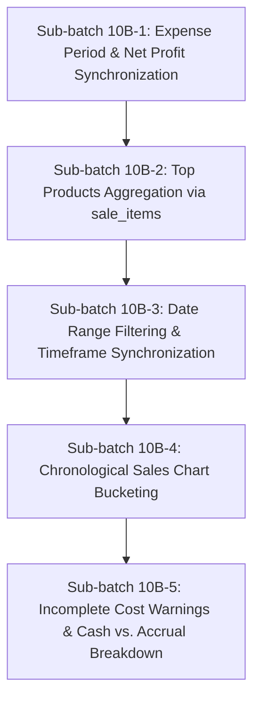

# TindaMate — Batch 10B: Financial Reporting Audit & Correction Plan

**Document ID:** `TM-AUDIT-10B-20261111`  
**Date:** November 11, 2026  
**Auditor:** Senior React Native Engineer, Financial Systems Analyst & Supabase/PostgreSQL Architect  
**Project Repository:** `AICO24/TindaMate`  
**Base Checkpoint:** `9343bd5`  
**Audit Scope:** Read-Only Audit of Financial Calculations, Reporting Architecture, and Data Aggregation  

---

## 1. Executive Summary

A comprehensive, read-only audit of TindaMate's reporting and analytics subsystem (`src/app/reports.tsx`, `src/lib/profit.ts`, `src/lib/expenses.ts`, `src/lib/sales.ts`, and Supabase aggregation schemas) was conducted.

The audit revealed that while foundational database tables (`public.sales`, `public.sale_items`, `public.expenses`, `public.credit_ledger`) and initial backend RPCs (`get_store_cogs_summary`) were constructed in Batches 4, 7, 8, 9A, and 9D, the user-facing Reports module (`src/app/reports.tsx`) suffers from critical mathematical discrepancies, period mismatches, and aggregation flaws that produce misleading financial figures for sari-sari store owners:

1. **Catastrophic Period Mismatch in Net Profit:** The Reports screen calculates `Net Store Profit` by subtracting **today's single-day expenses** from **all-time gross profit** (`grossProfit - totalExpenses`). An owner operating for six months with ₱150,000 in all-time gross profit and ₱200 in expenses today is shown a "Net Profit" of ₱149,800 today.
2. **False Metric Labeling:** The Breakdown Grid displays `<Text>Month Expenses</Text>` while rendering data fetched from `fetchDashboardExpenseSummary()`, which is hardcoded to `expense_date = todayISO`. Today's daily expenses are presented as the entire month's operational cost.
3. **Broken Top Products in Multi-Item Carts:** `topProducts` aggregates records from the `sales` table (the sale header) rather than `sale_items`. In POS multi-item sales (`record_cart_sale`), the header row attributes 100% of the cart's grand total to the first item (e.g., `"San Miguel Pale Pilsen + 3 more"`). The remaining products in the cart are completely ignored, and the first product's sales volume and revenue are severely distorted.
4. **Fabrication of Unsold Inventory as Sales:** When a store has 0 recorded sales (`sales.length === 0`), `topProducts` falls back to `products.slice(0, 4)` and computes `revenue = p.selling_price * p.stock_quantity`. A new store owner with zero sales is presented with fake "Top Products" claiming their unsold stock was sold.
5. **Array Index Modulo Sales Trend Chart:** The 5-bar vertical chart does not group sales by day, hour, or calendar period. It distributes transactions using `buckets[4 - (idx % 5)] += sale.total_amount` based strictly on array index position. Furthermore, when sales are empty, it renders hardcoded decorative bars `[0.3, 0.45, 0.6, 0.78, 0.95]`.
6. **No Date Filtering & Dead Header Action:** The tab strip offers domain category tabs (`['Sales', 'Profit', 'Inventory', 'Utang']`) rather than date range filters (Today, 7 Days, This Month). Tapping the header calendar icon navigates away to `/sales/history` instead of filtering report metrics.

This document details the exact root causes, mathematical models, database dependencies, risks, and a phased correction plan (Sub-batches 10B-1 through 10B-5) to establish reliable, production-ready financial reporting.

---

## 2. Current Reports Architecture

### 2.1 File Structure and Responsibilities
- **`src/app/reports.tsx`** (822 lines): Primary screen responsible for presenting KPIs, trend charts, top products, and financial breakdown tiles.
- **`src/lib/profit.ts`** (251 lines): Client service wrapping Supabase RPC `public.get_store_cogs_summary` and in-memory centavo calculations.
- **`src/lib/expenses.ts`** (584 lines): Expense management service, validation, normalization, and `fetchDashboardExpenseSummary()`.
- **`src/lib/sales.ts`** (1,380 lines): POS cart checkout, sales retrieval (`fetchStoreSales`), and dashboard sales summarization.
- **`src/lib/customers.ts`** (837 lines): Credit summaries and utang ledger aggregation.
- **`supabase/migrations/20261031000001_batch9d_cogs_aggregation_foundation.sql`**: PostgreSQL RPC `get_store_cogs_summary(p_start_date, p_end_date)`.

### 2.2 Data Fetching Lifecycle
When `/reports` mounts or refreshes (`loadAnalytics`, lines 99–147):
```typescript
const [salesData, productsData, cogsData, expenseData, utangData] =
  await Promise.all([
    fetchStoreSales(),             // All-time sales from public.sales
    fetchStoreProducts(),          // All store products
    fetchStoreCOGSSummary(),       // All-time COGS from RPC get_store_cogs_summary(null, null)
    fetchDashboardExpenseSummary(),// TODAY'S expenses only (expense_date = todayISO)
    fetchDashboardUtangSummary(),  // Current unpaid utang + today's payment collections
  ]);
```
Each data source queries a completely different temporal scope:
- Sales: **All-time**
- Products: **Current snapshot**
- COGS & Gross Profit: **All-time**
- Expenses: **Current day only**
- Utang: **Current balance + today's collections**

---

## 3. Gross Profit Calculation Findings

### 3.1 Implementation Location
`src/app/reports.tsx`: lines 105–112, 174–177, 264–274.

### 3.2 Code Evidence
```typescript
// lines 174-177
const grossProfit = cogsSummary?.grossProfit ?? 0;
const totalExpenses = expenseSummary?.totalExpenses ?? 0;
const netStoreProfit = Number((grossProfit - totalExpenses).toFixed(2));
```

```typescript
// lines 264-273
if (selectedTab === 'Profit') {
  return {
    amount: formatPesoCurrency(netStoreProfit),
    label: 'Net Store Profit',
    badge:
      netStoreProfit >= 0
        ? '↑ Positive Margin'
        : '↓ Loss / High Expenses',
  };
}
```

### 3.3 Root Cause Analysis
1. `fetchStoreCOGSSummary()` is invoked with default empty parameters `{}`. In `src/lib/profit.ts:211-224`, `p_start_date` and `p_end_date` resolve to `NULL`.
2. Supabase RPC `public.get_store_cogs_summary` executes against `public.sale_items` with no `created_at` boundaries, returning cumulative **all-time revenue** and **all-time tracked COGS**.
3. `totalExpenses` is populated by `fetchDashboardExpenseSummary()`, which queries:
   ```typescript
   supabase.from('expenses').select(...).eq('expense_date', todayISO);
   ```
4. **Formula Discrepancy:**
   $$\text{Net Profit}_{\text{displayed}} = \text{Gross Profit}_{\text{All-Time}} - \text{Expenses}_{\text{Today}}$$
   This subtracts a 1-day expense value from months or years of accumulated gross profit. If expenses were incurred yesterday, last week, or earlier this month, they are ignored. Conversely, if a store had high sales last month but zero sales today and paid rent today, the report shows massive negative profit instead of evaluating the actual period.

---

## 4. Expense Period Findings

### 4.1 Implementation Location
`src/app/reports.tsx`: lines 525–534; `src/lib/expenses.ts`: lines 549–582.

### 4.2 Code Evidence
```tsx
// src/app/reports.tsx: lines 525-533
<View style={styles.breakdownTile}>
  <Text style={styles.breakdownLabel}>Month Expenses</Text>
  <Text style={styles.breakdownValue}>
    {formatPesoCurrency(totalExpenses)}
  </Text>
  <Text style={styles.breakdownCaption}>
    {expenseSummary?.expenseCount ?? 0} expense entries
  </Text>
</View>
```

```typescript
// src/lib/expenses.ts: lines 549-558
export async function fetchDashboardExpenseSummary(): Promise<DashboardExpenseSummary> {
  const storeId = await getAuthenticatedStoreId();
  const todayISO = getTodayDateISO();

  const { data, error } = await supabase
    .from('expenses')
    .select('amount, expense_date')
    .eq('store_id', storeId)
    .eq('expense_date', todayISO);
```

### 4.3 Root Cause Analysis
- The UI explicitly promises "Month Expenses" (implying the calendar month from the 1st to the current day or last day of the current month).
- The service implementation was copied from the dashboard helper (`fetchDashboardExpenseSummary`), which was strictly designed for today's summary card on the home screen.
- No function exists in `src/lib/expenses.ts` to aggregate expenses across a date range (`startDate` to `endDate`) or for the current calendar month.

---

## 5. Top Products Aggregation Findings

### 5.1 Implementation Location
`src/app/reports.tsx`: lines 194–260.

### 5.2 Code Evidence
```typescript
// lines 201-218
if (sales.length > 0) {
  const map = new Map<
    string,
    { name: string; revenue: number; units: number; productId?: string }
  >();

  sales.forEach((s) => {
    const key = s.product_id || s.product_name;
    const prev = map.get(key) ?? {
      name: s.product_name,
      revenue: 0,
      units: 0,
      productId: s.product_id ?? undefined,
    };
    prev.revenue += Number(s.total_amount) || 0;
    prev.units += Number(s.quantity) || 1;
    map.set(key, prev);
  });
```

```typescript
// lines 244-259
// Fallback when store has products but 0 sales recorded yet: show top stocked products
const totalStock = products.reduce(
  (acc, p) => acc + Math.max(0, p.stock_quantity),
  0
);
return products.slice(0, 4).map((p) => ({
  id: p.id,
  name: p.name,
  imageUrl: p.image_url,
  revenue: Number((p.selling_price * p.stock_quantity).toFixed(2)),
  unitsSold: p.stock_quantity,
  sharePercent:
    totalStock > 0
      ? Math.max(5, Math.round((p.stock_quantity / totalStock) * 100))
      : 25,
}));
```

### 5.3 Root Cause Analysis
1. **Multi-Item POS Architecture Bypass:** Batch 7 introduced multi-item carts where individual items are stored in `public.sale_items` with their own `product_id`, `product_name`, `quantity`, `unit_price`, and `subtotal`. The header row in `public.sales` only records:
   - `product_id`: The ID of the *first* item in the cart.
   - `product_name`: `"<First Product Name> + N more"`.
   - `total_amount`: The entire cart grand total.
2. **Revenue Attribution Corruption:**
   - If a customer buys 1 sachet of Coffee (₱15) and 1 sack of Rice (₱2,500), and Coffee was added to the cart first, `sales.product_id` is Coffee, and `sales.total_amount` is ₱2,515.
   - `reports.tsx` credits Coffee with ₱2,515 in revenue! Rice receives ₱0 and never appears in top products.
3. **Inventory Fabrication on Zero Sales:**
   - When `sales.length === 0`, instead of rendering an empty state, lines 244–259 calculate `revenue = p.selling_price * p.stock_quantity`.
   - Unsold inventory sitting on the store shelf is displayed under the heading "Top Products" with a progress bar and revenue figure. This violates basic accounting principles.

---

## 6. Date Filter Findings

### 6.1 Implementation Location
`src/app/reports.tsx`: lines 53–55, 326–333, 342–356.

### 6.2 Code Evidence
```typescript
// lines 53-55
const REPORT_TABS = ['Sales', 'Profit', 'Inventory', 'Utang'] as const;
type ReportTab = (typeof REPORT_TABS)[number];
```

```tsx
// lines 326-333
<Pressable
  style={styles.calendarIconBtn}
  accessibilityRole="button"
  accessibilityLabel="Sales history calendar"
  onPress={() => router.push('/sales/history')}>
  <CalendarFilterIcon size={18} color={Colors.surface} />
</Pressable>
```

```tsx
// lines 343-356
<View style={styles.tabStrip}>
  {REPORT_TABS.map((tab) => {
    const isActive = selectedTab === tab;
    return (
      <Pressable
        key={tab}
        onPress={() => setSelectedTab(tab)}
        style={[styles.tabChip, isActive && styles.tabChipActive]}>
        <Text style={[styles.tabChipText, isActive && styles.tabChipTextActive]}>
          {tab}
        </Text>
      </Pressable>
    );
  })}
</View>
```

### 6.3 Root Cause Analysis
- The tabs are **domain entity selectors** (`Sales`, `Profit`, `Inventory`, `Utang`), not temporal filters.
- There is no UI state for selecting time horizons:
  - Today
  - Last 7 Days / This Week
  - This Month
  - Custom Date Range
- The header calendar icon has an `onPress` callback that executes `router.push('/sales/history')`. Rather than opening a date filter for reports, it abandons the Reports screen entirely.

---

## 7. Sales Chart Findings

### 7.1 Implementation Location
`src/app/reports.tsx`: lines 181–192, 414–431.

### 7.2 Code Evidence
```typescript
// lines 181-192
// 5-bar trend distribution (normalized 0.15 - 1.0)
const chartBars = useMemo<number[]>(() => {
  if (sales.length === 0) {
    return [0.3, 0.45, 0.6, 0.78, 0.95];
  }
  const buckets = [0, 0, 0, 0, 0];
  sales.forEach((sale, idx) => {
    buckets[4 - (idx % 5)] += sale.total_amount;
  });
  const max = Math.max(...buckets, 1);
  return buckets.map((v) => Math.max(0.18, Number((v / max).toFixed(2))));
}, [sales]);
```

### 7.3 Root Cause Analysis
1. **Index-Modulo Binning:**
   `buckets[4 - (idx % 5)] += sale.total_amount` assigns transactions to chart bars based on their index in the array rather than their timestamp (`created_at`).
   - If 5 sales occurred today, they fill 5 bars.
   - If 1 sale occurred today and 4 sales occurred 3 months ago, they also fill 5 bars in the exact same pattern.
   - A sale from 6 months ago will be added to the same bar as a sale from this morning if `idx % 5` coincides.
2. **Deceptive Empty-State Trend:**
   When `sales.length === 0`, the chart displays `[0.3, 0.45, 0.6, 0.78, 0.95]`, mimicking an accelerating upward growth trend for a store that has never made a sale.

---

## 8. COGS and Historical Cost Findings

### 8.1 Implementation Location
`src/lib/profit.ts`: lines 88–131, 211–250; `supabase/migrations/20261031000001_batch9d_cogs_aggregation_foundation.sql`.

### 8.2 Architectural Assessment
- The foundational database RPC `public.get_store_cogs_summary` correctly:
  - Sums authoritative `subtotal` from `public.sale_items`.
  - Calculates tracked COGS: `coalesce(sum(round(si.quantity * si.cost_price, 2)) FILTER (WHERE si.cost_price IS NOT NULL), 0.00)`.
  - Distinguishes tracked vs. untracked cost items (`has_incomplete_costs = true` if any `cost_price IS NULL`).
  - Accepts `p_start_date timestamptz` and `p_end_date timestamptz`.
- **The Breakdown in `/reports`:**
  - `reports.tsx` fails to pass date filters into `fetchStoreCOGSSummary()`.
  - `reports.tsx` completely ignores `cogsSummary.hasIncompleteCosts`. If an owner sold items before entering purchase costs, the reported gross profit is partially ungrounded, but the UI provides no warning, asterisk, or estimation disclaimer.

### 8.3 Cash vs. Accrual Treatment
- In `record_cart_sale`, sales with `payment_method = 'utang'` (Store Credit) are recorded with full `total_amount` in `public.sales` and line subtotals in `public.sale_items`.
- `public.get_store_cogs_summary` aggregates all sales regardless of payment method. Consequently:
  - **Revenue & Gross Profit are calculated on an Accrual basis.**
  - If a store made ₱10,000 in sales today, but ₱8,000 was utang (uncollected), the screen reports ₱10,000 in revenue and full profit, even though the store only has ₱2,000 in cash.
  - The UI fails to break down **Cash Sales vs. Utang Sales** or reconcile cash collections from past credit settlements (`customer_payments`).

---

## 9. Database and RPC Dependencies

### 9.1 Required Tables
- `public.sales`: Sale header transactions (`id`, `store_id`, `total_amount`, `payment_method`, `created_at`).
- `public.sale_items`: Authoritative sold items (`id`, `sale_id`, `store_id`, `product_id`, `product_name`, `quantity`, `unit_price`, `cost_price`, `subtotal`, `created_at`).
- `public.expenses`: Store operating expenses (`id`, `store_id`, `amount`, `category`, `expense_date`, `created_at`).
- `public.credit_ledger`: Immutable credit debits and payment credits (`id`, `store_id`, `customer_id`, `transaction_type`, `amount`, `created_at`).
- `public.products`: Store inventory master (`id`, `store_id`, `name`, `selling_price`, `cost_price`, `stock_quantity`, `image_url`).

### 9.2 Existing RPC Functions
- `public.get_store_cogs_summary(p_start_date timestamptz, p_end_date timestamptz)`: Fully functional and supports date filtering, but currently called with `NULL, NULL` by `/reports`.

### 9.3 Missing Backend Capabilities for Reports
1. **Aggregated Top Products RPC / Query:**
   Currently, there is no store-scoped aggregation function or index-optimized query to fetch top-selling products from `public.sale_items` within a date range. Doing this client-side by fetching all `sale_items` across history will severely degrade mobile performance as transaction volume grows.
2. **Date-Range Expense Aggregation:**
   `public.expenses` has no dedicated summary RPC; queries currently rely on direct table selects (`fetchDashboardExpenseSummary`). A range query (`expense_date >= start AND expense_date <= end`) is required.

---

## 10. Financial Data Integrity Risks

| Risk ID | Vulnerability / Bug | Financial Impact | Severity |
| :--- | :--- | :--- | :--- |
| **FIN-01** | All-time Gross Profit minus Today's Expenses | Store owner misjudges solvency; displays fictitious net profit | **CRITICAL** |
| **FIN-02** | Today's expenses labeled as "Month Expenses" | Owner assumes monthly operational costs are negligible | **HIGH** |
| **FIN-03** | Multi-item cart top products assigned to first item only | Inventory restocking decisions misled; false demand metrics | **HIGH** |
| **FIN-04** | Fabricated top products on zero sales | New vendors misled into believing unsold inventory generated income | **MEDIUM** |
| **FIN-05** | Index-modulo sales trend chart | Meaningless visual trends; cannot identify peak sales days | **MEDIUM** |
| **FIN-06** | Incomplete cost flag unhandled | Profit overreported when items lack historical purchase cost | **MEDIUM** |
| **FIN-07** | Accrual vs. Cash ambiguity | Owner conflates uncollected utang with liquid cash profit | **HIGH** |

---

## 11. Exact Files and Functions Requiring Changes

### 11.1 Client-Side TypeScript Files
1. **`src/app/reports.tsx`**
   - Implement date filter state (`DateFilterPeriod = 'today' | 'week' | 'month' | 'all'`).
   - Add date range selector UI (replacing or augmenting domain tabs, or introducing a dual-tier filter).
   - Re-route header calendar button to open date selector modal/sheet rather than navigating away.
   - Synchronize all metrics (`revenue`, `cogs`, `grossProfit`, `expenses`, `netProfit`) to the selected date range.
   - Fix `netStoreProfit` calculation:
     $$\text{Net Profit} = \text{Gross Profit}_{\text{Period}} - \text{Expenses}_{\text{Period}}$$
   - Correct breakdown tile label from "Month Expenses" to match the active period (e.g. "Today's Expenses", "This Month's Expenses").
   - Replace fake top products fallback with an informative empty state.
   - Replace modulo chart with chronological date bucketing (e.g., 7 days of the week or hourly buckets).
   - Display `hasIncompleteCosts` estimation warning banner when untracked items exist.
2. **`src/lib/expenses.ts`**
   - Add `fetchStoreExpenseSummaryForRange(startDate: string, endDate: string): Promise<DashboardExpenseSummary>`.
   - Ensure date boundaries are evaluated in store local time against `expense_date`.
3. **`src/lib/profit.ts`**
   - Export period helper functions to convert date filter selections into ISO timestamps for `fetchStoreCOGSSummary`.
4. **`src/lib/sales.ts`**
   - Add `fetchStoreTopProducts(startDate?: string, endDate?: string, limit?: number): Promise<TopProductMetric[]>`.
   - Query `public.sale_items` grouped by `product_id` and `product_name`.

### 11.2 Database & Migration Files
1. **`supabase/migrations/20261112000000_batch10b_reporting_aggregations.sql`** (Proposed)
   - Add `public.get_store_top_products(p_start_date timestamptz, p_end_date timestamptz, p_limit int)`: Aggregates `sale_items` with store scoping and joins `products.image_url`.
   - Add `public.get_store_financial_summary(p_start_date timestamptz, p_end_date timestamptz, p_start_date_iso text, p_end_date_iso text)`: Single atomic RPC returning revenue, COGS, expenses, gross profit, net profit, cash sales, and utang sales.

---

## 12. Recommended Batch 10B Implementation Sequence

To minimize risk and ensure thorough verification, Batch 10B should be executed in 5 discrete, sequential sub-batches:



### Sub-batch 10B-1: Expense Period & Net Profit Synchronization
- **Scope:** Correct the Net Profit formula and expense aggregation.
- **Actions:**
  - Implement `fetchStoreExpenseSummaryForRange()` in `src/lib/expenses.ts`.
  - In `reports.tsx`, ensure expenses and gross profit match identical temporal boundaries.
  - Update tile labels to dynamically reflect the queried period.
- **Verification:** Unit test net profit formula across matching date ranges.

### Sub-batch 10B-2: Top Products Aggregation via `sale_items`
- **Scope:** Fix multi-item cart distortion and eliminate fabricated inventory revenue.
- **Actions:**
  - Query `public.sale_items` grouped by `product_id` / `product_name`.
  - Sum actual sold units (`si.quantity`) and subtotal revenues (`si.subtotal`).
  - Join product image from `public.products` using foreign key or map.
  - Eliminate the fallback that computes `selling_price * stock_quantity`. Show a clear "No sales yet" empty state.
- **Verification:** Record a multi-item cart sale (e.g. 2 different items) and verify both items appear with exact quantities and revenues.

### Sub-batch 10B-3: Date Range Filtering & Timeframe Synchronization
- **Scope:** Introduce interactive temporal filters.
- **Actions:**
  - Add date filter chips: `Today`, `This Week`, `This Month`, `All Time`.
  - Connect the header calendar icon to toggle the date selector or open custom date picker.
  - Wire all data loaders (`sales`, `cogs`, `expenses`, `topProducts`) to react to active filter changes.
- **Verification:** Switching between `Today` and `This Month` updates all cards, KPIs, and breakdowns consistently.

### Sub-batch 10B-4: Chronological Sales Chart Bucketing
- **Scope:** Transform the 5-bar vertical chart into an accurate time-series visualization.
- **Actions:**
  - When filtering by `Today`: 4–6 hourly interval buckets (e.g., 6am–10am, 10am–2pm, 2pm–6pm, 6pm–10pm).
  - When filtering by `This Week`: 7 daily buckets (Mon through Sun).
  - When filtering by `This Month`: 4 weekly buckets.
  - Remove fake `[0.3, 0.45, 0.6, 0.78, 0.95]` array; display neutral empty baseline bars or empty state.
- **Verification:** Verify bars correspond strictly to transaction timestamps.

### Sub-batch 10B-5: Incomplete Cost Warnings & Cash vs. Accrual Breakdown
- **Scope:** Accounting disclosure and cash flow transparency.
- **Actions:**
  - Read `cogsSummary.hasIncompleteCosts`; display an amber badge / helper tooltip: *"Some items sold have no purchase cost recorded. Profit is estimated."*
  - Add Cash vs. Utang revenue breakdown tiles:
    - Cash Revenue (Immediate cash in drawer)
    - Credit Sales (Utang extended to customers)
    - Utang Collected (Cash recovered from ledger payments)
- **Verification:** Test with zero-cost products and verify warning displays. Test mixed cash/utang checkout.

---

## 13. Regression Test Plan

1. **POS Checkout Compatibility:**
   - Verify `recordCartSale` continues to snapshot `cost_price` into `sale_items` without interruption.
2. **Customer Credit & Ledger:**
   - Verify that adding utang breakdown tiles does not mutate customer balances or trigger recursive ledger syncs.
3. **Dashboard Sync:**
   - Confirm changes to expense and sales helper functions in `src/lib/` do not break the Home Dashboard cards (`src/app/index.tsx`).
4. **Offline & Network Resiliency:**
   - Verify error mapping functions (`mapProfitDatabaseError`, `mapExpenseDatabaseError`) handle network disconnects gracefully.
5. **TypeScript & Static Analysis:**
   - Run `npx tsc --noEmit` to ensure strict type compliance across all updated functions.

---

## 14. Acceptance Criteria

1. **Mathematical Accuracy:**
   $$\text{Net Profit} = \text{Gross Profit}_{\text{Period}} - \text{Total Expenses}_{\text{Period}}$$
   evaluated over the exact same date boundaries with zero cross-period pollution.
2. **True Top Products:**
   Top products reflect actual line items sold from `public.sale_items`. Multi-item sales are properly split into individual item units and revenues. Unsold inventory is never shown as sales.
3. **Functional Date Filtering:**
   Users can toggle between at least `Today`, `This Week`, and `This Month`, updating all financial metrics synchronously.
4. **Chronological Visuals:**
   Bar charts represent chronological time slices, not array index modulo calculations.
5. **Disclosed Estimations:**
   If products sold lack historical costs, the UI alerts the user that profit figures are estimated.

---

## 15. Known Limitations and Unverified Assumptions

1. **Historical Legacy Sales Data:**
   Sales recorded prior to Batch 7 (if any exist in production) only have rows in `public.sales` and lack `public.sale_items`. The existing RPC `get_store_cogs_summary` handles this with an orphan sales fallback, but top products aggregation will naturally only reflect items with `sale_items` rows.
2. **Database Migration Requirement:**
   Implementing optimal server-side aggregation for Top Products and date-range expenses will require deploying a new SQL migration (`20261112000000_batch10b_reporting_aggregations.sql`) to Supabase. Client-side fallbacks must be maintained if the migration is not yet deployed.
3. **Time Zone Alignment:**
   PostgreSQL stores timestamps in UTC (`timestamptz`), while store owners operate in Philippine Standard Time (PST / UTC+8). Date filters must ensure local midnight boundaries are properly converted to ISO strings before passing to backend queries.
