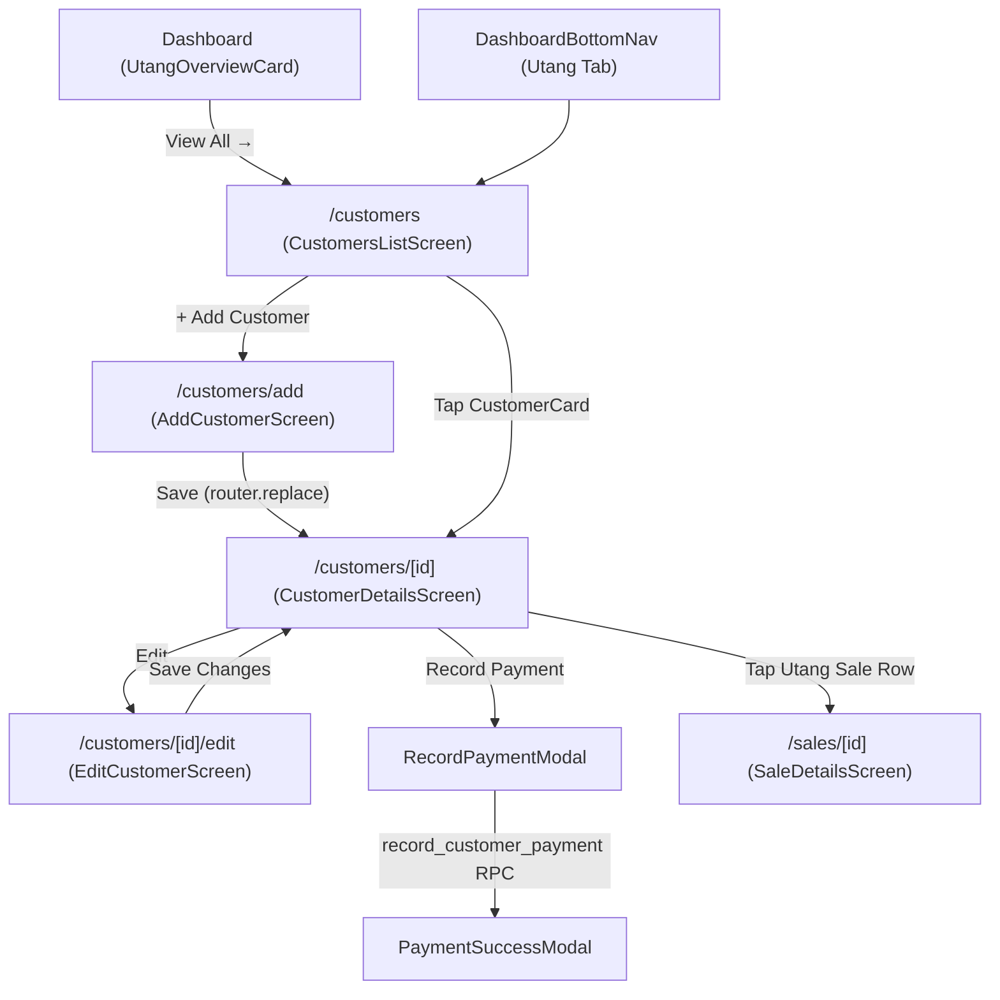

# TindaMate — Batch C-0: Customers Module UI/UX Audit & Redesign Recommendations
**Document Type:** Strictly Read-Only UI/UX & Architectural Assessment  
**Date:** 2026-11-14  
**Auditor Role:** Senior React Native Engineer, Mobile UI/UX Designer & Customer Management Architect  
**Status:** Read-Only Audit Complete — Awaiting User Review & Batch Authorization

---

## 1. Executive Summary

The TindaMate **Customers & Utang (Store Credit)** module (`src/app/customers/*` and `src/components/customers/*`) already has a strong functional and data-integrity foundation: store-scoped RLS queries, a 1-to-1 credit account model (`public.credit_accounts`), an immutable credit transaction ledger (`public.credit_transactions`), an authoritative balance view (`public.customer_credit_summaries`), atomic payment recording (`record_customer_payment` RPC with idempotency), and direct tap-through to POS Sale Details (`/sales/[id]`).

However, when compared against the modernized **Products** and **Sales (Batches S-1 to S-3)** modules, the Customers module exhibits several **high-impact UX, state-filtering, visual-hierarchy, and consistency gaps**:

1. **Filtered State Skews the Store's "Total Outstanding" KPI & Triggers Per-Keystroke Network Calls (`src/app/customers/index.tsx`):**
   - `totalOutstanding` and `utangCustomerCount` are computed from the currently filtered `customers` state rather than all store customers. Switching to the `Inactive` tab or typing a non-matching search query drops the Hero KPI card to `₱0.00` (`0 customers with active utang`).
   - `loadCustomers` re-runs two Supabase queries on every keystroke in `searchQuery` and on every filter tab switch, even though `fetchStoreCustomers` already performs search filtering in memory.
2. **Misleading Empty State When Filtering (`src/app/customers/index.tsx`):**
   - When a store has customers, but `With Utang` or `Inactive` returns zero matches (with an empty search bar), the screen displays **"No Customers Yet — Add your regular store patrons and suki..."** and **"+ Add Your First Customer"** instead of a filter-specific empty state with a **"Reset Filter"** action.
3. **Inverted Semantic Color Coding on `CustomerCard` (`src/components/customers/CustomerCard.tsx`):**
   - Customers **with unpaid utang** render with a **Green (`#0D7A4D`)** avatar and plain dark text (without an `"Utang"` label), while **settled/paid** customers render with an **Orange (`#EA580C`)** avatar—the exact opposite of TindaMate's semantic convention across Sales, Checkout, Receipt, and Customer Details (where Green = Paid/Settled and Orange = Utang/Unpaid Credit).
   - Additionally, a customer's phone number is hidden on `CustomerCard` as soon as `last_transaction_at` is present.
4. **Form Ergonomics & Android Keyboard Issues (`src/components/customers/CustomerForm.tsx` & `TindaMateInput.tsx`):**
   - `"Customer Name"` does not pass `autoCapitalize="words"`, defaulting to lowercase on Android (`autoCapitalize="none"`).
   - `"Mobile / Phone Number"` passes `keyboardType="phone-pad"`, which `TindaMateInput` strips on Android (`keyboardType={Platform.OS === 'ios' ? keyboardType : undefined}` and `computedInputMode` maps `'phone-pad'` to `'text'`), opening a standard text keyboard instead of a phone dialer pad.
   - The `Notes / Landmark` field uses `12px UPPERCASE` muted label styling that clashes with `TindaMateInput`'s `14px` mixed-case labels and lacks focus border feedback.
5. **Emoji Icons, Missing `tabular-nums`, and Modal Visual Drift (`src/app/customers/[id]/index.tsx`, `RecordPaymentModal.tsx`, `PaymentSuccessModal.tsx`):**
   - Multiple screens rely on emoji icons (`📞`, `💳`, `💡`, `📋`, `⚡`, `⚠️`, `🎉`, `ℹ️`) and plain `!` text instead of TindaMate's vector icon system (`DashboardNavIcons.tsx`, `AuthIcons.tsx`).
   - Financial balances, ledger amounts, and payment breakdowns lack `fontVariant: ['tabular-nums']`.

---

## 2. Git Working Tree Status

Inspected via `git status -s` prior to auditing:
- **Branch:** `main` (up to date with `origin/main` at commit `6b06552`).
- **Modified / Untracked Files:** Clean working tree (`0` uncommitted changes prior to creating this report).

---

## 3. Actual Customers Module Architecture

### Route Structure (`src/app/customers/`)
- [src/app/customers/index.tsx](file:///C:/TindaMate/src/app/customers/index.tsx) — **Customers List & Credit Overview Screen (`/customers`)**
- [src/app/customers/add.tsx](file:///C:/TindaMate/src/app/customers/add.tsx) — **Add Customer Screen (`/customers/add`)**
- [src/app/customers/[id]/index.tsx](file:///C:/TindaMate/src/app/customers/%5Bid%5D/index.tsx) — **Customer Details & Utang Ledger Screen (`/customers/[id]`)**
- [src/app/customers/[id]/edit.tsx](file:///C:/TindaMate/src/app/customers/%5Bid%5D/edit.tsx) — **Edit Customer Screen (`/customers/[id]/edit`)**

*(Note: There is no `src/app/customers/_layout.tsx`; routes are managed by the root stack navigator in `src/app/_layout.tsx`.)*

### Component Layer (`src/components/customers/`)
- [src/components/customers/CustomerCard.tsx](file:///C:/TindaMate/src/components/customers/CustomerCard.tsx) — Customer row card in `/customers`.
- [src/components/customers/CustomerForm.tsx](file:///C:/TindaMate/src/components/customers/CustomerForm.tsx) — Shared Add/Edit customer form.
- [src/components/customers/CreditTransactionCard.tsx](file:///C:/TindaMate/src/components/customers/CreditTransactionCard.tsx) — Individual charge/payment ledger card in `/customers/[id]`.
- [src/components/customers/RecordPaymentModal.tsx](file:///C:/TindaMate/src/components/customers/RecordPaymentModal.tsx) — Modal to record full or partial customer utang repayment.
- [src/components/customers/PaymentSuccessModal.tsx](file:///C:/TindaMate/src/components/customers/PaymentSuccessModal.tsx) — Confirmation receipt modal after recording a repayment.

### Service, Data & Type Layer
- [src/lib/customers.ts](file:///C:/TindaMate/src/lib/customers.ts) — Validation (`validateCustomerForm`, `validatePaymentAmountInput`), queries (`fetchStoreCustomers`, `fetchStoreCustomerById`, `fetchCustomerCreditTransactions`, `fetchDashboardUtangSummary`), and mutations (`createStoreCustomer`, `updateStoreCustomer`, `toggleCustomerActiveStatus`, `recordCustomerPayment`).
- [src/types/customer.ts](file:///C:/TindaMate/src/types/customer.ts) — TypeScript interfaces (`Customer`, `CustomerCreditSummary`, `CustomerWithCredit`, `CustomerCreditTransaction`, `CustomerFilterTab`, `RecordPaymentInput`, `CompletedPaymentResult`).

### Cross-Module Integration Points
- [src/components/sales/CheckoutModal.tsx](file:///C:/TindaMate/src/components/sales/CheckoutModal.tsx) — Calls `fetchStoreCustomers('', 'Active')` when recording an Utang sale at POS checkout.
- [src/components/dashboard/UtangOverviewCard.tsx](file:///C:/TindaMate/src/components/dashboard/UtangOverviewCard.tsx) — Dashboard KPI card displaying `DashboardUtangSummary` and linking to `/customers`.
- [src/app/sales/[id].tsx](file:///C:/TindaMate/src/app/sales/%5Bid%5D.tsx) — Target route when a user taps a POS-linked `CreditTransactionCard` (`onPressSale(saleId)`).

---

## 4. Files Inspected

| File Path | Role / Responsibility |
| :--- | :--- |
| [src/app/customers/index.tsx](file:///C:/TindaMate/src/app/customers/index.tsx) | Customers main screen, search bar, KPI hero card, filter tabs, customer list, empty/error states, bottom nav. |
| [src/app/customers/add.tsx](file:///C:/TindaMate/src/app/customers/add.tsx) | Add new customer screen wrapping `CustomerForm` and `createStoreCustomer()`. |
| [src/app/customers/[id]/index.tsx](file:///C:/TindaMate/src/app/customers/%5Bid%5D/index.tsx) | Customer profile, credit balance summary, payment modal triggers, ledger history, activate/deactivate toggle. |
| [src/app/customers/[id]/edit.tsx](file:///C:/TindaMate/src/app/customers/%5Bid%5D/edit.tsx) | Edit customer screen wrapping `CustomerForm` and `updateStoreCustomer()`. |
| [src/components/customers/CustomerCard.tsx](file:///C:/TindaMate/src/components/customers/CustomerCard.tsx) | Customer list item card with monogram avatar, name, balance/PAID pill, and secondary metadata. |
| [src/components/customers/CustomerForm.tsx](file:///C:/TindaMate/src/components/customers/CustomerForm.tsx) | Shared form for `name` (required), `phone` (optional), `notes` (optional), and `isActive` switch (edit mode). |
| [src/components/customers/CreditTransactionCard.tsx](file:///C:/TindaMate/src/components/customers/CreditTransactionCard.tsx) | Ledger entry card for `'charge'` (Utang Sale / Charge) and `'payment'` rows. |
| [src/components/customers/RecordPaymentModal.tsx](file:///C:/TindaMate/src/components/customers/RecordPaymentModal.tsx) | Payment entry modal with `Pay Full Amount` chip, live remaining-balance preview, and notes input. |
| [src/components/customers/PaymentSuccessModal.tsx](file:///C:/TindaMate/src/components/customers/PaymentSuccessModal.tsx) | Post-payment receipt confirmation modal. |
| [src/lib/customers.ts](file:///C:/TindaMate/src/lib/customers.ts) | Supabase queries, RPC invocation (`record_customer_payment`), centavo-safe payment validation. |
| [src/types/customer.ts](file:///C:/TindaMate/src/types/customer.ts) | Customer & Utang TypeScript domain types. |
| [src/components/ui/TindaMateInput.tsx](file:///C:/TindaMate/src/components/ui/TindaMateInput.tsx) | Shared text input component used by `CustomerForm`. |
| [src/components/sales/CheckoutModal.tsx](file:///C:/TindaMate/src/components/sales/CheckoutModal.tsx) | Utang customer selector integration during POS checkout. |
| [src/components/dashboard/UtangOverviewCard.tsx](file:///C:/TindaMate/src/components/dashboard/UtangOverviewCard.tsx) | Dashboard Utang KPI summary card. |

---

## 5. Current Screen and Component Structure

---

## 6. Main Screen UI/UX Findings (`src/app/customers/index.tsx`)

### Finding M-1: "Total Outstanding" KPI Is Computed from Filtered State & Re-Fetches on Every Keystroke
- **File:** [src/app/customers/index.tsx](file:///C:/TindaMate/src/app/customers/index.tsx#L78-L166)
- **Component / Function:** `CustomersListScreen` (`loadCustomers`, `totalOutstanding` `useMemo`)
- **Existing Behavior:**
  - `loadCustomers` passes `(searchQuery, selectedFilter)` into `fetchStoreCustomers(searchQuery, selectedFilter)` and is recreated whenever `searchQuery` or `selectedFilter` changes, triggering `useFocusEffect` to re-query Supabase on every keystroke and tab change.
  - `totalOutstanding` and `utangCustomerCount` sum over the filtered `customers` array.
- **Identified Problem:**
  1. Selecting the `Inactive` tab or typing a search string narrows `customers`, causing the store-level **"Total Outstanding"** Hero Card to change or drop to `₱0.00`—misleading the store owner about their total receivables.
  2. Every character typed into the search bar triggers 2 network requests (`public.customers` + `public.customer_credit_summaries`), even though `fetchStoreCustomers` in `src/lib/customers.ts` already fetches the store's rows and filters `searchQuery` in memory.
- **Recommended Improvement:**
  - Fetch all store customers once via `fetchStoreCustomers('', 'All')` on screen focus and pull-to-refresh (preserving `fetchStoreCustomers` implementation untouched).
  - Compute store-wide `totalOutstanding`, `utangCustomerCount`, and per-tab filter counts (`All`, `With Utang`, `Active`, `Inactive`) from the full store customer list in `useMemo`.
  - Apply `selectedFilter` and `searchQuery` (matching `name`, `phone`, `notes`) locally in `useMemo` for instant, zero-latency filtering.
- **Risk Classification:** **Medium Risk** (Changes screen-level filter/search state flow while keeping `fetchStoreCustomers` in `src/lib/customers.ts` completely untouched).

### Finding M-2: Misleading "No Customers Yet" Empty State When Filter Returns Zero Matches
- **File:** [src/app/customers/index.tsx](file:///C:/TindaMate/src/app/customers/index.tsx#L314-L354)
- **Component / Function:** `CustomersListScreen` empty state branching
- **Existing Behavior:** Only checks `searchQuery.trim().length > 0`. When `searchQuery` is empty and `selectedFilter` is `'With Utang'` or `'Inactive'` with 0 matching customers, it renders the `"No Customers Yet"` card with `"+ Add Your First Customer"`.
- **Identified Problem:** A store owner who has 20 settled customers and taps `"With Utang"` is told `"No Customers Yet"` as if their database is empty.
- **Recommended Improvement:** Distinguish three empty states:
  1. **Zero total customers in store:** `"No Customers Yet"` + `"+ Add Your First Customer"`.
  2. **Zero matches for active search query:** `"No Customers Found"` + `"Clear Search"`.
  3. **Zero matches for selected filter tab (`With Utang` / `Active` / `Inactive`):** Context-aware title (e.g., `"No Customers with Utang"` or `"No Inactive Customers"`) + `"Show All Customers"` reset button.
- **Risk Classification:** **Low Risk**.

### Finding M-3: Bespoke Filter Pills Instead of Shared `<FilterChipRow />` & Dead Styles
- **File:** [src/app/customers/index.tsx](file:///C:/TindaMate/src/app/customers/index.tsx#L267-L295) & [lines 416-464](file:///C:/TindaMate/src/app/customers/index.tsx#L416-L464)
- **Existing Behavior:** Uses a custom `<ScrollView>` of `<Pressable>` pills without counts, and retains 48 lines of unused styles (`heroHeaderZone`, `searchRowWrap`, `searchBar`, `searchInput`, `clearSearchBtn`, `clearSearchText`).
- **Identified Problem:** Visually inconsistent with Products and Sales screens, which use `<FilterChipRow />` with live item counts.
- **Recommended Improvement:** Replace the custom filter `<ScrollView>` with `<FilterChipRow />` displaying counts for `All`, `With Utang`, `Active`, and `Inactive`, and remove the unused styles.
- **Risk Classification:** **Low Risk**.

### Finding M-4: Redundant Bottom Promo Card & Missing Header Subtitle
- **File:** [src/app/customers/index.tsx](file:///C:/TindaMate/src/app/customers/index.tsx#L175-L185) & [lines 367-392](file:///C:/TindaMate/src/app/customers/index.tsx#L367-L392)
- **Existing Behavior:** `ProductScreenHeader` has no `subtitle`, while the bottom of the scroll view renders a `"Manage Your Customers Easily"` promo banner that duplicates the header's `"+ Add Customer"` action.
- **Recommended Improvement:** Add a dynamic subtitle to `ProductScreenHeader` (`"${allCustomers.length} registered customers • ${utangCustomerCount} with utang"`), add `fontVariant: ['tabular-nums']` to `outstandingAmount`, and remove or compact the redundant bottom promo banner when customers already exist.
- **Risk Classification:** **Low Risk**.

---

## 7. Customer Card Findings (`src/components/customers/CustomerCard.tsx`)

### Finding C-1: Inverted Semantic Colors for Utang vs Settled Customers
- **File:** [src/components/customers/CustomerCard.tsx](file:///C:/TindaMate/src/components/customers/CustomerCard.tsx#L91-L105) & [lines 191-207](file:///C:/TindaMate/src/components/customers/CustomerCard.tsx#L191-L207)
- **Component:** `CustomerCard`
- **Existing Behavior:**
  - When `hasUtang === true` (`balance > 0`), `avatarCircle` is **Green (`#0D7A4D`)** and `balanceAmountText` is plain dark slate (`Colors.textPrimary`) with no `"Utang"` label.
  - When `hasUtang === false` (`balance === 0`), `avatarCircleSettled` is **Orange (`#EA580C`)**.
- **Identified Problem:** Contradicts TindaMate's entire semantic color language (including `CustomerDetailsScreen` lines 741–750 where `avatarCircle` is green when settled and orange when `balance > 0`!). Store owners scanning the list associate Orange with unpaid Utang and Green with Paid/Settled.
- **Recommended Improvement:**
  - Use **Orange (`Colors.accent` / `Colors.accentLight`)** avatar + `Colors.accentDark` balance text + explicit `"UTANG BALANCE"` caption/pill when `hasUtang === true`.
  - Use **Green (`Colors.primary` / `Colors.primarySoft`)** avatar + `"PAID · ₱0.00"` / `"SETTLED"` pill when `hasUtang === false`.
  - Keep **Slate (`Colors.textMuted` / `Colors.backgroundAlt`)** when `!customer.is_active`.
- **Risk Classification:** **Low Risk**.

### Finding C-2: Customer Phone Number Hidden When `last_transaction_at` Exists
- **File:** [src/components/customers/CustomerCard.tsx](file:///C:/TindaMate/src/components/customers/CustomerCard.tsx#L60-L67)
- **Existing Behavior:** `secondaryMeta` uses `lastActivityDate ? 'Last activity: ...' : customer.phone ? 'Phone: ...' : null`.
- **Identified Problem:** Once a customer has any credit transaction, their phone number is no longer visible on the card, making it harder to distinguish customers with similar names or verify phone search matches.
- **Recommended Improvement:** Display both phone (when present) and last activity date cleanly on the metadata line (`0917 123 4567 • Last activity: Oct 20`) or in a structured two-column card layout (left: avatar + name + phone/activity; right: balance / `SETTLED` pill + chevron) with `fontVariant: ['tabular-nums']` on the balance.
- **Risk Classification:** **Low Risk**.

---

## 8. Search and Filtering Findings

- **Searchable Fields (`src/lib/customers.ts` lines 238–243):** `name`, `phone`, and `notes` (case-insensitive substring match).
- **Filter Tabs (`src/types/customer.ts` line 154):** `'All' | 'Active' | 'With Utang' | 'Inactive'`.
- **Identified Issues:**
  1. Because `CustomersListScreen` currently re-queries Supabase on every keystroke, typing quickly on a mobile connection causes loading flicker and unnecessary database traffic.
  2. The filter toggle button inside `TindaMateSearchBar` (`showFilterRow` state, lines 191–205) hides the active filter chip row when tapped, even if a non-`'All'` filter is active—leaving the user unaware that the list is still filtered.
- **Recommended Improvement:** Keep `<FilterChipRow />` persistently visible (matching Products and Sales History) or show an active-filter indicator dot on the toggle button, and filter locally in `useMemo` over the store's loaded `CustomerWithCredit[]` list.
- **Risk Classification:** **Low to Medium Risk**.

---

## 9. Add/Edit Customer Form Findings (`src/components/customers/CustomerForm.tsx`, `add.tsx`, `edit.tsx`)

### Finding F-1: Android Phone Keypad & Name Auto-Capitalization in `CustomerForm` / `TindaMateInput`
- **Files:** [src/components/customers/CustomerForm.tsx](file:///C:/TindaMate/src/components/customers/CustomerForm.tsx#L117-L137) & [src/components/ui/TindaMateInput.tsx](file:///C:/TindaMate/src/components/ui/TindaMateInput.tsx#L89-L96)
- **Existing Behavior:**
  - `CustomerForm` renders `"Customer Name"` without `autoCapitalize="words"`, so `TindaMateInput` defaults to `autoCapitalize="none"`.
  - `CustomerForm` renders `"Mobile / Phone Number"` with `keyboardType="phone-pad"`, but `TindaMateInput` maps only `email-address`, `decimal-pad`, and `numeric`/`number-pad` in `computedInputMode` (falling back to `'text'` for `'phone-pad'`) and sets `keyboardType={Platform.OS === 'ios' ? keyboardType : undefined}`.
- **Identified Problem:** On Android devices, typing a customer's name starts in lowercase, and tapping the phone number field opens a regular text keyboard instead of the numeric phone keypad (`tel`).
- **Recommended Improvement:**
  - Pass `autoCapitalize="words"` on the `"Customer Name"` `TindaMateInput` in `CustomerForm.tsx` and mark the label `"Customer Name *"`.
  - Support `keyboardType === 'phone-pad' ? 'tel' : ...` in `TindaMateInput.tsx` (or use `keyboardType="number-pad"` in `CustomerForm.tsx` if keeping `TindaMateInput.tsx` untouched).
- **Risk Classification:** **Low Risk**.

### Finding F-2: Inconsistent Notes Field Styling & Missing Focus / Character Count Feedback
- **File:** [src/components/customers/CustomerForm.tsx](file:///C:/TindaMate/src/components/customers/CustomerForm.tsx#L140-L157) & [lines 228-250](file:///C:/TindaMate/src/components/customers/CustomerForm.tsx#L228-L250)
- **Existing Behavior:** The `Notes / Landmark (Optional)` label uses `12px uppercase` `Colors.textSecondary`, while `TindaMateInput` labels use `14px` mixed-case `Colors.textPrimary`. The multiline `TextInput` has no focus state styling and does not show the `300`-character limit counter.
- **Recommended Improvement:** Match `TindaMateInput`'s label typography (`14px` bold `Colors.textPrimary`), add focus border highlighting (`Colors.primary`), and display a subtle `{values.notes.length}/300` counter row alongside the helper text.
- **Risk Classification:** **Low Risk**.

### Finding F-3: Raw `ActivityIndicator` in `EditCustomerScreen`
- **File:** [src/app/customers/[id]/edit.tsx](file:///C:/TindaMate/src/app/customers/%5Bid%5D/edit.tsx#L153-L157)
- **Existing Behavior:** Uses `<ActivityIndicator size="large" />` instead of `<TindaMateLoadingView compact />`, and does not provide a `"Back to Customers"` action if `!customer && loadError`.
- **Recommended Improvement:** Use `<TindaMateLoadingView compact message="Loading customer profile..." />` and render a clean not-found/error state card with retry and back actions matching `CustomerDetailsScreen`.
- **Risk Classification:** **Low Risk**.

---

## 10. Customer Details Findings (`src/app/customers/[id]/index.tsx`)

### Finding D-1: Emoji Icons & Raw `!` Error Icon Instead of Vector Icons
- **File:** [src/app/customers/[id]/index.tsx](file:///C:/TindaMate/src/app/customers/%5Bid%5D/index.tsx#L330-L332), [line 424](file:///C:/TindaMate/src/app/customers/%5Bid%5D/index.tsx#L424), [line 446](file:///C:/TindaMate/src/app/customers/%5Bid%5D/index.tsx#L446), [line 537](file:///C:/TindaMate/src/app/customers/%5Bid%5D/index.tsx#L537), [line 564](file:///C:/TindaMate/src/app/customers/%5Bid%5D/index.tsx#L564)
- **Existing Behavior:** Uses `📞` for phone, `💳` for credit header, `💡` for info banner, `📋` for empty history, and `!` text for error state.
- **Recommended Improvement:** Replace all emojis with existing vector icons (`WarningTriangleIcon`, `NavUtangIcon`, `UserPaymentVectorIcon`, `CheckIcon`, `DashboardBadgeVectorIcon`).
- **Risk Classification:** **Low Risk**.

### Finding D-2: Profile vs Financial Ledger Hierarchy & Missing `tabular-nums`
- **File:** [src/app/customers/[id]/index.tsx](file:///C:/TindaMate/src/app/customers/%5Bid%5D/index.tsx#L356-L540)
- **Existing Behavior:**
  - `bodyContainer` uses `paddingHorizontal: Spacing.four` (`24px`), which is wider than the `Spacing.three` (`16px`) standard used in Products and Sales, squeezing content to `272dp` on a `320dp` phone.
  - `balanceCalloutAmount` (`fontSize: Typography.sizes.hero` = `36px`) lacks `adjustsFontSizeToFit` and `fontVariant: ['tabular-nums']`, risking clipping on large balances on `320dp` screens.
  - `statValue` (`Total Charged`, `Total Paid`) also lacks `fontVariant: ['tabular-nums']`.
- **Recommended Improvement:**
  - Align `bodyContainer` horizontal padding to `Spacing.three` (`16px`, compact `12px` on `<360dp`).
  - Add `fontVariant: ['tabular-nums']` and `adjustsFontSizeToFit` (`minimumFontScale={0.75}`) to `balanceCalloutAmount`, `statValue`, and `CreditTransactionCard.amountText`.
- **Risk Classification:** **Low Risk**.

---

## 11. Utang Integration Findings (`RecordPaymentModal`, `PaymentSuccessModal`, `CreditTransactionCard`, `CheckoutModal`)

### Finding U-1: `RecordPaymentModal` & `PaymentSuccessModal` Visual & Emoji Inconsistencies
- **Files:**
  - [src/components/customers/RecordPaymentModal.tsx](file:///C:/TindaMate/src/components/customers/RecordPaymentModal.tsx)
  - [src/components/customers/PaymentSuccessModal.tsx](file:///C:/TindaMate/src/components/customers/PaymentSuccessModal.tsx)
- **Existing Behavior:**
  - `RecordPaymentModal` uses emojis (`⚡`, `⚠️`), hardcoded hex colors (`#FFF7ED`, `#FED7AA`, `#FFEDD5`, `#C2410C`), a `32×32` close button, and lacks `tabular-nums` on monetary figures.
  - `PaymentSuccessModal` uses emojis (`🎉`, `ℹ️`), lacks a status pill (`PAYMENT RECORDED` / `ACCOUNT FULLY SETTLED`), and lacks `tabular-nums` on `amountValue`, `detailValue`, and `detailValueBold`.
- **Recommended Improvement:**
  - Align both modals with Batch S-2's `CheckoutModal` and `SaleSuccessModal`: replace emojis with vector icons (`CheckIcon`, `WarningTriangleIcon`, `NavUtangIcon`), add `tabular-nums` to all monetary values, increase the close button touch target to `38×38`, and use centralized `Colors.*` tokens.
  - Preserve 100% of `validatePaymentAmountInput`, `recordCustomerPayment`, idempotency key handling, and modal props/callbacks.
- **Risk Classification:** **Low Risk**.

### Finding U-2: `CreditTransactionCard` Readability & `tabular-nums`
- **File:** [src/components/customers/CreditTransactionCard.tsx](file:///C:/TindaMate/src/components/customers/CreditTransactionCard.tsx)
- **Existing Behavior:** Displays `Utang Sale` / `Utang Charge` / `Payment` badge, `#XXXXXXXX` reference, date/time, item summary, and `+ ₱...` / `- ₱...` amount, with tap-through to `/sales/[id]` when `sale_id` is present.
- **Identified Problem:** `amountText` (line 285) lacks `fontVariant: ['tabular-nums']`, and the `"View Sale Receipt ›"` footer row uses plain text instead of a clear pill affordance matching `SaleHistoryItemCard`.
- **Recommended Improvement:** Add `fontVariant: ['tabular-nums']` to `amountText`, use `Colors.accentDark` for charge badges/amounts and `Colors.primaryDark` for payment badges/amounts, and style `"View Sale Receipt ›"` as a subtle pill affordance.
- **Risk Classification:** **Low Risk**.

---

## 12. Design Consistency Findings

| Aspect | Products & Sales (Batches S-1–S-3) | Customers Module (Current) | Consistency Gap |
| :--- | :--- | :--- | :--- |
| **Top Header** | `ProductScreenHeader` with dynamic count subtitle + embedded `TindaMateSearchBar` | `ProductScreenHeader` without subtitle on `/customers` | Missing count subtitle on `/customers` |
| **Filter Chips** | Shared `FilterChipRow` with live counts | Custom `<ScrollView>` pills without counts | Duplicate custom pill implementation |
| **Semantic Colors** | Green = Paid/Cash; Orange = Utang/Unpaid | `CustomerCard` uses Green avatar for Utang and Orange avatar for Settled | Inverted semantic colors on `CustomerCard` |
| **Icons** | Vector icons (`DashboardNavIcons`, `AuthIcons`) | Emojis (`📞`, `💳`, `💡`, `📋`, `⚡`, `⚠️`, `🎉`, `ℹ️`) + `!` text | Replace emojis with vector icons |
| **Monetary Typography** | `fontVariant: ['tabular-nums']` on all ₱ amounts | Missing `tabular-nums` across all 6 customer components/screens | Add `tabular-nums` everywhere |
| **Horizontal Padding** | `Spacing.three` (`16px`) | `Spacing.four` (`24px`) on `add`, `edit`, and `[id]` | Normalize to `Spacing.three` (`16px`) |

---

## 13. Mobile Responsiveness Findings (`320dp` / `360dp` / `390dp` / `412dp`)

1. **`320dp` & `360dp` Widths:**
   - In `CustomerDetailsScreen`, `add.tsx`, and `edit.tsx`, `bodyContainer` uses `paddingHorizontal: Spacing.four` (`24px` × 2 = `48px`), plus card padding `Spacing.four` (`24px` × 2 = `48px`), leaving only `224dp` of inner content width on a `320dp` screen.
   - `balanceCalloutAmount` (`36px` font) in `CustomerDetailsScreen` has `numberOfLines={1}` without `adjustsFontSizeToFit`, which can truncate `₱12,450.00` on a `320dp` device.
   - In `RecordPaymentModal`, `modalOverlay` has `padding: Spacing.four` (`24px`) and `footerRow` places `Cancel` and `Record Payment` side-by-side (`height: 48`), which is tight on `320dp` screens if button labels wrap.
2. **`390dp` & `412dp` Widths:**
   - Layouts scale cleanly within `DashboardMaxContentWidth`, though `CustomerCard` benefits from placing the balance/status column on the right so horizontal space is used effectively.

---

## 14. Accessibility Findings

- **Strengths:** `CustomerCard`, `CreditTransactionCard`, `CustomerDetailsScreen`, and `RecordPaymentModal` already include descriptive `accessibilityLabel` and `accessibilityRole` attributes.
- **Gaps to Fix:**
  1. `CustomerForm`: `"Customer Name"` label text does not visually show `*` for sighted users, and Android `phone-pad` input mode falls back to `'text'`.
  2. `RecordPaymentModal`: Close button is `32×32dp` (below the recommended `38–44dp` touch target) without `hitSlop`.
  3. `CustomersListScreen`: Filter pills use `accessibilityRole="button"` without `accessibilityState={{ selected: isSelected }}` (which `FilterChipRow` provides automatically).

---

## 15. Risk Classification Summary

| ID | Finding / Recommendation | Risk Level | Justification |
| :--- | :--- | :--- | :--- |
| **M-1** | Fetch full store customer list in `/customers/index.tsx` and filter/count in `useMemo` | **Medium Risk** | Changes screen-level state/filtering in `index.tsx` (keeps `fetchStoreCustomers` in `src/lib/customers.ts` untouched); requires testing search and filter tabs. |
| **M-2** | Separate empty states for empty store vs empty search vs empty filter tab | **Low Risk** | Pure conditional UI rendering in `src/app/customers/index.tsx`. |
| **M-3 / M-4** | Reuse `FilterChipRow` with counts, add header subtitle, remove dead styles & redundant promo banner | **Low Risk** | Reuses battle-tested shared component and cleans up unused styles. |
| **C-1 / C-2** | Fix `CustomerCard` semantic colors (Orange = Utang, Green = Settled), show phone + activity, add `tabular-nums` | **Low Risk** | Visual-only changes inside `CustomerCard.tsx`; preserves props and `onPress`. |
| **F-1 / F-2 / F-3** | Fix `CustomerForm` name capitalization, phone keypad, notes focus/counter, and `EditCustomerScreen` loading view | **Low Risk** | Preserves `validateCustomerForm`, `createStoreCustomer`, and `updateStoreCustomer` untouched. |
| **D-1 / D-2** | Replace emojis with vector icons, normalize padding for `320dp–360dp`, add `tabular-nums` in `CustomerDetailsScreen` | **Low Risk** | Visual-only presentation upgrade in `src/app/customers/[id]/index.tsx`. |
| **U-1 / U-2** | Polish `CreditTransactionCard`, `RecordPaymentModal`, and `PaymentSuccessModal` (vector icons, `tabular-nums`, theme tokens) | **Low Risk** | Preserves all payment validation, `recordCustomerPayment` RPC, and modal callbacks. |

*(No High Risk changes are recommended or required.)*

---

## 16. Recommended Implementation Batches (C-1, C-2, C-3)

The proposed **C-1 → C-2 → C-3** grouping aligns cleanly with the file boundaries and user journeys:

### Batch C-1: Customers Main Screen & Customer Card Redesign
- **Target Files:**
  - `src/app/customers/index.tsx`
  - `src/components/customers/CustomerCard.tsx`
- **Scope:**
  1. Load store customers via `fetchStoreCustomers('', 'All')` so `totalOutstanding` and `utangCustomerCount` always reflect true store-wide receivables regardless of active filter/search, and perform tab filtering + search instantaneously in `useMemo`.
  2. Replace bespoke filter pills with `<FilterChipRow />` showing live counts for `All`, `With Utang`, `Active`, and `Inactive`.
  3. Add dynamic customer/utang count subtitle to `ProductScreenHeader`, add `tabular-nums` to `outstandingAmount`, and remove dead styles.
  4. Provide distinct, accurate empty states for: (a) empty store, (b) no search matches, and (c) no filter-tab matches (`With Utang` / `Active` / `Inactive`).
  5. Redesign `CustomerCard` into a crisp two-column retail ledger row with corrected semantic colors (**Orange** for active Utang balance, **Green** for Settled/Paid, **Slate** for Inactive), visible phone + last activity metadata, and `tabular-nums` balance.

### Batch C-2: Add & Edit Customer Forms Ergonomics
- **Target Files:**
  - `src/components/customers/CustomerForm.tsx`
  - `src/app/customers/add.tsx`
  - `src/app/customers/[id]/edit.tsx`
  - *(Optional 1-line inputMode fix in `src/components/ui/TindaMateInput.tsx` if approved, or handled directly in `CustomerForm.tsx`)*
- **Scope:**
  1. Set `autoCapitalize="words"` on `"Customer Name *"` and ensure proper phone keypad behavior on `"Mobile / Phone Number"`.
  2. Unify `"Notes / Landmark (Optional)"` label typography, focus border state, and `{length}/300` character counter with `TindaMateInput`.
  3. Upgrade `EditCustomerScreen` loading/error states to use `TindaMateLoadingView` and responsive `Spacing.three` padding for `320dp–360dp` screens.
  4. Preserve 100% of `validateCustomerForm`, `createStoreCustomer`, and `updateStoreCustomer`.

### Batch C-3: Customer Details, Credit Ledger & Payment Modals Polish
- **Target Files:**
  - `src/app/customers/[id]/index.tsx`
  - `src/components/customers/CreditTransactionCard.tsx`
  - `src/components/customers/RecordPaymentModal.tsx`
  - `src/components/customers/PaymentSuccessModal.tsx`
- **Scope:**
  1. Replace all emoji icons (`📞`, `💳`, `💡`, `📋`, `⚡`, `⚠️`, `🎉`, `ℹ️`) and raw `!` text with TindaMate vector icons.
  2. Improve `CustomerDetailsScreen` responsive padding (`320dp–360dp`), profile contact card, credit summary hierarchy, and `tabular-nums` formatting (`adjustsFontSizeToFit` on hero balance).
  3. Polish `CreditTransactionCard` with `tabular-nums` amounts and a clear `"View Sale Receipt ›"` pill affordance.
  4. Align `RecordPaymentModal` and `PaymentSuccessModal` with Batch S-2 (`CheckoutModal` / `SaleSuccessModal`) styling, touch targets, status pills, and `tabular-nums` while keeping `validatePaymentAmountInput` and `recordCustomerPayment` untouched.

---

## 17. Dependencies and Potential Regression Risks

1. **POS Checkout Integration (`CheckoutModal.tsx`):** `CheckoutModal` calls `fetchStoreCustomers('', 'Active')` directly from `src/lib/customers.ts`. Because `src/lib/customers.ts` will **not** be modified in Batches C-1–C-3, `CheckoutModal` is insulated from regression.
2. **Sale Details Navigation (`/sales/[id]`):** `CreditTransactionCard` calls `onPressSale(transaction.sale_id!)`, which navigates to `/sales/[id]`. Preserving `onPressSale` ensures seamless navigation into the Batch S-3 receipt screen.
3. **Payment Recording Integrity:** `RecordPaymentModal` and `CustomerDetailsScreen` rely on `validatePaymentAmountInput()` and `recordCustomerPayment()` in `src/lib/customers.ts`. Keeping all props, callbacks, and service functions unchanged guarantees zero regression in ledger balance calculations or idempotency protection.

---

## 18. Recommended Implementation Order

1. **Batch C-1** (`src/app/customers/index.tsx`, `src/components/customers/CustomerCard.tsx`) — Establishes the Customers list hierarchy, fixes the skewed "Total Outstanding" KPI and filter empty state, and corrects `CustomerCard` semantic colors.
2. **Batch C-2** (`src/components/customers/CustomerForm.tsx`, `src/app/customers/add.tsx`, `src/app/customers/[id]/edit.tsx`) — Polishes customer creation and editing ergonomics on small Android screens.
3. **Batch C-3** (`src/app/customers/[id]/index.tsx`, `src/components/customers/CreditTransactionCard.tsx`, `src/components/customers/RecordPaymentModal.tsx`, `src/components/customers/PaymentSuccessModal.tsx`) — Completes the Customer Details, Credit Ledger, and Repayment modal experience.

---

## 19. Final Audit Conclusion

The Customers module has a solid backend and ledger foundation and requires **no database, RPC, or business-logic changes**. Implementing the Low- and Medium-Risk UI/UX improvements across **Batches C-1, C-2, and C-3** will bring the entire Customers & Utang experience up to the same production retail standard as the completed Products and Sales modules.
