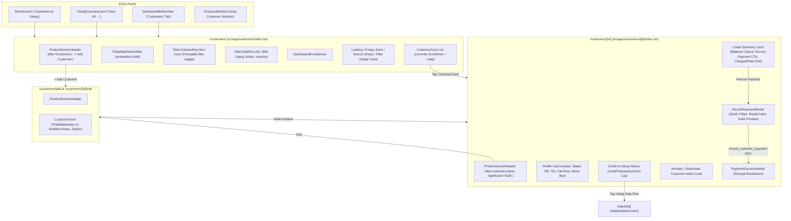

# TindaMate — Customers Screen UI/UX Audit & Implementation Plan

**Project:** TindaMate — *Your Digital Tindahan Assistant*  
**Module Audited:** Customers & Customer Credit (*Utang*) Management (`/customers`, `/customers/add`, `/customers/[id]`, `/customers/[id]/edit`, and `src/components/customers/*`)  
**Audit Date:** November 17, 2026  
**Role:** Senior Mobile UI/UX Designer, React Native Engineer, Product Designer & Mobile Application Usability Auditor  
**Task Mode:** Strictly Read-Only Audit & Implementation Planning (Zero application source code files modified)

---

## 1. Executive Summary

### 1.1 Overall Assessment
The TindaMate Customers and Credit (*Utang*) module (`src/app/customers/*`, `src/components/customers/*`, `src/lib/customers.ts`, and `src/types/customer.ts`) has already undergone significant foundational work (Batches 8A–8F and initial Design 2.0 alignment). It features store-scoped Row Level Security (RLS), an immutable credit ledger (`public.credit_transactions`), an authoritative balance summary view (`public.customer_credit_summaries`), atomic idempotent payment settlement (`public.record_customer_payment` RPC with centavo-safe change/*sukli* calculation), and Design 2.0 header and filter components (`ProductScreenHeader`, `TindaMateSearchBar`, `FilterChipRow`).

However, a rigorous code-level UI/UX and usability audit reveals **critical gaps in list virtualization, initial error-state truthfulness, debt-prioritized sorting, card scannability, layout spacing geometry, and ledger filtering** that prevent the module from reaching its full potential as a high-trust commercial POS and credit management tool.

### 1.2 Existing Strengths (Verified in Code)
1. **Authoritative Financial Architecture:** Customer balances are derived from `public.customer_credit_summaries` (`total_charged - total_paid`), and payments use centavo-integer math (`validatePaymentAmountInput` in [src/lib/customers.ts](file:///c:/TindaMate/src/lib/customers.ts#L591-L661)) and atomic RPC execution (`recordCustomerPayment` in [src/lib/customers.ts](file:///c:/TindaMate/src/lib/customers.ts#L676-L766)).
2. **Store-Wide KPI Integrity:** `CustomersListScreen` ([src/app/customers/index.tsx](file:///c:/TindaMate/src/app/customers/index.tsx#L171-L200)) computes `totalOutstanding`, `utangCustomerCount`, and filter tab counts from the full `allCustomers` array in `useMemo`, preventing search queries or filter selections from distorting the store-wide `"Total Outstanding"` Hero Card.
3. **Instant In-Memory Search & Filter Switching:** Search (`name`, `phone`, `notes`) and status tabs (`All`, `With Utang`, `Active`, `Inactive`) execute synchronously in memory ([src/app/customers/index.tsx](file:///c:/TindaMate/src/app/customers/index.tsx#L212-L241)) without redundant network round-trips per keystroke.
4. **Cash Tender & Change (*Sukli*) Support in Payment Modal:** `RecordPaymentModal` ([src/components/customers/RecordPaymentModal.tsx](file:///c:/TindaMate/src/components/customers/RecordPaymentModal.tsx#L248-L374)) and `PaymentSuccessModal` ([src/components/customers/PaymentSuccessModal.tsx](file:///c:/TindaMate/src/components/customers/PaymentSuccessModal.tsx#L156-L176)) support quick bill chips (`getQuickPaymentOptions`), a 1-tap `Pay Full` chip, and automatic change calculation when cash received exceeds the outstanding balance.
5. **Cross-Module POS & Sale Receipt Linking:** `CreditTransactionCard` ([src/components/customers/CreditTransactionCard.tsx](file:///c:/TindaMate/src/components/customers/CreditTransactionCard.tsx#L158-L186)) links POS-originated credit charges directly to `/sales/[id]` so store owners can inspect the exact itemized receipt behind any *utang* entry.

### 1.3 Most Important UX & Technical Problems Identified
1. **Misleading Empty State & ₱0.00 KPI on Initial Load Error ([src/app/customers/index.tsx](file:///c:/TindaMate/src/app/customers/index.tsx#L298-L387)):** When the initial customer fetch fails (e.g., offline/network drop) and `allCustomers` is empty, the screen renders `Total Outstanding: ₱0.00 (0 customers with active utang)` and the **"No Customers Yet — Add your regular store patrons..."** card below the error banner, instead of a dedicated **"Could Not Load Customers"** error state card.
2. **Unvirtualized `.map()` List Rendering Inside `ScrollView` ([src/app/customers/index.tsx](file:///c:/TindaMate/src/app/customers/index.tsx#L278-L291), [L430-L438](file:///c:/TindaMate/src/app/customers/index.tsx#L430-L438)):** Unlike `ProductsListScreen` (which uses a virtualized `FlatList`), `CustomersListScreen` mounts every `CustomerCard` at once inside a `ScrollView`, degrading performance as a store's *suki* list grows.
3. **Lack of Debt-Prioritized Sorting & Results Toolbar ([src/app/customers/index.tsx](file:///c:/TindaMate/src/app/customers/index.tsx#L212-L241)):** Customers are strictly ordered alphabetically (`name ASC`). Store owners cannot sort by **Highest Utang**, **Recent Activity**, or **Name A–Z**, nor is there a results count toolbar (`Showing X of Y customers`) like on the Products screen.
4. **Severely Cramped `64px` (`Spacing.six`) Card Padding on Empty & Loading Cards ([src/app/customers/index.tsx](file:///c:/TindaMate/src/app/customers/index.tsx#L555), [src/app/customers/[id]/index.tsx](file:///c:/TindaMate/src/app/customers/%5Bid%5D/index.tsx#L711), [L1124](file:///c:/TindaMate/src/app/customers/%5Bid%5D/index.tsx#L1124), [src/app/customers/[id]/edit.tsx](file:///c:/TindaMate/src/app/customers/%5Bid%5D/edit.tsx#L251)):** Applying `padding: Spacing.six` (`64px` on all 4 sides = `128px` total horizontal padding) squeezes empty/loading text into a narrow `160px–200px` column on mobile phones.
5. **Dead `leftIcon` Prop & Redundant Back Button on Primary Bottom-Nav Tab ([src/app/customers/index.tsx](file:///c:/TindaMate/src/app/customers/index.tsx#L258-L266)):** Passing `showBack={true}` alongside `leftIcon={<NavUtangIcon />}` causes `ProductScreenHeader` to ignore `leftIcon` completely and render a Back arrow on a top-level bottom navigation tab.
6. **Avatar Color Shift, Missing Notes Snippet, and Unaligned Settled Readout on `CustomerCard` ([src/components/customers/CustomerCard.tsx](file:///c:/TindaMate/src/components/customers/CustomerCard.tsx#L99-L185)):** `CustomerCard` uses solid dark fills (`#EA580C` / `#0D7A4D`) for avatars while `CustomerDetailsScreen` uses soft pastel fills (`#FFF4E8` / `#EAF7F0`); settled cards hide `₱0.00`; and customer `notes` (landmarks) are never shown even when matched by search.
7. **Below-the-Fold Transaction History & No Charge/Payment Filter on `CustomerDetailsScreen` ([src/app/customers/[id]/index.tsx](file:///c:/TindaMate/src/app/customers/%5Bid%5D/index.tsx#L466-L624)):** An oversized credit summary card (with a static 3-line blue info banner) pushes transaction history below the fold, and there is no filter strip (`All`, `Charges`, `Payments`) to audit long customer ledgers.
8. **Double Input Spacing (`42px` Gap) in `CustomerForm` ([src/components/customers/CustomerForm.tsx](file:///c:/TindaMate/src/components/customers/CustomerForm.tsx#L235)):** Combining `TindaMateInput`'s internal `marginBottom: 18` with `styles.card`'s `gap: 24` creates an excessive `42px` vertical gap between fields.

---

## 2. Current Implementation Overview

### 2.1 Inspected Files Inventory

| File Path | Lines | Responsibility |
| :--- | :---: | :--- |
| [src/app/customers/index.tsx](file:///c:/TindaMate/src/app/customers/index.tsx) | 603 | Main Customers List & Credit Overview screen (`/customers`) |
| [src/app/customers/add.tsx](file:///c:/TindaMate/src/app/customers/add.tsx) | 145 | Add Customer screen (`/customers/add`) |
| [src/app/customers/[id]/index.tsx](file:///c:/TindaMate/src/app/customers/%5Bid%5D/index.tsx) | 1,170 | Customer Details, Credit Summary & Ledger History screen (`/customers/[id]`) |
| [src/app/customers/[id]/edit.tsx](file:///c:/TindaMate/src/app/customers/%5Bid%5D/edit.tsx) | 285 | Edit Customer screen (`/customers/[id]/edit`) |
| [src/components/customers/CustomerCard.tsx](file:///c:/TindaMate/src/components/customers/CustomerCard.tsx) | 352 | Reusable customer row card component for `/customers` |
| [src/components/customers/CreditTransactionCard.tsx](file:///c:/TindaMate/src/components/customers/CreditTransactionCard.tsx) | 335 | Reusable ledger entry card (`charge` / `payment`) for `/customers/[id]` |
| [src/components/customers/CustomerForm.tsx](file:///c:/TindaMate/src/components/customers/CustomerForm.tsx) | 320 | Shared form component for creating and editing customer records |
| [src/components/customers/RecordPaymentModal.tsx](file:///c:/TindaMate/src/components/customers/RecordPaymentModal.tsx) | 819 | Modal for recording full/partial customer payments with *sukli* calculation |
| [src/components/customers/PaymentSuccessModal.tsx](file:///c:/TindaMate/src/components/customers/PaymentSuccessModal.tsx) | 437 | Modal displaying payment receipt confirmation and updated balance |
| [src/lib/customers.ts](file:///c:/TindaMate/src/lib/customers.ts) | 1,026 | Supabase queries, RPC callers, validation, and data normalization |
| [src/types/customer.ts](file:///c:/TindaMate/src/types/customer.ts) | 207 | TypeScript domain models for customers, credit summaries, and payments |
| [src/constants/theme.ts](file:///c:/TindaMate/src/constants/theme.ts) | 461 | Centralized Design 2.0 tokens (`Colors`, `Spacing`, `BorderRadius`, `Typography`, `Shadows`, `IconSizes`) |
| [src/components/products/ProductScreenHeader.tsx](file:///c:/TindaMate/src/components/products/ProductScreenHeader.tsx) | 418 | Shared curved deep-green screen header |
| [src/components/ui/TindaMateSearchBar.tsx](file:///c:/TindaMate/src/components/ui/TindaMateSearchBar.tsx) | 159 | Shared pill search bar with clear button and `rightAction` slot |
| [src/components/ui/FilterChipRow.tsx](file:///c:/TindaMate/src/components/ui/FilterChipRow.tsx) | 179 | Shared horizontal filter chip strip with live count badges |
| [src/components/ui/TindaMateInput.tsx](file:///c:/TindaMate/src/components/ui/TindaMateInput.tsx) | 259 | Shared text input component used by `CustomerForm` |
| [src/components/ui/TindaMateButton.tsx](file:///c:/TindaMate/src/components/ui/TindaMateButton.tsx) | 251 | Shared button component (`primary`, `accent`, `secondary`, `ghost`, `danger`) |
| [src/components/dashboard/DashboardBottomNav.tsx](file:///c:/TindaMate/src/components/dashboard/DashboardBottomNav.tsx) | 297 | Floating capsule bottom navigation bar (`Home`, `Products`, `POS`, `Customers`, `More`) |
| [src/components/dashboard/UtangOverviewCard.tsx](file:///c:/TindaMate/src/components/dashboard/UtangOverviewCard.tsx) | 509 | Dashboard Utang KPI summary card linking to `/customers` |
| [src/app/products/index.tsx](file:///c:/TindaMate/src/app/products/index.tsx) | 869 | Reference peer catalog screen (`FlatList`, sort toolbar, feedback banner) |
| [src/app/sales/history.tsx](file:///c:/TindaMate/src/app/sales/history.tsx) | 901 | Reference peer ledger screen |

---

## 3. Route and Component Architecture

### 3.1 Navigation & Entry Points
- **Expo Router Stack Registration ([src/app/_layout.tsx](file:///c:/TindaMate/src/app/_layout.tsx#L110-L113)):**
  - `customers/index` (`/customers`)
  - `customers/add` (`/customers/add`)
  - `customers/[id]/index` (`/customers/[id]`)
  - `customers/[id]/edit` (`/customers/[id]/edit`)
- **Entry Points into `/customers`:**
  1. **Bottom Navigation Bar ([src/components/dashboard/DashboardBottomNav.tsx](file:///c:/TindaMate/src/components/dashboard/DashboardBottomNav.tsx#L37-L43), [L144-L148](file:///c:/TindaMate/src/components/dashboard/DashboardBottomNav.tsx#L144-L148)):** The 4th tab (`Customers`, with `NavCustomersIcon`) resolves as active for any `/customers*` or `/utang*` pathname.
  2. **Dashboard Utang Overview Card ([src/components/dashboard/UtangOverviewCard.tsx](file:///c:/TindaMate/src/components/dashboard/UtangOverviewCard.tsx#L67), [L151](file:///c:/TindaMate/src/components/dashboard/UtangOverviewCard.tsx#L151)):** Tapping `"All →"` or `"View All →"` navigates to `/customers`.
  3. **Dashboard Quick Actions ([src/app/home.tsx](file:///c:/TindaMate/src/app/home.tsx)):** Quick action tile for Utang / Customers.
  4. **More Menu ([src/app/more.tsx](file:///c:/TindaMate/src/app/more.tsx)):** `"Customers & Utang"` menu row.

### 3.2 Component Architecture Diagram



---

## 4. Existing Functionality Inventory

| Capability | Current Implementation Status | Source Location |
| :--- | :--- | :--- |
| **Fetch Store Customers & Credit Summaries** | Fetches `public.customers` (`store_id` scoped) and merges `public.customer_credit_summaries` in memory. | [src/lib/customers.ts](file:///c:/TindaMate/src/lib/customers.ts#L200-L282) |
| **Store-Wide Outstanding Utang KPI** | Computes `totalOutstanding` and `utangCustomerCount` across `allCustomers`. Tapping toggles `'With Utang'` filter. | [src/app/customers/index.tsx](file:///c:/TindaMate/src/app/customers/index.tsx#L171-L200), [L298-L339](file:///c:/TindaMate/src/app/customers/index.tsx#L298-L339) |
| **Customer Search** | Case-insensitive substring match against `name`, `phone`, and `notes`. | [src/app/customers/index.tsx](file:///c:/TindaMate/src/app/customers/index.tsx#L226-L241) |
| **Customer Status Filtering** | `<FilterChipRow>` with live counts for `All`, `With Utang`, `Active`, and `Inactive`. | [src/app/customers/index.tsx](file:///c:/TindaMate/src/app/customers/index.tsx#L202-L225), [L342-L350](file:///c:/TindaMate/src/app/customers/index.tsx#L342-L350) |
| **Customer Sorting** | **Not implemented** on UI (hardcoded `ORDER BY name ASC` from database query). | [src/lib/customers.ts](file:///c:/TindaMate/src/lib/customers.ts#L211) |
| **Add Customer** | Validates `name` (required, $\le 100$ chars), `phone`, `notes` ($\le 300$ chars); inserts customer + `open` credit account; navigates to `/customers/[id]`. | [src/app/customers/add.tsx](file:///c:/TindaMate/src/app/customers/add.tsx#L51-L71), [src/lib/customers.ts](file:///c:/TindaMate/src/lib/customers.ts#L448-L509) |
| **Edit Customer** | Updates `name`, `phone`, `notes`, and `is_active`; navigates back to `/customers/[id]`. | [src/app/customers/[id]/edit.tsx](file:///c:/TindaMate/src/app/customers/%5Bid%5D/edit.tsx#L94-L121), [src/lib/customers.ts](file:///c:/TindaMate/src/lib/customers.ts#L516-L567) |
| **Customer Details & Call Action** | Displays initials avatar, status pill, `Linking.openURL('tel:...')` phone row, notes box, and credit summary. | [src/app/customers/[id]/index.tsx](file:///c:/TindaMate/src/app/customers/%5Bid%5D/index.tsx#L164-L167), [L378-L579](file:///c:/TindaMate/src/app/customers/%5Bid%5D/index.tsx#L378-L579) |
| **Record Customer Payment** | Opens `RecordPaymentModal`, validates amount in integer centavos, computes *sukli* if cash tendered $>$ balance, executes `record_customer_payment` RPC, and shows `PaymentSuccessModal`. | [src/app/customers/[id]/index.tsx](file:///c:/TindaMate/src/app/customers/%5Bid%5D/index.tsx#L184-L220), [src/components/customers/RecordPaymentModal.tsx](file:///c:/TindaMate/src/components/customers/RecordPaymentModal.tsx) |
| **Credit Ledger Transaction History** | Fetches `public.credit_transactions` (`created_at DESC`) enriched with `public.sales` snapshot metadata; links sale rows to `/sales/[id]`. | [src/lib/customers.ts](file:///c:/TindaMate/src/lib/customers.ts#L353-L441), [src/components/customers/CreditTransactionCard.tsx](file:///c:/TindaMate/src/components/customers/CreditTransactionCard.tsx) |
| **Deactivate / Reactivate Customer** | Confirmation alert (`Alert.alert` / `window.confirm`) toggling `is_active` while preserving all historical credit records. | [src/app/customers/[id]/index.tsx](file:///c:/TindaMate/src/app/customers/%5Bid%5D/index.tsx#L226-L277) |

---

## 5. UI/UX Audit Findings

Below is the evaluation across all 15 audit dimensions, backed by exact file and line citations.

### 5.1 Visual Hierarchy
- **Customers List (`src/app/customers/index.tsx`):** The top-down hierarchy (`ProductScreenHeader` $\rightarrow$ `Total Outstanding` Hero Card $\rightarrow$ `FilterChipRow` $\rightarrow$ `CustomerCard` list) is logical. However, when `totalOutstanding === 0` (all customers settled), the Hero Card remains an intense dark forest green card with a chevron `›` ([lines 299–338](file:///c:/TindaMate/src/app/customers/index.tsx#L299-L338)), and when `selectedFilter === 'With Utang'` is toggled via the Hero Card, there is no visual active state on the card to show it is currently filtering the list.
- **Customer Details (`src/app/customers/[id]/index.tsx`):** The screen stacks two heavy white container cards (`profileCard` at [lines 378–463](file:///c:/TindaMate/src/app/customers/%5Bid%5D/index.tsx#L378-L463) and `creditCard` at [lines 466–579](file:///c:/TindaMate/src/app/customers/%5Bid%5D/index.tsx#L466-L579)) before the user ever sees a single transaction in `Credit & Utang History` ([line 582](file:///c:/TindaMate/src/app/customers/%5Bid%5D/index.tsx#L582)). Inside `creditCard`, the static 3-line blue informational banner ([lines 573–578](file:///c:/TindaMate/src/app/customers/%5Bid%5D/index.tsx#L573-L578)) consumes ~64dp of vertical prime real estate on every single visit.

### 5.2 Spacing and Alignment
- **Critical `64px` (`Spacing.six`) Padding Bug on State Cards:**
  - In [src/app/customers/index.tsx](file:///c:/TindaMate/src/app/customers/index.tsx#L555) (`styles.stateCard`), [src/app/customers/[id]/index.tsx](file:///c:/TindaMate/src/app/customers/%5Bid%5D/index.tsx#L711) (`styles.loadingCard`), [src/app/customers/[id]/index.tsx](file:///c:/TindaMate/src/app/customers/%5Bid%5D/index.tsx#L1124) (`styles.emptyHistoryCard`), and [src/app/customers/[id]/edit.tsx](file:///c:/TindaMate/src/app/customers/%5Bid%5D/edit.tsx#L251) (`styles.stateCard`), `padding: Spacing.six` (`64px`) is applied to all four sides.
  - On a `360dp` screen with `32dp` outer margin (`328dp` card width), `128dp` of horizontal padding (`64dp` left + `64dp` right) leaves only **`200dp`** (and **`160dp`** on a `320dp` phone) for the title, subtitle, and action button!
- **Double Input Spacing (`42px`) in `CustomerForm`:**
  - `TindaMateInput` ([src/components/ui/TindaMateInput.tsx](file:///c:/TindaMate/src/components/ui/TindaMateInput.tsx#L187)) applies `marginBottom: 18` to `styles.wrapper`.
  - `CustomerForm` ([src/components/customers/CustomerForm.tsx](file:///c:/TindaMate/src/components/customers/CustomerForm.tsx#L235)) wraps those inputs inside `styles.card` with `gap: Spacing.four` (`24px`), producing a **`42px`** gap between `"Customer Name *"` and `"Mobile / Phone Number"`, and between `"Mobile / Phone Number"` and `"Notes / Landmark"`.

### 5.3 Typography and Readability
- **Oversized Line Height on `CreditTransactionCard` Title:** In [src/components/customers/CreditTransactionCard.tsx](file:///c:/TindaMate/src/components/customers/CreditTransactionCard.tsx#L275-L279), `itemTitle` uses `fontSize: Typography.sizes.base` (`16px`) paired with `lineHeight: Typography.lineHeights.heading` (`28px`), making single-line and two-line transaction titles look vertically stretched above `itemSubtitle` (`12px`). Using `Typography.lineHeights.relaxed` (`22px`) is far cleaner.
- **Micro-Badge Font Sizes Below Scale:** `CustomerCard` uses `fontSize: 9` for `utangPillText` ([line 328](file:///c:/TindaMate/src/components/customers/CustomerCard.tsx#L328)) and `fontSize: 10` for `paidPillText` ([line 342](file:///c:/TindaMate/src/components/customers/CustomerCard.tsx#L342)) and `inactiveBadgeText` ([line 285](file:///c:/TindaMate/src/components/customers/CustomerCard.tsx#L285)). On lower-DPI budget Android screens, `9px` text can appear blurry; `10px–11px` is more legible.

### 5.4 Color Contrast & Semantic Consistency
- **Avatar Palette Mismatch Between List and Details:**
  - In `CustomerCard` ([src/components/customers/CustomerCard.tsx](file:///c:/TindaMate/src/components/customers/CustomerCard.tsx#L236-L256)), avatars use **solid dark fills** (`#EA580C` for Utang, `#0D7A4D` for Settled, `#64748B` for Inactive) with white initials (`#FFFFFF`).
  - In `CustomerDetailsScreen` ([src/components/customers/CustomerCard.tsx](file:///c:/TindaMate/src/components/customers/CustomerCard.tsx) vs [src/app/customers/[id]/index.tsx](file:///c:/TindaMate/src/app/customers/%5Bid%5D/index.tsx#L774-L802)), the exact same customer's avatar uses **soft pastel fills** with colored 2px borders (`Colors.pastel.orange.bg` / `Colors.pastel.green.bg`) and colored text.
  - Unifying both screens on the refined **tinted pastel surface + crisp border + high-contrast monogram** (or giving `CustomerCard` a subtle left accent bar / pastel badge) eliminates visual jarring during navigation and reduces heavy blocks of dark orange/green when 8+ cards are stacked on screen.

### 5.5 Card Design and Information Density (`CustomerCard`)
- **Missing `₱0.00` Balance Readout on Settled Cards:** In [src/components/customers/CustomerCard.tsx](file:///c:/TindaMate/src/components/customers/CustomerCard.tsx#L158-L180), customers with `hasUtang` display a 2-line right column (`₱450.00` + `UTANG` pill), while settled customers display only a `PAID` pill. Showing `₱0.00` (in muted or green tabular numerals) above `SETTLED` / `PAID` maintains a scannable vertical ledger column.
- **Hidden `notes` / Landmark Metadata:** `CustomerCard` ([lines 64–75](file:///c:/TindaMate/src/components/customers/CustomerCard.tsx#L64-L75)) only builds `secondaryMeta` from `customer.phone` and `lastActivityDate`. If a store owner registers `"Aling Nena"` without a phone number but adds landmark notes `"Tapat ng basketball court"`, the card displays `"No transactions yet"` (or only the date) and hides the landmark note—even when the user searches by `"basketball"`!

### 5.6 Customer List Organization & Virtualization
- **Unvirtualized `ScrollView`:** `CustomersListScreen` ([src/app/customers/index.tsx](file:///c:/TindaMate/src/app/customers/index.tsx#L278-L291)) renders all cards in a `ScrollView` via `.map()` instead of a `FlatList`.
- **Alphabetical-Only Order:** There is no grouping or sorting to surface customers with active *utang* above settled customers when viewing the `'All'` tab, or to sort by highest balance.

### 5.7 Search Bar Usability
- `TindaMateSearchBar` ([src/app/customers/index.tsx](file:///c:/TindaMate/src/app/customers/index.tsx#L269-L274)) is well-positioned inside `ProductScreenHeader`. However, unlike `ProductsListScreen` ([src/app/products/index.tsx](file:///c:/TindaMate/src/app/products/index.tsx#L508)), `CustomersListScreen` does not pass `inputProps={{ editable: !isInitialLoading }}` to prevent typing before initial data loads, nor does it display a result counter (`"Showing X of Y customers"`) below the filter chips when a search query is active.

### 5.8 Filter and Sorting Experience
- **Filter Chips:** `FilterChipRow` works well and shows live counts (`All`, `With Utang`, `Active`, `Inactive`).
- **Missing Sort Control:** Store owners managing credit need to answer three primary questions:
  1. *"Who owes me the most money right now?"* (**Sort: Highest Utang**)
  2. *"Who borrowed or paid most recently?"* (**Sort: Recent Activity**)
  3. *"Where is [Customer Name]?"* (**Sort: Name A–Z**)
  Currently, only `Name A–Z` is possible. Adding a 1-tap sort pill in a results toolbar (matching `ProductsListScreen` [lines 364–396](file:///c:/TindaMate/src/app/products/index.tsx#L364-L396)) solves this cleanly.

### 5.9 Outstanding Balance Visibility
- On `/customers`, the `"Total Outstanding"` Hero Card is prominent, and `CustomerCard` highlights individual balances in `Colors.accentDark` (`#EA580C`).
- However, on `/customers`, the Hero Card does not show how much has been collected or how many total active customers exist alongside debtors, and when `totalOutstanding === 0`, the Hero Card does not celebrate or clearly state `"All customer accounts settled"` (unlike `UtangOverviewCard` on Dashboard, [src/components/dashboard/UtangOverviewCard.tsx](file:///c:/TindaMate/src/components/dashboard/UtangOverviewCard.tsx#L210)).

### 5.10 Primary and Secondary Actions
- **Add Customer:** Well-placed in the header (`+ Add Customer`) and in the store-wide empty state (`+ Add Your First Customer`).
- **Record Payment:** On `CustomerDetailsScreen`, `"Record Payment"` is a clear primary green button inside `creditCard` ([lines 519–528](file:///c:/TindaMate/src/app/customers/%5Bid%5D/index.tsx#L519-L528)). However, on `CustomersListScreen`, a store owner who just wants to record a quick payment from a known *suki* must tap the card $\rightarrow$ wait for `CustomerDetailsScreen` to fetch 2 queries $\rightarrow$ tap `"Record Payment"`.
- **Edit vs. Deactivate on Details:** `"Edit"` is in the top-right header pill, while `"Deactivate Customer"` sits at the bottom of the scroll view ([lines 627–650](file:///c:/TindaMate/src/app/customers/%5Bid%5D/index.tsx#L627-L650)) styled with `variant="secondary"` (green outline)—the exact same visual style as a standard positive secondary action, rather than a muted or caution/danger-toned administrative action.

### 5.11 Navigation Consistency
- **Top-Level Tab Back Button Bug ([src/app/customers/index.tsx](file:///c:/TindaMate/src/app/customers/index.tsx#L258-L266)):**
  - `CustomersListScreen` is a root bottom-tab screen, yet it sets `showBack={true}`, which hides `leftIcon` and shows a back button.
  - In `ProductsListScreen` ([src/app/products/index.tsx](file:///c:/TindaMate/src/app/products/index.tsx#L494-L496)), `showBack={false}` is used so the module icon badge renders in the top-left.
- **Missing Bottom Navigation or Quick POS Link:** Sub-screens (`add.tsx`, `[id]/index.tsx`, `[id]/edit.tsx`) appropriately hide the bottom tab bar to focus on the detail/form task and provide a back button.

### 5.12 Mobile Responsiveness (`320dp–430dp+`)
- Most components check `windowWidth < 360` (`isCompactPhone` / `isNarrowPhone`).
- However, the `padding: Spacing.six` (`64px`) on state cards ([src/app/customers/index.tsx](file:///c:/TindaMate/src/app/customers/index.tsx#L555)) breaks narrow phone layouts (`<360dp`).
- In `CustomerDetailsScreen` ([src/app/customers/[id]/index.tsx](file:///c:/TindaMate/src/app/customers/%5Bid%5D/index.tsx#L437-L454)), the phone `contactRow` places `TEL` badge + `Mobile Phone / 0917...` + `Tap to Call` horizontally without `flexShrink` or wrapping protection on `callBadge` if a user enters a long phone string (e.g., `"0917 123 4567 / 0918 999 8888"`).

### 5.13 Touch Target Accessibility
- `TindaMateSearchBar` (`44px` height), `FilterChipRow` (`36px` minHeight + `hitSlop`), `TindaMateButton` (`52px` minHeight), and `RecordPaymentModal` close button (`38x38` + `hitSlop`) meet mobile touch target guidelines.
- In `CreditTransactionCard` ([src/components/customers/CreditTransactionCard.tsx](file:///c:/TindaMate/src/components/customers/CreditTransactionCard.tsx#L173-L185)), the entire card is a single `Pressable` when `hasSale` is true, which is easy to tap.

### 5.14 Empty, Loading, and Error State Presentation
- **Critical Flaw on Initial Load Error (`src/app/customers/index.tsx#L353-L387`):** As detailed in Section 1.3, when `errorMessage` is set on initial load (`allCustomers.length === 0`), the screen simultaneously renders:
  1. `Total Outstanding: ₱0.00` Hero Card
  2. `FilterChipRow` (`All 0`, `With Utang 0`, `Active 0`, `Inactive 0`)
  3. `DashboardErrorBanner`
  4. `"No Customers Yet"` empty store card with `"+ Add Your First Customer"` CTA!
- **Duplicate Status Pill on `CustomerDetailsScreen`:** The header subtitle already states `"Active Customer"` / `"Inactive Customer"` ([line 299](file:///c:/TindaMate/src/app/customers/[id]/index.tsx#L299)), while `profileCard` renders the same status pill directly below the name ([lines 404–431](file:///c:/TindaMate/src/app/customers/[id]/index.tsx#L404-L431)), yet omits credit status or customer registration date.

### 5.15 Overall Visual Consistency with the TindaMate Design System
- The module generally adheres to `src/constants/theme.ts`, but contains hardcoded border radii (`24` instead of `BorderRadius.xl`), wrong card radius on `CustomerCard` (`BorderRadius.xl` `24px` instead of `BorderRadius.card` `16px`), `Spacing.six` (`64px`) card padding misuse, text `"TEL"` icon badge instead of vector icon on `CustomerDetailsScreen`, and double vertical spacing in `CustomerForm`.

---

## 6. Customer Workflow Assessment

### 6.1 Viewing and Finding Customers
- **Current Flow:** Open `/customers` $\rightarrow$ scan list or type in `TindaMateSearchBar` / tap `FilterChipRow`.
- **Friction Points:**
  1. Because the list is always alphabetical, a store owner with 50 customers (10 of whom have *utang*) sees 40 settled `PAID` cards mixed in alphabetically on the `All` tab, and even on the `With Utang` tab, a customer owing `₱15.00` (`"Aling Ana"`) is ranked above a customer owing `₱3,500.00` (`"Tito Boy"`).
  2. If the store owner searches by a landmark note (e.g., `"kanto"`), the matching `CustomerCard` appears, but the note itself is not shown on the card, leaving the user unsure why it matched.

### 6.2 Adding and Editing a Customer
- **Current Flow:** Tap `+ Add Customer` $\rightarrow$ fill `CustomerForm` (`Name *`, `Phone`, `Notes`) $\rightarrow$ tap `Save Customer` $\rightarrow$ `router.replace('/customers/[id]')`.
- **Friction Points:**
  1. Excessive `42px` vertical spacing between form fields pushes the `Save Customer` / `Cancel` buttons lower toward the keyboard on compact phones.
  2. After saving a new or edited customer, the user lands on `CustomerDetailsScreen` with no visual confirmation toast/banner (`"Customer added"` or `"Customer profile updated"`).

### 6.3 Inspecting Utang, Recording Payments & Auditing the Ledger
- **Current Flow:** Tap `CustomerCard` $\rightarrow$ `CustomerDetailsScreen` loads profile + credit summary + credit transactions $\rightarrow$ tap `Record Payment` $\rightarrow$ `RecordPaymentModal` $\rightarrow$ `PaymentSuccessModal`.
- **Friction Points:**
  1. On `CustomerDetailsScreen`, `profileCard` + `creditCard` take up ~520–580dp of vertical height before the first transaction card in `Credit & Utang History` appears. Compacting `profileCard` and removing the redundant 3-line blue hint box in `creditCard` brings the transaction ledger above the fold.
  2. `Credit & Utang History` has no filter tabs (`All`, `Charges`, `Payments`). When a customer asks *"When was the last time I paid you?"*, the store owner must manually scroll through dozens of `Utang Sale` cards to spot green `Payment` cards.
  3. For payment transactions where the user did not enter custom notes, `recordCustomerPaymentFallback` stores `'Customer payment'` and the RPC stores `null` (which `CreditTransactionCard` renders as `'Payment Received'`). When custom notes *are* entered (e.g., `'GCash bayad via Maria'`), `CreditTransactionCard` ([line 52](file:///c:/TindaMate/src/components/customers/CreditTransactionCard.tsx#L52)) replaces the title `'Payment Received'` with the raw note string instead of keeping `'Payment Received'` as the clear title and showing the note (`'GCash bayad via Maria'`) as the subtitle!

---

## 7. Design System Compliance (`src/constants/theme.ts`)

| Token Category | Expected Token (`src/constants/theme.ts`) | Actual Usage in Customers Module | Compliance Status |
| :--- | :--- | :--- | :--- |
| **Colors** | `Colors.primaryDark`, `Colors.primary`, `Colors.accentDark`, `Colors.pastel.*`, `Colors.surface`, `Colors.border` | Mostly uses `Colors.*`, except `src/app/customers/index.tsx#L525` (`#A7F3D0`), `L506` (`rgba(16, 185, 129, 0.22)`). | **Mostly Compliant** (minor inline hex cleanup needed) |
| **Spacing** | `Spacing.screenPadding` (`16`), `Spacing.four` (`24`), `Spacing.five` (`32`) | Misuses `Spacing.six` (`64px`) as all-around card padding on empty/loading state cards (`index.tsx#L555`, `[id]/index.tsx#L711, L1124`, `edit.tsx#L251`); double spacing (`18 + 24 = 42px`) in `CustomerForm.tsx#L235`. | **Non-Compliant in State Cards & Form** |
| **BorderRadius** | `BorderRadius.card` (`16`) for list cards; `BorderRadius.primaryCard` (`20`) / `BorderRadius.xl` (`24`) for hero/summary cards | `CustomerCard.tsx#L194` uses `BorderRadius.xl` (`24px`) instead of `BorderRadius.card` (`16px`). `index.tsx#L486` uses raw `24`. | **Minor Drift** |
| **Typography** | `Typography.sizes.*`, `Typography.weights.*`, `tabular-nums` on all financial figures | `tabular-nums` is properly applied to balances and payment modals. `CreditTransactionCard.tsx#L278` misuses `lineHeight: 28` (`heading`) on `16px` title text. | **Mostly Compliant** |
| **Shadows** | `Shadows.xs`, `Shadows.sm`, `Shadows.card`, `Shadows.md` | Properly uses `Shadows.xs`, `Shadows.sm`, `Shadows.md`. | **Compliant** |
| **IconSizes & Icons** | Vector icons from `DashboardNavIcons.tsx` & `AuthIcons.tsx` | `CustomerDetailsScreen` (`[id]/index.tsx#L446`) uses a plain text `<Text>TEL</Text>` badge instead of a vector icon; `index.tsx#L265` passes `NavUtangIcon` while `DashboardBottomNav` uses `NavCustomersIcon`. | **Minor Drift** |

---

## 8. Recommended Visual Improvements

### 8.1 Customers List Screen (`/customers`)
1. **Header Alignment (`ProductScreenHeader`):**
   - Set `showBack={false}` and `leftIcon={<NavCustomersIcon color={Colors.textInverse} />}` so the Customers tab matches `ProductsListScreen` (`showBack={false}` with module icon badge) and matches the `NavCustomersIcon` used in `DashboardBottomNav`.
2. **Enhanced Total Outstanding Hero Card:**
   - Keep the rich `Colors.primaryDark` surface, but make its interactive filter behavior unmistakable:
     - Replace the ambiguous right navigation chevron `›` with a compact pill badge on the right: **`Filter Utang` / `Showing Utang ✕`** when active.
     - When `totalOutstanding === 0` and `allCustomers.length > 0`, show a reassuring settled subtitle (`"All customer credit accounts are settled"`).
3. **Result Count & Sort Toolbar (Below `FilterChipRow`):**
   - Add the same clean, compact toolbar pattern proven in `ProductsListScreen`:
     - Left: `"Showing X of Y customers"` (when filtered/searched) or `"Y Customers"`.
     - Right: Interactive sort pill (`Sort: Highest Utang ▾` / `Sort: Name A–Z ▾` / `Sort: Recent Activity ▾`).
     - Default sort: When viewing `'With Utang'`, default or allow 1-tap sorting by **Highest Utang** so largest debtors appear first; on `'All'`, support **Name A–Z** (default), **Highest Utang**, and **Recent Activity**.
4. **Refined `CustomerCard` (`src/components/customers/CustomerCard.tsx`):**
   - Use `BorderRadius.card` (`16px`) and `Colors.border` (`#E2E8F0`) for crisp card definition on the `#F4F6F8` slate canvas (with a subtle warm orange border tint `Colors.pastel.orange.border` when `hasUtang` is true).
   - Unify the avatar monogram styling with `CustomerDetailsScreen` (`Colors.pastel.orange` for Utang, `Colors.pastel.green` for Settled, `Colors.pastel.neutral` for Inactive) so the list and details screens match 100%.
   - Include a truncated landmark/note snippet in the secondary metadata line when `customer.notes` is present (especially helpful when `phone` is empty or when searching by notes).
   - Display `₱0.00` above the `PAID` pill on settled cards so the right financial column maintains strict vertical `tabular-nums` alignment across all rows.

### 8.2 Customer Details Screen (`/customers/[id]`)
1. **Streamlined Profile & Credit Summary Hierarchy:**
   - Combine the redundant status indicator with customer metadata (e.g., `Active Customer` pill + `Has Unpaid Utang` / `Settled` pill, or registration date), and add a vector phone icon to the `Tap to Call` contact row.
   - Remove the permanent 3-line blue `infoBanner` inside `creditCard` (or move a concise 1-line helper into the empty history state) to save ~64dp of vertical space and bring `Credit & Utang History` above the fold.
   - Support a `?status=created` / `?status=updated` confirmation banner at the top of `CustomerDetailsScreen` when returning from `AddCustomerScreen` or `EditCustomerScreen`.
2. **Transaction Ledger Filter Strip (`All`, `Charges`, `Payments`):**
   - Above the transaction list in `Credit & Utang History`, render `<FilterChipRow>` when `transactions.length > 0` with three tabs:
     - `All (${transactions.length})`
     - `Utang Charges (${chargeCount})`
     - `Payments (${paymentCount})`
   - This uses existing client-side `transactions` state with zero extra database queries.
3. **Clearer `CreditTransactionCard` Title/Notes Hierarchy:**
   - For payment transactions (`transaction_type === 'payment'`), always display **`Payment Received`** as the primary card title (`itemTitle`), and render custom `transaction.notes` (when different from the default `'Customer payment'`) as the secondary `itemSubtitle`.
   - Fix `itemTitle` line height from `28px` (`heading`) to `22px` (`relaxed`).

---

## 9. Prioritized Improvement List

### Priority 1 — Critical UX, Financial Clarity & Performance Improvements

#### Recommendation P1-1: Fix Initial Load Error State & Hide Zeroed KPI/Filters When Load Fails
- **Identified Issue:** When `loadCustomers` fails on initial mount (`errorMessage !== null && allCustomers.length === 0`), `CustomersListScreen` still renders the `Total Outstanding: ₱0.00` Hero Card, `FilterChipRow (All 0)`, `DashboardErrorBanner`, and the `"No Customers Yet"` empty state card simultaneously.
- **Current Implementation:** [src/app/customers/index.tsx](file:///c:/TindaMate/src/app/customers/index.tsx#L298-L387) checks `!isInitialLoading` for the Hero Card and `FilterChipRow`, and checks `allCustomers.length === 0` without checking `errorMessage`.
- **Recommended Improvement:**
  - Render the Hero Card and `FilterChipRow` only when `!isInitialLoading && (allCustomers.length > 0 || !errorMessage)`.
  - When `errorMessage && allCustomers.length === 0`, render a dedicated **"Could Not Load Customers"** error state card with `WarningTriangleIcon`, the error message, and a `"Retry Loading"` primary `TindaMateButton` (matching `ProductsListScreen` and `ExpensesListScreen`).
  - Render `DashboardErrorBanner` only when `errorMessage && allCustomers.length > 0` (i.e., when pull-to-refresh fails on an already loaded list).
- **Reason for Recommendation:** Prevents store owners from seeing a false `₱0.00` total outstanding balance and a false `"No Customers Yet"` message during network interruptions.
- **Expected UX Benefit:** 100% honest financial state communication and clear 1-tap error recovery.
- **Affected Files & Components:** [src/app/customers/index.tsx](file:///c:/TindaMate/src/app/customers/index.tsx)
- **Implementation Complexity:** Low
- **Potential Regression Risks:** None (strictly improves error branching).

#### Recommendation P1-2: Virtualize Customer List with `FlatList`
- **Identified Issue:** `CustomersListScreen` renders all `filteredCustomers` inside a `ScrollView` using `.map()`.
- **Current Implementation:** [src/app/customers/index.tsx](file:///c:/TindaMate/src/app/customers/index.tsx#L278-L291), [L430-L438](file:///c:/TindaMate/src/app/customers/index.tsx#L430-L438).
- **Recommended Improvement:** Replace the `ScrollView` + `.map()` with React Native's `<FlatList>` using `ListHeaderComponent` (for Hero Card, FilterChipRow, Sort Toolbar, Error Banner), `ListEmptyComponent` (for loading, error, and empty states), `ItemSeparatorComponent`, and standard virtualization props (`initialNumToRender={12}`, `maxToRenderPerBatch={12}`, `windowSize={7}`).
- **Reason for Recommendation:** Matches `ProductsListScreen` ([src/app/products/index.tsx](file:///c:/TindaMate/src/app/products/index.tsx#L541-L572)) and ensures smooth 60fps scrolling even with 200+ customers.
- **Expected UX Benefit:** Faster initial render and lower memory footprint on budget Android devices.
- **Affected Files & Components:** [src/app/customers/index.tsx](file:///c:/TindaMate/src/app/customers/index.tsx)
- **Implementation Complexity:** Low
- **Potential Regression Risks:** Low — ensure `contentContainerStyle` preserves `maxWidth: DashboardMaxContentWidth` and `keyboardShouldPersistTaps="handled"`.

#### Recommendation P1-3: Fix `64px` (`Spacing.six`) Card Padding Bug Across Empty & Loading States
- **Identified Issue:** `padding: Spacing.six` (`64px` on all sides) is applied to `stateCard`, `loadingCard`, and `emptyHistoryCard`, leaving only `160dp–200dp` of horizontal text width on mobile phones.
- **Current Implementation:** [src/app/customers/index.tsx](file:///c:/TindaMate/src/app/customers/index.tsx#L555), [src/app/customers/[id]/index.tsx](file:///c:/TindaMate/src/app/customers/%5Bid%5D/index.tsx#L711), [L1124](file:///c:/TindaMate/src/app/customers/%5Bid%5D/index.tsx#L1124), [src/app/customers/[id]/edit.tsx](file:///c:/TindaMate/src/app/customers/%5Bid%5D/edit.tsx#L251).
- **Recommended Improvement:** Change state card padding to `paddingVertical: Spacing.five` (`32px`) and `paddingHorizontal: Spacing.four` (`24px`), matching `ExpensesListScreen` and `ProductsListScreen`.
- **Reason for Recommendation:** Eliminates awkward 4–5 line text wrapping inside empty and loading cards on `320dp–375dp` screens.
- **Expected UX Benefit:** Balanced, readable empty and loading state cards across all phone widths.
- **Affected Files & Components:** [src/app/customers/index.tsx](file:///c:/TindaMate/src/app/customers/index.tsx), [src/app/customers/[id]/index.tsx](file:///c:/TindaMate/src/app/customers/%5Bid%5D/index.tsx), [src/app/customers/[id]/edit.tsx](file:///c:/TindaMate/src/app/customers/%5Bid%5D/edit.tsx)
- **Implementation Complexity:** Low
- **Potential Regression Risks:** None.

---

### Priority 2 — Visual Design & Hierarchy Improvements

#### Recommendation P2-1: Remove Redundant Back Button on `/customers` & Render `NavCustomersIcon` Badge
- **Identified Issue:** `CustomersListScreen` passes `showBack={true}` and `leftIcon={<NavUtangIcon />}`, causing `ProductScreenHeader` to ignore `leftIcon` and show a Back arrow on a primary bottom-tab screen.
- **Current Implementation:** [src/app/customers/index.tsx](file:///c:/TindaMate/src/app/customers/index.tsx#L258-L266).
- **Recommended Improvement:** Set `showBack={false}` and pass `leftIcon={<NavCustomersIcon color={Colors.textInverse} />}` (matching `DashboardBottomNav` and `ProductsListScreen`).
- **Reason for Recommendation:** Top-level bottom navigation tabs should display their module identity icon badge in the header rather than a back button, and `leftIcon` was previously dead code due to `showBack={true}`.
- **Expected UX Benefit:** Consistent navigation mental model across `Home`, `Products`, and `Customers`.
- **Affected Files & Components:** [src/app/customers/index.tsx](file:///c:/TindaMate/src/app/customers/index.tsx)
- **Implementation Complexity:** Low
- **Potential Regression Risks:** None (`DashboardBottomNav` is persistently visible at the bottom of `/customers`).

#### Recommendation P2-2: Unify `CustomerCard` Avatar Palette, Border Radius, Landmark Snippet & `₱0.00` Alignment
- **Identified Issue:**
  1. `CustomerCard` avatars use solid dark fills (`#EA580C` / `#0D7A4D`) while `CustomerDetailsScreen` uses soft pastel fills with borders.
  2. Settled customers show only a `PAID` pill without `₱0.00`.
  3. Customer `notes` (landmarks) are hidden on the card even when `phone` is absent or when `notes` matched the search query.
  4. Card radius uses `BorderRadius.xl` (`24px`) instead of `BorderRadius.card` (`16px`).
- **Current Implementation:** [src/components/customers/CustomerCard.tsx](file:///c:/TindaMate/src/components/customers/CustomerCard.tsx#L64-L75), [L99-L185](file:///c:/TindaMate/src/components/customers/CustomerCard.tsx#L99-L185), [L192-L351](file:///c:/TindaMate/src/components/customers/CustomerCard.tsx#L192-L351).
- **Recommended Improvement:**
  - Style `avatarCircle` using the same semantic pastel tokens as `CustomerDetailsScreen` (`Colors.pastel.orange.bg` + `border` + `accent` text for Utang; `Colors.pastel.green.bg` + `border` + `accent` text for Settled; `Colors.backgroundAlt` + `Colors.border` + `Colors.textMuted` for Inactive).
  - Use `BorderRadius.card` (`16px`) and `Colors.border` (with `Colors.pastel.orange.border` highlight when `hasUtang` is true).
  - Display `₱0.00` in muted/settled tabular numerals above the `PAID` pill when `balance === 0`.
  - When `customer.notes` is present, display a concise 1-line landmark/note preview (or append it when `phone` is missing) so patrons with similar names or note-based search matches are immediately identifiable.
- **Reason for Recommendation:** Creates a cohesive visual transition from list to details and makes financial amounts align vertically down the right edge of the list.
- **Expected UX Benefit:** Faster visual scanning of balances and customer identities.
- **Affected Files & Components:** [src/components/customers/CustomerCard.tsx](file:///c:/TindaMate/src/components/customers/CustomerCard.tsx)
- **Implementation Complexity:** Low
- **Potential Regression Risks:** Low — purely visual/presentational within `CustomerCard`.

#### Recommendation P2-3: Fix `42px` Double Input Spacing in `CustomerForm`
- **Identified Issue:** `CustomerForm` sets `gap: Spacing.four` (`24px`) on `styles.card`, while `TindaMateInput` already has `marginBottom: 18`, creating a `42px` gap between fields.
- **Current Implementation:** [src/components/customers/CustomerForm.tsx](file:///c:/TindaMate/src/components/customers/CustomerForm.tsx#L116-L140), [L235](file:///c:/TindaMate/src/components/customers/CustomerForm.tsx#L235).
- **Recommended Improvement:** Pass `style={styles.inputField}` (`marginBottom: 0`) to `TindaMateInput` inside `CustomerForm` and use `gap: Spacing.threeHalf` (`20px`) on `styles.card` so spacing between all fields (Name, Phone, Notes, Status Switch) is uniform and compact.
- **Reason for Recommendation:** Keeps the entire form and primary `Save` button visible above the soft keyboard on mobile screens.
- **Expected UX Benefit:** Tighter, more cohesive form layout with less scrolling required during customer registration.
- **Affected Files & Components:** [src/components/customers/CustomerForm.tsx](file:///c:/TindaMate/src/components/customers/CustomerForm.tsx)
- **Implementation Complexity:** Low
- **Potential Regression Risks:** None.

#### Recommendation P2-4: Compact `CustomerDetailsScreen` Top Cards & Refine `CreditTransactionCard` Typography
- **Identified Issue:**
  1. `CustomerDetailsScreen` repeats `'Active Customer'` in both the header subtitle and `profileCard`, uses plain text `'TEL'` instead of an icon, and renders a permanent 3-line blue `infoBanner` inside `creditCard` that pushes transaction history below the fold.
  2. `CreditTransactionCard` uses `lineHeight: 28` on `16px` `itemTitle` and overwrites `'Payment Received'` with raw notes text.
- **Current Implementation:** [src/app/customers/[id]/index.tsx](file:///c:/TindaMate/src/app/customers/%5Bid%5D/index.tsx#L296-L306), [L403-L454](file:///c:/TindaMate/src/app/customers/%5Bid%5D/index.tsx#L403-L454), [L573-L578](file:///c:/TindaMate/src/app/customers/%5Bid%5D/index.tsx#L573-L578); [src/components/customers/CreditTransactionCard.tsx](file:///c:/TindaMate/src/components/customers/CreditTransactionCard.tsx#L51-L55), [L275-L279](file:///c:/TindaMate/src/components/customers/CreditTransactionCard.tsx#L275-L279).
- **Recommended Improvement:**
  - In `CustomerDetailsScreen`, show customer registration context or phone in the header subtitle (`customer.phone ? customer.phone : 'Customer Credit Ledger'`), keep the status pill in `profileCard`, remove the redundant 3-line blue `infoBanner` from `creditCard` (moving a brief note into the empty history state), and style the `Deactivate Customer` button in `actionCard` with `variant="danger"` (when active) so destructive/deactivation intent is visually distinct from positive actions.
  - In `CreditTransactionCard`, keep `'Payment Received'` as `displayTitle` for payments and render custom payment notes in `itemSubtitle`; set `itemTitle` `lineHeight` to `Typography.lineHeights.relaxed` (`22`).
- **Reason for Recommendation:** Brings the transaction ledger above the fold and makes payment vs. charge cards easier to read.
- **Expected UX Benefit:** Immediate visibility of recent *utang* charges and payments upon opening a customer's profile.
- **Affected Files & Components:** [src/app/customers/[id]/index.tsx](file:///c:/TindaMate/src/app/customers/%5Bid%5D/index.tsx), [src/components/customers/CreditTransactionCard.tsx](file:///c:/TindaMate/src/components/customers/CreditTransactionCard.tsx)
- **Implementation Complexity:** Low
- **Potential Regression Risks:** None.

---

### Priority 3 — Interaction & Workflow Improvements

#### Recommendation P3-1: Add Customer Sorting (`Highest Utang`, `Recent Activity`, `Name A–Z`) & Results Count Toolbar
- **Identified Issue:** `CustomersListScreen` has no sorting options and no results count bar.
- **Current Implementation:** [src/app/customers/index.tsx](file:///c:/TindaMate/src/app/customers/index.tsx#L212-L241).
- **Recommended Improvement:**
  - Add `sortBy` state (`'name' | 'balance_desc' | 'recent'`) and a compact `resultsToolbar` row directly below `FilterChipRow` (matching `ProductsListScreen` [lines 364–396](file:///c:/TindaMate/src/app/products/index.tsx#L364-L396)):
    - Left: `"Showing X of Y customers"` (when filtered/searched) or `"Y Customers"`.
    - Right: `Sort: Name A–Z ▾` / `Sort: Highest Utang ▾` / `Sort: Recent Activity ▾` pill button.
  - Enhance the `"Total Outstanding"` Hero Card's right indicator so it clearly communicates filter state (`"Filter Utang"` pill when `selectedFilter !== 'With Utang'`, and `"Filtering Utang ✕"` when `selectedFilter === 'With Utang'`).
- **Reason for Recommendation:** Store owners reviewing credit need to prioritize highest balances and most recent transactions without scrolling through an alphabetical list.
- **Expected UX Benefit:** Instant 1-tap prioritization of top debtors and recently active patrons.
- **Affected Files & Components:** [src/app/customers/index.tsx](file:///c:/TindaMate/src/app/customers/index.tsx)
- **Implementation Complexity:** Low
- **Potential Regression Risks:** Low — pure in-memory sorting over `filteredCustomers`.

#### Recommendation P3-2: Add Transaction Type Filter (`All`, `Charges`, `Payments`) on `CustomerDetailsScreen`
- **Identified Issue:** `CustomerDetailsScreen` renders all credit transactions in a single unfiltered list.
- **Current Implementation:** [src/app/customers/[id]/index.tsx](file:///c:/TindaMate/src/app/customers/%5Bid%5D/index.tsx#L581-L624).
- **Recommended Improvement:** When `transactions.length > 0`, render `<FilterChipRow>` inside `historySection` with `All (${transactions.length})`, `Utang Charges (${chargeCount})`, and `Payments (${paymentCount})`, filtering the rendered `CreditTransactionCard` list in memory.
- **Reason for Recommendation:** Allows store owners and customers to quickly verify payment history separately from credit purchases during balance inquiries.
- **Expected UX Benefit:** Faster ledger auditing without backend changes.
- **Affected Files & Components:** [src/app/customers/[id]/index.tsx](file:///c:/TindaMate/src/app/customers/%5Bid%5D/index.tsx)
- **Implementation Complexity:** Low
- **Potential Regression Risks:** None (uses existing `FilterChipRow` component and local `useMemo`).

#### Recommendation P3-3: Add Post-Save Feedback Banner on `CustomerDetailsScreen` (`?status=created|updated`)
- **Identified Issue:** Saving a new customer in `AddCustomerScreen` or updating one in `EditCustomerScreen` redirects to `/customers/[id]` without any visual confirmation banner.
- **Current Implementation:** [src/app/customers/add.tsx](file:///c:/TindaMate/src/app/customers/add.tsx#L61), [src/app/customers/[id]/edit.tsx](file:///c:/TindaMate/src/app/customers/%5Bid%5D/edit.tsx#L111), [src/app/customers/[id]/index.tsx](file:///c:/TindaMate/src/app/customers/%5Bid%5D/index.tsx#L73).
- **Recommended Improvement:** Pass `?status=created` from `add.tsx` and `?status=updated` from `edit.tsx`, and display a dismissible green confirmation banner at the top of `CustomerDetailsScreen` (matching `ProductsListScreen` and `ExpensesListScreen`).
- **Reason for Recommendation:** Provides immediate, reassuring visual feedback that the database write succeeded.
- **Expected UX Benefit:** Clearer action completion feedback.
- **Affected Files & Components:** [src/app/customers/add.tsx](file:///c:/TindaMate/src/app/customers/add.tsx), [src/app/customers/[id]/edit.tsx](file:///c:/TindaMate/src/app/customers/%5Bid%5D/edit.tsx), [src/app/customers/[id]/index.tsx](file:///c:/TindaMate/src/app/customers/%5Bid%5D/index.tsx)
- **Implementation Complexity:** Low
- **Potential Regression Risks:** None.

---

### Priority 4 — Polish and Optimization

#### Recommendation P4-1: Hero KPI Settled State Polish & Search Input Loading Guard
- **Identified Issue:**
  1. When `totalOutstanding === 0`, the Hero Card on `/customers` still looks identical to when debt exists and does not acknowledge that all accounts are settled.
  2. `TindaMateSearchBar` on `/customers` remains editable while `isInitialLoading` is `true`.
- **Current Implementation:** [src/app/customers/index.tsx](file:///c:/TindaMate/src/app/customers/index.tsx#L269-L274), [L298-L339](file:///c:/TindaMate/src/app/customers/index.tsx#L298-L339).
- **Recommended Improvement:**
  - Pass `inputProps={{ editable: !isInitialLoading }}` to `TindaMateSearchBar`.
  - When `totalOutstanding === 0 && allCustomers.length > 0`, display `"All customer accounts settled"` in `outstandingSubtext`.
- **Affected Files & Components:** [src/app/customers/index.tsx](file:///c:/TindaMate/src/app/customers/index.tsx)
- **Implementation Complexity:** Low
- **Potential Regression Risks:** None.

---

## 10. Proposed Implementation Batches

To ensure safe, incremental delivery with zero regressions to financial calculations or Supabase data flows, improvements are organized into **3 focused implementation batches**:

---

### Batch C-1 — Customers List Layout, `FlatList` Virtualization, Sorting & Error State Integrity

1. **Scope:** Main Customers List screen (`/customers`) layout, header icon consistency, `FlatList` virtualization, initial error state truthfulness, Hero KPI filter pill indicator, and client-side sorting toolbar.
2. **Objectives:**
   - Replace `ScrollView` + `.map()` with a virtualized `FlatList` (matching `ProductsListScreen`).
   - Fix the initial load error state so network failures on an empty list show a dedicated `"Could Not Load Customers"` retry card instead of `"No Customers Yet"` and `₱0.00`.
   - Fix `ProductScreenHeader` on `/customers` (`showBack={false}`, `leftIcon={<NavCustomersIcon color={Colors.textInverse} />}`).
   - Add a **Results Count & Sort Toolbar** (`Name A–Z`, `Highest Utang`, `Recent Activity`) below `FilterChipRow`.
   - Replace the Hero Card's static `›` chevron with an explicit filter pill (`Filter Utang` / `Filtering Utang ✕`) and settled subtext when `totalOutstanding === 0`.
   - Fix `styles.stateCard` padding from `Spacing.six` (`64px`) to `paddingVertical: Spacing.five, paddingHorizontal: Spacing.four`.
3. **Exact Files Expected to Be Modified:**
   - [src/app/customers/index.tsx](file:///c:/TindaMate/src/app/customers/index.tsx)
4. **Components to Reuse:**
   - `ProductScreenHeader`, `TindaMateSearchBar`, `FilterChipRow`, `DashboardErrorBanner`, `TindaMateLoadingView`, `TindaMateButton`, `DashboardBottomNav`, `NavCustomersIcon`, `WarningTriangleIcon`.
5. **Components to Improve or Create:**
   - Improve `CustomersListScreen` in [src/app/customers/index.tsx](file:///c:/TindaMate/src/app/customers/index.tsx) (no new files needed).
6. **UI/UX Acceptance Criteria:**
   - **Mandatory:** `/customers` header shows the `NavCustomersIcon` badge on the left without a redundant back button.
   - **Mandatory:** When initial fetch fails (`errorMessage && allCustomers.length === 0`), the Hero Card and `"No Customers Yet"` card are hidden, and a `"Could Not Load Customers"` card with `"Retry Loading"` is displayed.
   - **Mandatory:** Below `FilterChipRow`, a toolbar displays the customer count (`"X Customers"` or `"Showing X of Y customers"`) and a `Sort: ... ▾` pill cycling through `Name A–Z`, `Highest Utang`, and `Recent Activity`.
   - **Mandatory:** Empty and loading state cards have comfortable `24px` horizontal padding (`Spacing.four`) with no cramped text wrapping on `320dp–360dp` screens.
7. **Technical Acceptance Criteria:**
   - Uses `<FlatList>` with `initialNumToRender={12}`, `maxToRenderPerBatch={12}`, `windowSize={7}`, and `RefreshControl`.
   - Zero changes to `fetchStoreCustomers` in `src/lib/customers.ts`.
   - `npx expo lint` and `npx tsc --noEmit` pass with 0 errors.
8. **Regression Testing Checklist:**
   - [ ] Verify pull-to-refresh reloads customers and updates `Total Outstanding`.
   - [ ] Verify tapping the Hero Card toggles between `'With Utang'` and `'All'`.
   - [ ] Verify `All`, `With Utang`, `Active`, and `Inactive` filter chips show accurate counts.
   - [ ] Verify searching by name, phone, and notes filters the `FlatList` instantaneously.
   - [ ] Verify bottom navigation tab switching (`Home`, `Products`, `POS`, `Customers`, `More`).
9. **Estimated Complexity:** Low–Medium
10. **Dependencies on Previous Batches:** None.

---

### Batch C-2 — `CustomerCard` Scannability & `CustomerForm` Ergonomics

1. **Scope:** Visual refinement and information alignment on `CustomerCard`, plus spacing and state card fixes in `CustomerForm`, `AddCustomerScreen`, and `EditCustomerScreen`.
2. **Objectives:**
   - Align `CustomerCard` avatar colors with `CustomerDetailsScreen` (`Colors.pastel.orange` for Utang, `Colors.pastel.green` for Settled, `Colors.pastel.neutral` for Inactive).
   - Use `BorderRadius.card` (`16px`) and `Colors.border` (with `Colors.pastel.orange.border` when `hasUtang` is true) on `CustomerCard`.
   - Display `₱0.00` above the `PAID` pill on settled customer cards for consistent vertical `tabular-nums` alignment.
   - Surface customer `notes` (landmark) on `CustomerCard` when present so patrons without phone numbers or matched via note search show helpful context.
   - Eliminate the `42px` double spacing between inputs in `CustomerForm.tsx`.
   - Fix `Spacing.six` (`64px`) state card padding in `EditCustomerScreen` (`src/app/customers/[id]/edit.tsx`).
3. **Exact Files Expected to Be Modified:**
   - [src/components/customers/CustomerCard.tsx](file:///c:/TindaMate/src/components/customers/CustomerCard.tsx)
   - [src/components/customers/CustomerForm.tsx](file:///c:/TindaMate/src/components/customers/CustomerForm.tsx)
   - [src/app/customers/[id]/edit.tsx](file:///c:/TindaMate/src/app/customers/%5Bid%5D/edit.tsx)
4. **Components to Reuse:**
   - `TindaMateInput`, `TindaMateButton`, `DashboardErrorBanner`, `TindaMateLoadingView`.
5. **Components to Improve or Create:**
   - Improve `CustomerCard` and `CustomerForm` in place.
6. **UI/UX Acceptance Criteria:**
   - **Mandatory:** `CustomerCard` avatar colors match `CustomerDetailsScreen` (soft orange for Utang, soft green for Settled, neutral slate for Inactive).
   - **Mandatory:** Both `UTANG` and `PAID` customer cards display a Peso balance (`₱X.XX` or `₱0.00`) in `tabular-nums` above their status pill.
   - **Mandatory:** When `customer.notes` is present, a 1-line truncated note/landmark snippet is visible on `CustomerCard`.
   - **Mandatory:** Vertical spacing between fields in `CustomerForm` is a clean `20px` (`Spacing.threeHalf`) instead of `42px`.
7. **Technical Acceptance Criteria:**
   - Preserves `CustomerCardProps` and `CustomerFormProps` interfaces without breaking changes.
   - `npx expo lint` and `npx tsc --noEmit` pass with 0 errors.
8. **Regression Testing Checklist:**
   - [ ] Verify tapping a `CustomerCard` navigates to `/customers/[id]`.
   - [ ] Verify required name validation and 300-character notes counter in `CustomerForm`.
   - [ ] Verify active/inactive `Switch` works in edit mode (`EditCustomerScreen`).
9. **Estimated Complexity:** Low
10. **Dependencies on Previous Batches:** Can be executed independently or right after Batch C-1.

---

### Batch C-3 — Customer Details, Ledger Filtering & Post-Save Confirmation Polish

1. **Scope:** `CustomerDetailsScreen` (`/customers/[id]`), `CreditTransactionCard`, and post-save feedback params from `/customers/add` and `/customers/[id]/edit`.
2. **Objectives:**
   - Add a client-side **Transaction Type Filter Strip** (`All`, `Utang Charges`, `Payments`) using `<FilterChipRow>` inside the `Credit & Utang History` section of `CustomerDetailsScreen`.
   - Compact `CustomerDetailsScreen` top cards by removing the permanent 3-line blue `infoBanner` from `creditCard` (moving a concise hint to the empty history state) so the transaction ledger is visible above the fold.
   - Fix `loadingCard` and `emptyHistoryCard` padding in `CustomerDetailsScreen` (`paddingVertical: Spacing.five, paddingHorizontal: Spacing.four` instead of `Spacing.six`).
   - Style the `"Deactivate Customer"` button with `variant="danger"` (when customer is active) to clearly distinguish deactivation from primary/secondary actions.
   - Refine `CreditTransactionCard` so payment transactions always display `"Payment Received"` as the main title and show custom notes in `itemSubtitle`, with `lineHeight: Typography.lineHeights.relaxed` (`22px`).
   - Add `?status=created` / `?status=updated` confirmation banner support when navigating from `AddCustomerScreen` or `EditCustomerScreen` to `CustomerDetailsScreen`.
3. **Exact Files Expected to Be Modified:**
   - [src/app/customers/[id]/index.tsx](file:///c:/TindaMate/src/app/customers/%5Bid%5D/index.tsx)
   - [src/components/customers/CreditTransactionCard.tsx](file:///c:/TindaMate/src/components/customers/CreditTransactionCard.tsx)
   - [src/app/customers/add.tsx](file:///c:/TindaMate/src/app/customers/add.tsx)
   - [src/app/customers/[id]/edit.tsx](file:///c:/TindaMate/src/app/customers/%5Bid%5D/edit.tsx)
4. **Components to Reuse:**
   - `FilterChipRow`, `ProductScreenHeader`, `TindaMateButton`, `RecordPaymentModal`, `PaymentSuccessModal`, `DashboardErrorBanner`, `TindaMateLoadingView`, `CheckIcon`.
5. **Components to Improve or Create:**
   - Improve `CustomerDetailsScreen` and `CreditTransactionCard` in place.
6. **UI/UX Acceptance Criteria:**
   - **Mandatory:** `Credit & Utang History` displays `<FilterChipRow>` (`All`, `Utang Charges`, `Payments`) with accurate counts whenever the customer has at least 1 transaction, plus a clean empty state if a selected filter has 0 matches.
   - **Mandatory:** Creating or editing a customer displays a dismissible green confirmation banner at the top of `CustomerDetailsScreen`.
   - **Mandatory:** `CreditTransactionCard` displays `"Payment Received"` as the title for payment entries and renders custom notes in the subtitle below it.
   - **Optional Enhancement:** Add a vector phone icon inside `contactIconBadge` on `CustomerDetailsScreen`.
7. **Technical Acceptance Criteria:**
   - Zero changes to `recordCustomerPayment`, `validatePaymentAmountInput`, `RecordPaymentModal`, or `PaymentSuccessModal` business logic.
   - `npx expo lint` and `npx tsc --noEmit` pass with 0 errors.
8. **Regression Testing Checklist:**
   - [ ] Verify opening `RecordPaymentModal`, entering partial and full payments, and over-tendering cash (computing *sukli*) still works identically.
   - [ ] Verify tapping an `Utang Sale` transaction card navigates to `/sales/[id]`.
   - [ ] Verify `Tap to Call` triggers `Linking.openURL('tel:...')`.
   - [ ] Verify Deactivate / Reactivate customer confirmation dialog and status update.
9. **Estimated Complexity:** Low–Medium
10. **Dependencies on Previous Batches:** Recommended after Batches C-1 and C-2.

---

## 11. Exact Files and Components Affected Across All Batches

| File Path | Batch | Planned Changes | Files NOT Modified (Protected) |
| :--- | :---: | :--- | :--- |
| [src/app/customers/index.tsx](file:///c:/TindaMate/src/app/customers/index.tsx) | **C-1** | `FlatList` virtualization, initial load error card, `showBack={false}` + `NavCustomersIcon`, sort toolbar (`Name A–Z`, `Highest Utang`, `Recent Activity`), Hero Card filter pill, state card padding fix. | `src/lib/customers.ts` (Untouched) |
| [src/components/customers/CustomerCard.tsx](file:///c:/TindaMate/src/components/customers/CustomerCard.tsx) | **C-2** | Pastel avatar alignment, `BorderRadius.card` (`16px`), `₱0.00` settled amount readout, landmark/notes metadata snippet. | `src/types/customer.ts` (Untouched) |
| [src/components/customers/CustomerForm.tsx](file:///c:/TindaMate/src/components/customers/CustomerForm.tsx) | **C-2** | Remove double input spacing (`42px` $\rightarrow$ `20px`). | `src/components/customers/RecordPaymentModal.tsx` (Untouched) |
| [src/app/customers/[id]/edit.tsx](file:///c:/TindaMate/src/app/customers/%5Bid%5D/edit.tsx) | **C-2, C-3** | Fix `stateCard` padding (`Spacing.six` $\rightarrow$ `Spacing.five/four`); pass `?status=updated` on save. | `src/components/customers/PaymentSuccessModal.tsx` (Untouched) |
| [src/app/customers/add.tsx](file:///c:/TindaMate/src/app/customers/add.tsx) | **C-3** | Pass `?status=created` on save redirect to `/customers/[id]`. | `supabase/migrations/*` (Untouched) |
| [src/app/customers/[id]/index.tsx](file:///c:/TindaMate/src/app/customers/%5Bid%5D/index.tsx) | **C-3** | Add ledger `FilterChipRow` (`All`, `Utang Charges`, `Payments`), post-save confirmation banner, compact `creditCard` (remove static 3-line info banner), fix `Spacing.six` padding, `danger` variant on Deactivate CTA. | `src/constants/theme.ts` (Untouched) |
| [src/components/customers/CreditTransactionCard.tsx](file:///c:/TindaMate/src/components/customers/CreditTransactionCard.tsx) | **C-3** | Fix `itemTitle` line height (`28` $\rightarrow$ `22`) and preserve `"Payment Received"` title when payment notes exist. | `src/components/sales/CheckoutModal.tsx` (Untouched) |

*(Note: Zero backend, database schema, RLS policy, or RPC changes are required for any recommended improvement.)*

---

## 12. Visual Reference & Proposed Screen Layouts

### 12.1 Proposed Customers List Screen (`/customers`) Layout
```text
┌──────────────────────────────────────────────────────────┐
│ [👥]  Customers                        [+ Add Customer]  │  <- Deep Forest Green (#064E3B), showBack={false}
│       24 customers • 6 with utang                        │
│  ┌────────────────────────────────────────────────────┐  │
│  │ 🔍 Search name, phone, or notes...              [✕]│  │  <- Embedded TindaMateSearchBar (44dp pill)
│  └────────────────────────────────────────────────────┘  │
╰──────────────────────────────────────────────────────────╯
  ┌──────────────────────────────────────────────────────┐
  │  (💳)  Total Outstanding            [Filter Utang]   │  <- Deep Forest Green Hero KPI Card (20dp radius)
  │        ₱4,850.00                                     │     Toggles 'With Utang' filter; shows active pill
  │        6 customers with active utang                 │
  └──────────────────────────────────────────────────────┘
  [ All (24) ]  [ With Utang (6) ]  [ Active (22) ]  [ Inactive (2) ]  <- Shared FilterChipRow

  Showing 6 of 24 customers       [ Sort: Highest Utang ▾ ]  <- Compact Results & Sort Toolbar

  ┌──────────────────────────────────────────────────────┐
  │ (JD)  Juan Dela Cruz                         ₱1,250.00 › │  <- CustomerCard (16dp radius, orange border tint)
  │       0917 123 4567 • Active Nov 16          [ UTANG ]   │     Pastel orange avatar, tabular-nums balance
  │       "Suki sa kanto, tapat ng bakery"                   │     1-line landmark note snippet
  └──────────────────────────────────────────────────────┘
  ┌──────────────────────────────────────────────────────┐
  │ (MN)  Maria Natividad                          ₱0.00 › │  <- Settled CustomerCard (16dp radius)
  │       0918 555 0192 • Active Nov 14           [ PAID ]   │     Pastel green avatar, aligned ₱0.00 + PAID pill
  └──────────────────────────────────────────────────────┘
  ... (Virtualized FlatList) ...
  ╭──────────────────────────────────────────────────────╮
  │   🏠 Home    📦 Products   (➕)   👥 Customers   ⋯ More  │  <- Floating Capsule DashboardBottomNav
  ╰──────────────────────────────────────────────────────╯
```

### 12.2 Proposed Customer Details Screen (`/customers/[id]`) Layout
```text
┌──────────────────────────────────────────────────────────┐
│ [←]  Juan Dela Cruz                              [Edit]  │  <- Deep Forest Green Header
│      0917 123 4567 • Customer Ledger                     │
╰──────────────────────────────────────────────────────────╯
  ┌──────────────────────────────────────────────────────┐
  │ (✓) Customer changes saved.                       ✕  │  <- Optional Post-Save Confirmation Banner
  └──────────────────────────────────────────────────────┘
  ┌──────────────────────────────────────────────────────┐
  │ (JD)  Juan Dela Cruz                                 │  <- Compact Profile Card
  │       [● Active Customer]                            │
  │  ┌────────────────────────────────────────────────┐  │
  │  │ [📞] Mobile Phone: 0917 123 4567   Tap to Call │  │
  │  └────────────────────────────────────────────────┘  │
  │  ┌────────────────────────────────────────────────┐  │
  │  │ NOTES / LANDMARK                               │  │
  │  │ Suki sa kanto, tapat ng bakery                 │  │
  │  └────────────────────────────────────────────────┘  │
  └──────────────────────────────────────────────────────┘
  ┌──────────────────────────────────────────────────────┐
  │ 💳 Customer Credit (Utang)          [Unpaid Balance] │  <- Compacted Credit Summary Card
  │  ┌────────────────────────────────────────────────┐  │
  │  │            OUTSTANDING BALANCE                 │  │
  │  │                 ₱1,250.00                      │  │
  │  └────────────────────────────────────────────────┘  │
  │  [          Record Payment →                      ]  │  <- Primary CTA (opens RecordPaymentModal)
  │  ┌───────────────────────┐ ┌──────────────────────┐  │
  │  │ Total Charged         │ │ Total Paid           │  │
  │  │ ₱3,450.00             │ │ ₱2,200.00            │  │
  │  └───────────────────────┘ └──────────────────────┘  │
  │  Last Credit Activity:                  Nov 16, 2026 │
  └──────────────────────────────────────────────────────┘
  Credit & Utang History (8)                Newest first
  [ All (8) ]  [ Utang Charges (5) ]  [ Payments (3) ]    <- New Ledger FilterChipRow
  ┌──────────────────────────────────────────────────────┐
  │ [Payment] #8F3A19C2               Nov 16 · 2:15 PM   │  <- CreditTransactionCard
  │ Payment Received                         - ₱500.00   │     Title preserved as "Payment Received"
  │ Partial cash bayad                  Payment credit   │     Custom note shown in subtitle
  └──────────────────────────────────────────────────────┘
  ┌──────────────────────────────────────────────────────┐
  │ [Utang Sale] #4B91E0A1            Nov 15 · 9:40 AM   │
  │ Pancit Canton, Eggs +2 more              + ₱245.00   │
  │ 4 items · 6 total units             Added to utang   │
  │ ──────────────────────────────────────────────────── │
  │                                [ View Sale Receipt › ]│
  └──────────────────────────────────────────────────────┘
```

---

## 13. UI/UX Acceptance Criteria

1. **Honest Financial & Error States:** A failed initial network request on `/customers` must never display `Total Outstanding: ₱0.00` or `"No Customers Yet"`; it must display a dedicated error recovery card with a `"Retry Loading"` button.
2. **High-Contrast Financial Scannability:** Every `CustomerCard` must display a right-aligned Peso amount (`₱X.XX` in warm orange for debtors, `₱0.00` in muted/green for settled) using `tabular-nums`, paired with an explicit `UTANG` or `PAID` pill.
3. **Visual Continuity:** Customer monogram avatars on `CustomerCard` and `CustomerDetailsScreen` must share the same semantic color treatment (Orange pastel for unpaid *utang*, Green pastel for settled, Neutral slate for inactive).
4. **Effortless Debt Prioritization:** Store owners must be able to sort the customer list by `Highest Utang`, `Recent Activity`, or `Name A–Z` with a single tap.
5. **Fast Ledger Auditing:** Store owners viewing a customer's ledger on `/customers/[id]` must be able to filter transactions by `All`, `Utang Charges`, and `Payments`.
6. **Responsive Mobile Geometry:** No card in the Customers module may use `64px` (`Spacing.six`) horizontal padding; all screens must render cleanly on `320dp–430dp` viewports without clipped text or double-spaced form inputs.

---

## 14. Technical Acceptance Criteria

1. **Virtualized List Performance:** `/customers` must render its customer list via React Native `<FlatList>` with proper `keyExtractor`, `ListHeaderComponent`, and `ListEmptyComponent`.
2. **Zero Business Logic or Database Mutations Altered:** All existing functions in `src/lib/customers.ts` (`fetchStoreCustomers`, `fetchStoreCustomerById`, `fetchCustomerCreditTransactions`, `createStoreCustomer`, `updateStoreCustomer`, `toggleCustomerActiveStatus`, `validatePaymentAmountInput`, `recordCustomerPayment`, `fetchDashboardUtangSummary`) and types in `src/types/customer.ts` must remain 100% intact.
3. **Zero New Dependencies:** All improvements must use existing React Native primitives, `src/constants/theme.ts` tokens, and shared UI components (`ProductScreenHeader`, `TindaMateSearchBar`, `FilterChipRow`, `TindaMateButton`, `TindaMateInput`).
4. **Static Verification:** Both `npx expo lint` and `npx tsc --noEmit` must pass with zero warnings or errors after each batch.

---

## 15. Regression Risks & Mitigations

| Risk Area | Potential Regression | Mitigation Strategy |
| :--- | :--- | :--- |
| **`FlatList` Migration in `/customers`** | Losing pull-to-refresh, keyboard dismissal on scroll, or max-width centering (`DashboardMaxContentWidth`). | Apply `maxWidth: DashboardMaxContentWidth, alignSelf: 'center', width: '100%'` on `contentContainerStyle`, keep `keyboardShouldPersistTaps="handled"`, and wire `RefreshControl` directly to `FlatList` (matching `src/app/products/index.tsx`). |
| **Sorting & Filtering State in `/customers`** | Mutating the underlying `allCustomers` array in place during `.sort()`. | Always clone before sorting (`[...filtered].sort(...)`) inside `useMemo` so `allCustomers` order is never mutated. |
| **Ledger Filtering in `/customers/[id]`** | Confusing *"No transactions at all"* with *"No payments recorded yet"* when filtering by `Payments`. | Render a filter-specific empty card (with `"Show All Transactions"` reset button) when `transactions.length > 0` but `filteredTransactions.length === 0`. |
| **Post-Save Route Params (`?status=created`)** | Banner re-appearing inappropriately after dismissing. | Store banner message in local component state (`feedbackBanner`) initialized from `params.status` and clear it on dismiss or subsequent actions (matching `ProductsListScreen`). |

---

## 16. Final Recommendations

1. **Approve and execute Batch C-1 first** to resolve the critical initial load error bug, upgrade `/customers` to a virtualized `FlatList`, fix the top-level header icon/back-button behavior, and introduce the **Highest Utang / Recent Activity / Name A–Z** sort toolbar.
2. **Execute Batch C-2 second** to unify `CustomerCard` and `CustomerDetailsScreen` avatar styling, add `₱0.00` tabular alignment and landmark notes to `CustomerCard`, and fix the `42px` double input gap in `CustomerForm`.
3. **Execute Batch C-3 third** to bring the customer transaction ledger above the fold on `/customers/[id]`, add `All / Utang Charges / Payments` ledger filtering, refine `CreditTransactionCard` payment titles/notes, and add post-save confirmation banners.
