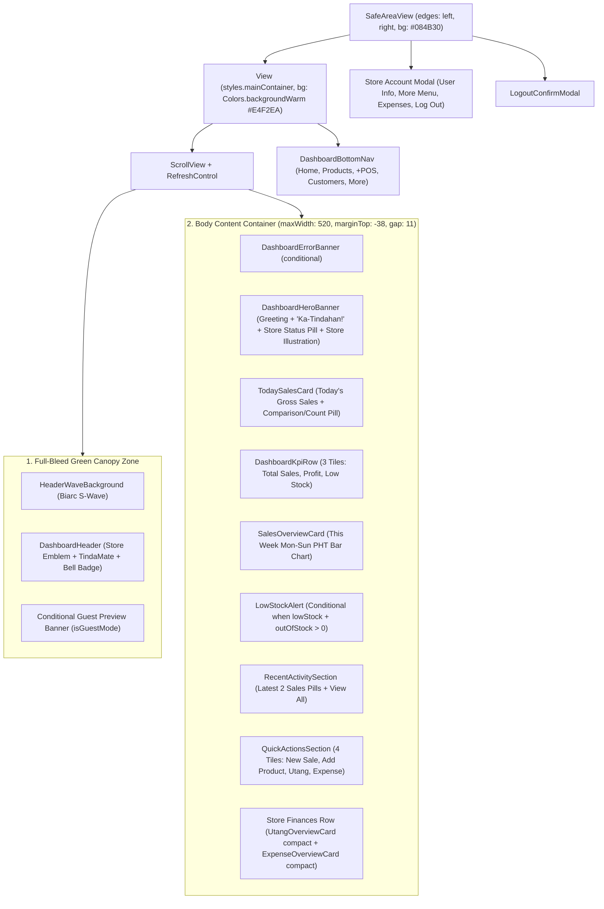

# TindaMate — Dashboard UI/UX Audit & Implementation Plan

**Project:** TindaMate — *Your Digital Tindahan Assistant*  
**Module Audited:** Main Authenticated & Guest Dashboard (`src/app/home.tsx`, `src/components/dashboard/*`, and supporting financial/inventory services)  
**Audit Date:** November 17, 2026  
**Role:** Senior Mobile Product Designer, UI/UX Auditor, React Native Engineer & Fintech Dashboard Specialist  
**Task Mode:** Strictly Read-Only Audit & Implementation Planning (Zero application source code files modified)

---

## 1. Executive Summary

### 1.1 Overall Assessment
The TindaMate Dashboard ([src/app/home.tsx](file:///c:/TindaMate/src/app/home.tsx)) serves as the primary operational command center for sari-sari store owners. It already features a recognizable deep forest green S-wave canopy header (`HeaderWaveBackground` + `DashboardHeader`), a friendly Pinoy-fintech store greeting (`DashboardHeroBanner`), a prominent `"Today's Sales"` hero card (`TodaySalesCard`), a 3-tile KPI strip (`DashboardKpiRow`), a PHT-aligned weekly sales bar chart (`SalesOverviewCard`), a conditional low-stock warning banner (`LowStockAlert`), a recent sales feed (`RecentActivitySection`), a 4-tile shortcut strip (`QuickActionsSection`), and a bottom pair of compact Utang and Expense cards (`UtangOverviewCard` and `ExpenseOverviewCard`).

However, a deep code-level financial and usability audit reveals **critical financial presentation flaws, mixed date horizons across adjacent KPI tiles, silent fallback of Gross Profit to Gross Sales Revenue, discarded incomplete-cost (`hasIncompleteCosts`) warnings, omitted Net Profit and COGS breakdowns, inconsistent low/out-of-stock counts, and sticky `#000000` black hover borders** that undermine financial clarity and visual polish.

### 1.2 Existing Dashboard Strengths (Verified in Code)
1. **Resilient Parallel Data Orchestration:** `loadDashboardData()` ([src/app/home.tsx](file:///c:/TindaMate/src/app/home.tsx#L187-L246)) uses `Promise.allSettled` across 6 store-scoped queries so a single failing metric (e.g., Utang or Expenses) degrades gracefully without crashing the entire Dashboard.
2. **PHT-Accurate Weekly Sales Bucketing:** Following Batch 10B-5, the `"Sales Overview"` bar chart ([src/app/home.tsx](file:///c:/TindaMate/src/app/home.tsx#L544-L565)) uses `getReportingPeriodRange('week')` and `computeSalesBuckets(allStoreSales, 'week', ...)` evaluated strictly in `Asia/Manila` (`UTC+08:00`) with zero fabricated historical data.
3. **Recognizable Brand Identity:** The custom storefront emblem (`DashboardHeader`), `"Ka-Tindahan!"` greeting (`DashboardHeroBanner`), and floating capsule navigation bar (`DashboardBottomNav`) establish a warm, commercial sari-sari store identity.
4. **Actionable Stock Alert Deep-Linking:** Tapping the notification bell ([src/app/home.tsx](file:///c:/TindaMate/src/app/home.tsx#L691-L707)) or `LowStockAlert` ([src/app/home.tsx](file:///c:/TindaMate/src/app/home.tsx#L837-L845)) deep-links directly into `/products` with the appropriate `filter` param (`Low Stock` or `Out of Stock`).

### 1.3 Most Important Financial & UI/UX Problems Identified
1. **CRITICAL FINANCIAL BUG — Silent Fallback Equating Sales Revenue to Profit ([src/app/home.tsx](file:///c:/TindaMate/src/app/home.tsx#L108), [L217-L221](file:///c:/TindaMate/src/app/home.tsx#L217-L221), [L599-L601](file:///c:/TindaMate/src/app/home.tsx#L599-L601)):**
   - Line 601 computes `formatPesoCurrency(todayGrossProfit ?? todaySalesSummary.totalAmount)`. Whenever `fetchStoreCOGSSummary` fails or returns `null`, **the Dashboard silently displays 100% of Today's Gross Sales Revenue as `"Profit"`**!
   - Furthermore, `home.tsx` discards `cogsRes.value.hasIncompleteCosts`, `cogsRes.value.cogs`, and `cogsRes.value.untrackedCostItemCount`, violating the **Incomplete Cost Safety Rule** in [src/types/profit.ts](file:///c:/TindaMate/src/types/profit.ts#L18-L21) (*"When `hasIncompleteCosts` is true... Gross Profit must be presented as an estimate rather than exact"*).
2. **CRITICAL FINANCIAL CLARITY FLAW — Mixed Time Horizons & Ambiguous Labels in `DashboardKpiRow` ([src/app/home.tsx](file:///c:/TindaMate/src/app/home.tsx#L185-L196), [L771-L779](file:///c:/TindaMate/src/app/home.tsx#L771-L779)):**
   - Tile 1 is labeled `"Total Sales"` but passes `allStoreSales.length` (which is **This Week's** transaction count, because `allStoreSales` is fetched with `weekRange` at lines 193–196!).
   - Tile 2 is labeled `"Profit"` and displays **Today's Gross Profit** (before operating expenses), with no distinction between Gross Profit, COGS, Expenses, or Net Profit.
   - Tile 3 is labeled `"Low Stock"` and passes only `lowStockCount` (ignoring `outOfStockCount`), so a store with `0` low-stock items and `4` out-of-stock items shows **`0`** on Tile 3 while the notification bell badge shows **`4`** and `LowStockAlert` shows **`"4 Products Out of Stock"`**!
3. **CRITICAL DATE BOUNDARY & MONDAY COMPARISON BUG ([src/app/home.tsx](file:///c:/TindaMate/src/app/home.tsx#L174-L183), [L197](file:///c:/TindaMate/src/app/home.tsx#L197), [L574-L589](file:///c:/TindaMate/src/app/home.tsx#L574-L589)):**
   - `fetchStoreCOGSSummary` is called with device-local `startOfToday` and no `endDate` ([line 197](file:///c:/TindaMate/src/app/home.tsx#L197)), whereas `fetchDashboardSalesData()` uses PHT `getReportingPeriodRange('today')` (`startTimestampISO` and `endTimestampISO`).
   - On Mondays (`todayBucketIdx === 0`), `yesterdayBucketIdx = (0 + 6) % 7 = 6` ([line 575](file:///c:/TindaMate/src/app/home.tsx#L575)) indexes **upcoming Sunday of the current week** instead of yesterday!
4. **Buried Financial Cards (`UtangOverviewCard` & `ExpenseOverviewCard`) & Missing COGS / Net Profit Context ([src/app/home.tsx](file:///c:/TindaMate/src/app/home.tsx#L885-L917)):**
   - Utang and Expenses are placed at the very bottom of the scroll view without a section header, without period labels on compact cards (`"Expenses"` doesn't say `"Today"`), using the wrong icon on `ExpenseOverviewCard` (`NavMoreIcon` 2x2 grid icon at [line 81](file:///c:/TindaMate/src/components/dashboard/ExpenseOverviewCard.tsx#L81)), and with no view of Today's Tracked COGS or Today's Estimated Net Profit (`Gross Profit - Today's Expenses`).
5. **Harsh `#000000` Black Hover Borders Across All Dashboard Cards:**
   - Every dashboard component (`TodaySalesCard`, `DashboardKpiRow`, `SalesOverviewCard`, `LowStockAlert`, `RecentActivitySection`, `QuickActionTile`, `UtangOverviewCard`, `ExpenseOverviewCard`) sets `borderColor: '#000000'` on `isHovered`. On touch screens and mobile web, tapping latches `isHovered = true`, leaving a harsh black border around cards.

---

## 2. Current Dashboard Implementation Overview

### 2.1 Files Inspected

| File Path | Lines | Responsibility |
| :--- | :---: | :--- |
| [src/app/home.tsx](file:///c:/TindaMate/src/app/home.tsx) | 1,256 | Main Dashboard route (`/home`); session check, guest mode, parallel data fetching, section layout, Store Account modal, Logout modal |
| [src/components/dashboard/DashboardHeader.tsx](file:///c:/TindaMate/src/components/dashboard/DashboardHeader.tsx) | 182 | Top bar inside green canopy: Storefront emblem, `TindaMate` wordmark, tagline, and notification bell with red badge |
| [src/components/dashboard/HeaderWaveBackground.tsx](file:///c:/TindaMate/src/components/dashboard/HeaderWaveBackground.tsx) | 200 | Pure React Native C1 tangent biarc S-wave green canopy background |
| [src/components/dashboard/DashboardHeroBanner.tsx](file:///c:/TindaMate/src/components/dashboard/DashboardHeroBanner.tsx) | 201 | Time-of-day greeting, `"Ka-Tindahan!"` headline, `"Store Open • Today's summary"` pill, and `DashboardMarketIllustration` |
| [src/components/dashboard/DashboardMarketIllustration.tsx](file:///c:/TindaMate/src/components/dashboard/DashboardMarketIllustration.tsx) | 520 | Pure React Native vector illustration of a sari-sari store storefront |
| [src/components/dashboard/TodaySalesCard.tsx](file:///c:/TindaMate/src/components/dashboard/TodaySalesCard.tsx) | 203 | Primary hero KPI card displaying Today's Sales amount and comparison/count pill |
| [src/components/dashboard/DashboardKpiRow.tsx](file:///c:/TindaMate/src/components/dashboard/DashboardKpiRow.tsx) | 178 | 3-column compact KPI row (`Total Sales`, `Profit`, `Low Stock`) |
| [src/components/dashboard/SalesOverviewCard.tsx](file:///c:/TindaMate/src/components/dashboard/SalesOverviewCard.tsx) | 363 | Weekly (`Mon–Sun`) bar chart with 4-step Y-axis, grid lines, and tap callout bubble |
| [src/components/dashboard/LowStockAlert.tsx](file:///c:/TindaMate/src/components/dashboard/LowStockAlert.tsx) | 153 | Conditional peach/amber warning banner when `lowStockCount + outOfStockCount > 0` |
| [src/components/dashboard/RecentActivitySection.tsx](file:///c:/TindaMate/src/components/dashboard/RecentActivitySection.tsx) | 315 | Displays up to 2 recent sales (`sales.slice(0, 2)`) with `View All →` link to `/sales/history` |
| [src/components/dashboard/QuickActionsSection.tsx](file:///c:/TindaMate/src/components/dashboard/QuickActionsSection.tsx) | 61 | Section wrapper for the 4 Quick Action tiles |
| [src/components/dashboard/QuickActionTile.tsx](file:///c:/TindaMate/src/components/dashboard/QuickActionTile.tsx) | 182 | Individual quick action tile (`New Sale`, `Add Product`, `Utang`, `Expense`) |
| [src/components/dashboard/UtangOverviewCard.tsx](file:///c:/TindaMate/src/components/dashboard/UtangOverviewCard.tsx) | 509 | Utang summary card (supports `compact` and full modes; rendered in `compact` mode on `/home`) |
| [src/components/dashboard/ExpenseOverviewCard.tsx](file:///c:/TindaMate/src/components/dashboard/ExpenseOverviewCard.tsx) | 523 | Expense summary card (supports `compact` and full modes; rendered in `compact` mode on `/home`) |
| [src/components/dashboard/DashboardBottomNav.tsx](file:///c:/TindaMate/src/components/dashboard/DashboardBottomNav.tsx) | 297 | Persistent floating capsule bottom navigation bar (`Home`, `Products`, `POS`, `Customers`, `More`) |
| [src/components/dashboard/DashboardErrorBanner.tsx](file:///c:/TindaMate/src/components/dashboard/DashboardErrorBanner.tsx) | 125 | Dismissible error banner with `Retry` button |
| [src/components/dashboard/DashboardNavIcons.tsx](file:///c:/TindaMate/src/components/dashboard/DashboardNavIcons.tsx) | 1,440 | Vector icon primitives used across Dashboard and navigation |
| [src/components/dashboard/StoreOverviewCard.tsx](file:///c:/TindaMate/src/components/dashboard/StoreOverviewCard.tsx) | 255 | Legacy/unused pastel overview card component (not imported in `home.tsx`) |
| [src/lib/sales.ts](file:///c:/TindaMate/src/lib/sales.ts), [src/lib/products.ts](file:///c:/TindaMate/src/lib/products.ts), [src/lib/customers.ts](file:///c:/TindaMate/src/lib/customers.ts), [src/lib/expenses.ts](file:///c:/TindaMate/src/lib/expenses.ts), [src/lib/profit.ts](file:///c:/TindaMate/src/lib/profit.ts), [src/lib/chartBuckets.ts](file:///c:/TindaMate/src/lib/chartBuckets.ts), [src/lib/pht.ts](file:///c:/TindaMate/src/lib/pht.ts) | — | Authoritative domain services and calculation helpers |
| [src/constants/theme.ts](file:///c:/TindaMate/src/constants/theme.ts) | 461 | Centralized Design 2.0 tokens |

---

## 3. Route and Component Architecture

### 3.1 Route Entry Point
- **Route:** `/home` ([src/app/home.tsx](file:///c:/TindaMate/src/app/home.tsx)), registered in [src/app/_layout.tsx](file:///c:/TindaMate/src/app/_layout.tsx#L102).
- **Authentication & Guest Mode:**
  - Checks `supabase.auth.getSession()` on mount ([lines 272–317](file:///c:/TindaMate/src/app/home.tsx#L272-L317)).
  - Redirects unauthenticated users to `/` unless `?guest=1` (`isGuestMode`) is present.
  - Refreshes all metrics on screen focus via `useFocusEffect` ([lines 344–350](file:///c:/TindaMate/src/app/home.tsx#L344-L350)) and on pull-to-refresh via `handleRefresh` ([lines 363–396](file:///c:/TindaMate/src/app/home.tsx#L363-L396)).

### 3.2 Component Hierarchy Diagram



---

## 4. Data Sources and Dependencies

When `loadDashboardData()` executes ([src/app/home.tsx](file:///c:/TindaMate/src/app/home.tsx#L144-L266)), it runs **6 parallel promises** via `Promise.allSettled`:

| # | Service Function | Source File | Database Tables / Views / RPCs | Data Returned | Period Scope Used in `home.tsx` |
| :---: | :--- | :--- | :--- | :--- | :--- |
| **1** | `fetchStoreProductSummary()` | [src/lib/products.ts](file:///c:/TindaMate/src/lib/products.ts#L499-L518) | `public.products` | `{ totalProducts, inStockCount, lowStockCount, outOfStockCount }` | Live current inventory snapshot |
| **2** | `fetchDashboardSalesData()` | [src/lib/sales.ts](file:///c:/TindaMate/src/lib/sales.ts#L1265-L1324) | `public.sales` | `{ todaySummary: { totalAmount, transactionCount }, recentSales: Sale[5] }` | `todaySummary`: Today in PHT (`getReportingPeriodRange('today')`); `recentSales`: Latest 5 sales |
| **3** | `fetchDashboardUtangSummary()` | [src/lib/customers.ts](file:///c:/TindaMate/src/lib/customers.ts#L952-L1024) | `public.customer_credit_summaries`, `public.credit_transactions` | `{ totalOutstandingUtang, customersWithBalanceCount, todayPaymentsTotal }` | `totalOutstandingUtang`: Current open balance; `todayPaymentsTotal`: Today (`startOfToday`) |
| **4** | `fetchDashboardExpenseSummary()` | [src/lib/expenses.ts](file:///c:/TindaMate/src/lib/expenses.ts#L550-L583) | `public.expenses` | `{ totalExpenses, expenseCount }` | Today (`expense_date = getTodayDateISO()`) |
| **5** | `fetchStoreSales(start, end)` | [src/lib/sales.ts](file:///c:/TindaMate/src/lib/sales.ts) | `public.sales` | `Sale[]` | This Week in PHT (`getReportingPeriodRange('week')`) |
| **6** | `fetchStoreCOGSSummary({ startDate })` | [src/lib/profit.ts](file:///c:/TindaMate/src/lib/profit.ts#L211-L250) | RPC `public.get_store_cogs_summary` | `COGSSummary` (`revenue`, `cogs`, `grossProfit`, `hasIncompleteCosts`, `untrackedCostItemCount`, etc.) | Device-local `startOfToday` (missing `endDate` and not using PHT `getReportingPeriodRange('today')`) |

---

## 5. Existing Dashboard Features Inventory

| Section / Feature | Exists on Dashboard? | Current Implementation Details |
| :--- | :---: | :--- |
| **Welcome Header & Store Identity** | **Yes** | `DashboardHeader` (Emblem + `TindaMate` + Bell) + `DashboardHeroBanner` (`Good morning/afternoon/evening, Ka-Tindahan!` + `Store Open • Today's summary` pill + Storefront illustration). Note: Ignores user's actual `store_name` metadata. |
| **Today's Sales Summary** | **Yes** | `TodaySalesCard` displays `todaySalesSummary.totalAmount` and a right pill showing either `%` diff vs. yesterday or `${transactionCount} sales`. |
| **Sales Performance Chart** | **Yes** | `SalesOverviewCard` displays a 7-bar `Mon–Sun` chart for `This Week` in PHT with tap-to-inspect callout bubbles. |
| **Inventory Summary** | **Partial** | `DashboardKpiRow` Tile 3 shows `lowStockCount` (`Low Stock`). However, `totalProducts`, `inStockCount`, and `outOfStockCount` (already fetched in `productSummary`!) are hidden from the KPI tiles. |
| **Low-Stock & Out-of-Stock Alerts** | **Yes** | `LowStockAlert` banner renders when `lowStockCount + outOfStockCount > 0`, and `DashboardHeader` bell badge shows `lowStockCount + outOfStockCount`. |
| **Customer Utang Summary** | **Yes (Buried)** | `UtangOverviewCard` (`compact` mode) at the bottom of the scroll view shows `totalOutstandingUtang`, `${customersWithBalanceCount} debtors`, and `+{todayPaymentsTotal}`. |
| **Customer Payment Information** | **Partial** | Shown only as `+{paymentsLabel}` in the bottom-right corner of the compact `UtangOverviewCard` when `todayPaymentsTotal > 0`, without a `"today"` label. |
| **Expenses Summary** | **Yes (Buried)** | `ExpenseOverviewCard` (`compact` mode) at the bottom of the scroll view shows today's `totalExpenses` and `${expenseCount} entries`. |
| **COGS Information** | **No (Fetched but Discarded)** | `fetchStoreCOGSSummary` returns `cogs`, `trackedCostItemCount`, `untrackedCostItemCount`, and `hasIncompleteCosts`, but `home.tsx` only saves `grossProfit` and discards the rest! |
| **Net Profit Information** | **No** | Not computed or displayed on `/home` (even though both Today's `grossProfit` and Today's `totalExpenses` are already fetched in `loadDashboardData`!). |
| **Recent Sales / Transactions** | **Yes (Truncated to 2)** | `RecentActivitySection` renders only `sales.slice(0, 2)` out of the 5 fetched recent sales. |
| **Quick Actions** | **Yes** | `QuickActionsSection` renders 4 tiles: `New Sale`, `Add Product`, `Utang`, `Expense`. |

---

## 6. Financial Information Audit (Critical Analysis)

### 6.1 Silent Substitution of Gross Sales Revenue for Profit (Critical Defect)
- **Location:** [src/app/home.tsx](file:///c:/TindaMate/src/app/home.tsx#L108), [L217-L221](file:///c:/TindaMate/src/app/home.tsx#L217-L221), [L599-L601](file:///c:/TindaMate/src/app/home.tsx#L599-L601)
- **Code Evidence:**
  ```tsx
  const profitValueDisplay = isGuestMode
    ? '₱0.00'
    : formatPesoCurrency(todayGrossProfit ?? todaySalesSummary.totalAmount);
  ```
- **Audit Finding:**
  1. When `fetchStoreCOGSSummary` fails or rejects (`todayGrossProfit === null`), `todayGrossProfit ?? todaySalesSummary.totalAmount` evaluates to `todaySalesSummary.totalAmount` (**100% of gross sales revenue**). Presenting gross revenue as `"Profit"` violates core accounting truth and misleads the store owner into believing they earned 100% margin.
  2. When `todayGrossProfit === null` (unavailable), the UI must display `'—'` or `'Unavailable'` instead of fabricating profit from sales revenue.

### 6.2 Discarded Incomplete-Cost (`hasIncompleteCosts`) & Tracked COGS Metadata
- **Location:** [src/app/home.tsx](file:///c:/TindaMate/src/app/home.tsx#L108), [L217-L221](file:///c:/TindaMate/src/app/home.tsx#L217-L221) vs. [src/types/profit.ts](file:///c:/TindaMate/src/types/profit.ts#L18-L44)
- **Code Evidence:**
  - `fetchStoreCOGSSummary` returns a full `COGSSummary` object (`{ revenue, cogs, grossProfit, saleItemCount, trackedCostItemCount, untrackedCostItemCount, untrackedQuantity, hasIncompleteCosts }`).
  - `home.tsx` stores only `const [todayGrossProfit, setTodayGrossProfit] = useState<number | null>(null)` and discards the rest of `COGSSummary`.
- **Audit Finding:**
  - If a vendor sells 5 products today and 2 of those products had no `cost_price` recorded (`cost_price IS NULL`), `get_store_cogs_summary` sets `hasIncompleteCosts = true` and `untrackedCostItemCount = 2`.
  - On `/reports`, this triggers an explicit `"Est. Gross Profit"` / incomplete-cost warning. On `/home`, it is presented unconditionally as `"Profit"` with no indication that some sold items lacked cost prices.

### 6.3 Gross Profit vs. Operating Expenses vs. Net Profit Clarity
- **Location:** [src/app/home.tsx](file:///c:/TindaMate/src/app/home.tsx#L777), [L885-L917](file:///c:/TindaMate/src/app/home.tsx#L885-L917)
- **Audit Finding:**
  - `loadDashboardData()` already fetches **Today's Gross Profit** (`cogsSummary.grossProfit = Revenue - Tracked COGS`) AND **Today's Operating Expenses** (`expenseSummary.totalExpenses`).
  - Yet Tile 2 in `DashboardKpiRow` is vaguely labeled `"Profit"` (which is actually *Today's Gross Profit* before expenses), while Today's Operating Expenses (`₱450.00`) sits detached at the bottom of the screen.
  - By storing the full `todayCogsSummary: COGSSummary | null` state in `home.tsx`, the Dashboard can transparently communicate:
    - **Today's Gross Profit** (`Est. Gross Profit` when `hasIncompleteCosts` is true)
    - **Today's Tracked COGS** (`cogsSummary.cogs`)
    - **Today's Operating Expenses** (`expenseSummary.totalExpenses`)
    - **Today's Net Profit** (`grossProfit - totalExpenses`, using centavo-safe subtraction matching [src/app/reports.tsx](file:///c:/TindaMate/src/app/reports.tsx#L248-L256)), with an explicit warning badge whenever `hasIncompleteCosts` is true!

### 6.4 Timezone & Date Horizon Mismatches Across Today's Metrics
- **Location:** [src/app/home.tsx](file:///c:/TindaMate/src/app/home.tsx#L174-L198), [L573-L589](file:///c:/TindaMate/src/app/home.tsx#L573-L589), [L772-L776](file:///c:/TindaMate/src/app/home.tsx#L772-L776)
- **Audit Findings:**
  1. **COGS Query Timezone Drift ([lines 175–183, 197](file:///c:/TindaMate/src/app/home.tsx#L175-L183)):** `home.tsx` uses `new Date(now.getFullYear(), now.getMonth(), now.getDate(), 0, 0, 0, 0)` (device timezone, no `endDate`) for `fetchStoreCOGSSummary`, whereas `fetchDashboardSalesData()` uses `getReportingPeriodRange('today')` (`Asia/Manila` PHT start and end ISO strings). `home.tsx` should pass `const todayRange = getReportingPeriodRange('today')` (`{ startDate: todayRange.startTimestampISO, endDate: todayRange.endTimestampISO }`) to `fetchStoreCOGSSummary` so Today's Sales and Today's COGS/Gross Profit use the exact same PHT time window.
  2. **Monday "Yesterday" Comparison Bug ([lines 574–585](file:///c:/TindaMate/src/app/home.tsx#L574-L585)):**
     ```tsx
     const yesterdayBucketIdx = (todayBucketIdx + 6) % 7;
     const yesterdayBarAmount = weeklyBars[yesterdayBucketIdx]?.amount ?? 0;
     ```
     Because `weeklyBars` contains `Mon (0)` through `Sun (6)` of the **current week**, when today is Monday (`todayBucketIdx === 0`), `yesterdayBucketIdx` evaluates to `6` (**upcoming Sunday of the current week**), not last Sunday! Comparison against `weeklyBars[todayBucketIdx - 1]` is only valid when `todayBucketIdx > 0` (Tuesday–Sunday); on Monday (`todayBucketIdx === 0`), the badge should cleanly display `${todaySalesSummary.transactionCount} sales today`.
  3. **Mislabeled Weekly Count in `DashboardKpiRow` Tile 1 ([lines 772–776](file:///c:/TindaMate/src/app/home.tsx#L772-L776)):**
     Tile 1 is labeled `"Total Sales"` and passes `allStoreSales.length > 0 ? allStoreSales.length : todaySalesSummary.transactionCount`. Because `allStoreSales` is scoped to `weekRange` ([lines 193–196](file:///c:/TindaMate/src/app/home.tsx#L193-L196)), this number is actually **This Week's Sales Count** (or Today's Sales Count if all three tiles are aligned to Today).

---

## 7. UI/UX Findings (Screen & Component Evaluation)

### Finding U-1: Sticky `#000000` Black Hover Borders Across All 8 Dashboard Components
- **Severity:** **High (Visual Consistency & Mobile Touch Bug)**
- **Locations:**
  - [TodaySalesCard.tsx](file:///c:/TindaMate/src/components/dashboard/TodaySalesCard.tsx#L106-L108) (`cardHovered: { borderColor: '#000000' }`)
  - [DashboardKpiRow.tsx](file:///c:/TindaMate/src/components/dashboard/DashboardKpiRow.tsx#L155-L157) (`cardHovered: { borderColor: '#000000' }`)
  - [SalesOverviewCard.tsx](file:///c:/TindaMate/src/components/dashboard/SalesOverviewCard.tsx#L203-L205) (`sectionContainerHovered: { borderColor: '#000000' }`)
  - [LowStockAlert.tsx](file:///c:/TindaMate/src/components/dashboard/LowStockAlert.tsx#L93-L95) (`cardHovered: { borderColor: '#000000' }`)
  - [RecentActivitySection.tsx](file:///c:/TindaMate/src/components/dashboard/RecentActivitySection.tsx#L235-L237) (`salePillRowHovered: { borderColor: '#000000' }`)
  - [QuickActionTile.tsx](file:///c:/TindaMate/src/components/dashboard/QuickActionTile.tsx#L151-L153) (`tileHovered: { borderColor: '#000000' }`)
  - [UtangOverviewCard.tsx](file:///c:/TindaMate/src/components/dashboard/UtangOverviewCard.tsx#L268-L270) (`compactCardHovered: { borderColor: '#000000' }`)
  - [ExpenseOverviewCard.tsx](file:///c:/TindaMate/src/components/dashboard/ExpenseOverviewCard.tsx#L276-L278) (`compactCardHovered: { borderColor: '#000000' }`)
- **Problem:** Pure black (`#000000`) borders do not exist anywhere in `src/constants/theme.ts` and clash with TindaMate's emerald/slate palette. Worse, on touch devices and mobile web, tapping a `Pressable` triggers `onHoverIn` without `onHoverOut`, leaving tapped cards permanently outlined in harsh black.
- **Recommendation:** Replace harsh `#000000` hover borders with semantic brand borders (`Colors.primaryBorder` / `Colors.borderStrong`) or clean `pressed` feedback matching the Sales and Customers modules.

### Finding U-2: Inventory KPI Tile Excludes Out-of-Stock Items & Hides Total SKU Count
- **Severity:** **High (Operational Clarity)**
- **Location:** [src/app/home.tsx](file:///c:/TindaMate/src/app/home.tsx#L538-L541), [L778](file:///c:/TindaMate/src/app/home.tsx#L778); [src/components/dashboard/DashboardKpiRow.tsx](file:///c:/TindaMate/src/components/dashboard/DashboardKpiRow.tsx#L116-L123)
- **Problem:**
  - `productSummary` contains `{ totalProducts, inStockCount, lowStockCount, outOfStockCount }`.
  - The notification bell (`line 690`) and `LowStockAlert` (`line 540`) use `alertProductCount = lowStockCount + outOfStockCount`.
  - However, `DashboardKpiRow` Tile 3 only receives `lowStockCount` (`line 778`). If 3 products are completely `Out of Stock` (`stock_quantity === 0`) and 0 products are `Low Stock`, Tile 3 displays **`0 Low Stock`** while `LowStockAlert` directly below it displays **`3 Products Out of Stock`**!
  - Furthermore, `LowStockAlert` ([src/components/dashboard/LowStockAlert.tsx](file:///c:/TindaMate/src/components/dashboard/LowStockAlert.tsx#L33-L36)) only mentions `lowStockCount` when both `lowStockCount > 0` and `outOfStockCount > 0` (e.g., if 2 are low stock and 3 are out of stock, it says `"2 Products Running Low"` and omits the 3 out-of-stock products!).
- **Recommendation:**
  - Pass `alertProductCount` (`lowStockCount + outOfStockCount`) and `totalProducts` context to `DashboardKpiRow` (e.g., `"Stock Alerts"` or `"Low / Out"` with sub-caption `${totalProducts} total items`), and update `LowStockAlert` to mention both counts when both exist (`"2 Low Stock • 3 Out of Stock"`).

### Finding U-3: Store Finances (`Utang` & `Expenses`) Are Buried at the Bottom Without Section Header, Period Clarity, or Net Profit / COGS Summary
- **Severity:** **High (Financial Hierarchy)**
- **Location:** [src/app/home.tsx](file:///c:/TindaMate/src/app/home.tsx#L885-L917), [UtangOverviewCard.tsx](file:///c:/TindaMate/src/components/dashboard/UtangOverviewCard.tsx#L62-L122), [ExpenseOverviewCard.tsx](file:///c:/TindaMate/src/components/dashboard/ExpenseOverviewCard.tsx#L64-L126)
- **Problem:**
  1. `storeFinancesRow` sits at the very bottom of the screen with no section heading (`SectionHeader` from `src/components/ui/SectionHeader.tsx` is unused).
  2. `ExpenseOverviewCard` uses `<NavMoreIcon size={13} color="#EF4444" />` (the 2x2 Bento grid "More" icon!) instead of an expense icon, and its compact title `"Expenses"` does not indicate that the figure is **Today's** expenses (`Today's Outlay`), while `UtangOverviewCard` next to it shows **All-Time Outstanding Utang** plus `+{paymentsLabel}` (`Collected today`).
  3. There is no summary showing how **Today's Sales Revenue**, **Today's Tracked COGS**, **Today's Gross Profit**, and **Today's Expenses** combine into **Today's Net Profit**.

### Finding U-4: Quick Actions Duplicate Bottom Nav Tabs & Miss High-Value Direct Workflows (`+ Add Expense`, `+ Add Customer`, `Reports`)
- **Severity:** **Medium (Navigation Efficiency)**
- **Location:** [src/app/home.tsx](file:///c:/TindaMate/src/app/home.tsx#L604-L658)
- **Problem:**
  - Tile 1 (`New Sale` $\rightarrow$ `/sales`) and Tile 3 (`Utang` $\rightarrow$ `/customers`) duplicate the primary bottom navigation bar (`+` POS center button and `Customers` tab) that is permanently pinned 100dp below them.
  - Tile 4 (`id: 'add_expense'`, labeled `Expense`) navigates to `/expenses` (the list screen) instead of `/expenses/add` (the Add Expense form), whereas Tile 2 (`Add Product`) navigates directly to `/products/add`.
  - Meanwhile, **Reports (`/reports`)** is hidden inside the `More` menu (`2` taps away), and **Add Customer (`/customers/add`)** requires navigating to `/customers` first.
- **Recommendation:** Make the Quick Actions strip genuinely action-oriented and non-redundant:
  1. **New Sale** (`/sales` — primary orange CTA)
  2. **Add Product** (`/products/add`)
  3. **Add Expense** (`/expenses/add` — direct form entry matching `Add Product`)
  4. **Reports** (`/reports` — direct access to analytics, COGS, and profit reports) or **Add Customer** (`/customers/add`).

### Finding U-5: `RecentActivitySection` Discards 3 of 5 Fetched Sales & Omits Item Count / Customer Context
- **Severity:** **Medium (Information Density & Scannability)**
- **Location:** [src/components/dashboard/RecentActivitySection.tsx](file:///c:/TindaMate/src/components/dashboard/RecentActivitySection.tsx#L90-L165)
- **Problem:**
  - `fetchDashboardSalesData()` fetches the latest `5` sales, but `RecentActivitySection` renders `sales.slice(0, 2)` (only 2 rows).
  - Each row renders a single inline string (`{titleLabel} • {formattedTotal}`) where `titleLabel` is truncated before the bullet, and neither multi-item count (`item_count`) nor `customer_name` (for Utang sales) is shown.
- **Recommendation:** Display up to `3` recent sales (or `3–4`), and use a clean two-part row layout: Left icon + Title & subtitle (`customer_name` for Utang or `${item_count} items` + relative time) on the left, and right-aligned `tabular-nums` Peso amount + `Utang` / `Cash` badge on the right.

### Finding U-6: Ignored `storeName` / `displayName` Props in `DashboardHeroBanner` & Hardcoded Store Name
- **Severity:** **Low–Medium (Personalization & Polish)**
- **Location:** [src/app/home.tsx](file:///c:/TindaMate/src/app/home.tsx#L745-L749), [src/components/dashboard/DashboardHeroBanner.tsx](file:///c:/TindaMate/src/components/dashboard/DashboardHeroBanner.tsx#L16-L20), [L49-L60](file:///c:/TindaMate/src/components/dashboard/DashboardHeroBanner.tsx#L49-L60)
- **Problem:**
  - `home.tsx` passes `displayName={displayName}` and `storeName="TindaMate Store"` to `DashboardHeroBanner`, but `DashboardHeroBanner` ignores both props!
  - `DashboardHeroBanner.getGreeting()` uses `new Date().getHours()` (device local time) instead of `getPHTParts(new Date()).hour` (`Asia/Manila`).
  - If the authenticated user has `user_metadata.store_name` or `business_name` (as read in `MoreScreen` [src/app/more.tsx](file:///c:/TindaMate/src/app/more.tsx#L87-L92)), showing their store name in the status pill (`"● [Store Name] • Today's summary"`) and Store Account modal makes the dashboard feel personally tailored to their tindahan.

### Finding U-7: Excessive Staggered Entrance Animations (`FadeInDown` Up to ~1 Second Delay)
- **Severity:** **Low (Perceived Performance)**
- **Location:** [src/app/home.tsx](file:///c:/TindaMate/src/app/home.tsx#L744), [L753](file:///c:/TindaMate/src/app/home.tsx#L753), [L770](file:///c:/TindaMate/src/app/home.tsx#L770), [L815](file:///c:/TindaMate/src/app/home.tsx#L815), [L833](file:///c:/TindaMate/src/app/home.tsx#L833), [L851](file:///c:/TindaMate/src/app/home.tsx#L851), [L878](file:///c:/TindaMate/src/app/home.tsx#L878), [L886](file:///c:/TindaMate/src/app/home.tsx#L886)
- **Problem:** Stacking 8 `FadeInDown` animations with cumulative delays up to `560ms` + `420ms` duration (`980ms` total) delays the visibility of below-the-fold cards. Tightening or removing the long delays makes the Dashboard feel snappy and instant.

---

## 8. Design System Compliance (`src/constants/theme.ts`)

| Token Category | Expected (`src/constants/theme.ts`) | Actual Usage in Dashboard (`home.tsx` & `src/components/dashboard/*`) | Compliance Status |
| :--- | :--- | :--- | :--- |
| **Colors** | `Colors.primaryDark` (`#064E3B`), `Colors.primary` (`#0D7A4D`), `Colors.accent` (`#F97316`), `Colors.backgroundWarm` (`#E4F2EA`), `Colors.surface` (`#FFFFFF`), `Colors.border` (`#E2E8F0`) | Hardcodes `#000000` hover borders in 8 files; hardcodes `#FDF7EB` in `home.tsx#L1073`; hardcodes `#EDF4EE`, `#0B6B41`, `#0A3D28` across cards. | **Partial Drift** (`#000000` hover borders and legacy `#FDF7EB` loading bg should be fixed) |
| **Spacing** | `Spacing.three` (`16px` screen padding), `Spacing.twoHalf` (`12px`), `Spacing.four` (`24px`) | `home.tsx#L1114` uses `gap: 11`; `DashboardKpiRow` uses `gap: Spacing.twoHalf` (`12px`). | **Mostly Compliant** |
| **BorderRadius** | `BorderRadius.primaryCard` (`20`), `BorderRadius.card` (`16`), `BorderRadius.md` (`14`), `BorderRadius.pill` (`9999`) | `TodaySalesCard` (`20`), `SalesOverviewCard` (`20`), `DashboardKpiRow` (`16`), `LowStockAlert` (`16`), `RecentActivitySection` (`15`). | **Compliant** |
| **Typography** | `Typography.weights.*`, `fontVariant: ['tabular-nums']` on all financial numbers | `TodaySalesCard.tsx#L179` (`amount`) and `DashboardKpiRow.tsx#L165` (`value`) and `ExpenseOverviewCard.tsx#L455` (`totalExpenseAmount`) **omit `fontVariant: ['tabular-nums']`**! | **Non-Compliant on Primary KPI Amounts** (missing `tabular-nums`) |
| **Shadows** | `Shadows.xs`, `Shadows.sm`, `Shadows.md`, `Shadows.card` | Uses centralized `Shadows.xs`, `Shadows.sm`, `Shadows.md`. | **Compliant** |
| **Icons** | Semantic vector icons from `DashboardNavIcons.tsx` | `ExpenseOverviewCard.tsx#L81, L141` misuses `NavMoreIcon` (2x2 Bento grid icon) for Expenses instead of an expense/outlay icon (`DashboardBadgeVectorIcon type="add_expense"`). | **Non-Compliant in `ExpenseOverviewCard`** |

---

## 9. Recommended Visual Improvements

### 9.1 Dashboard Header & Hero Banner
- Keep the signature Deep Forest Green S-Wave Canopy (`HeaderWaveBackground` + `DashboardHeader`) and `DashboardMarketIllustration`.
- Use PHT hour (`getPHTParts(new Date()).hour`) for the time-of-day greeting in `DashboardHeroBanner`.
- Display the store owner's configured store name (`user.user_metadata?.store_name || user.user_metadata?.business_name || 'Store Open'`) inside the live status pill (`● [Store Name] • Today's summary`).

### 9.2 Today's Sales & 3-Tile KPI Strip (`TodaySalesCard` & `DashboardKpiRow`)
- **Fix Monday Comparison Badge in `TodaySalesCard`:** Only compute day-over-day `%` change from `weeklyBars` when `todayBucketIdx > 0` and `yesterdayBarAmount > 0`; otherwise display `${transactionCount} ${transactionCount === 1 ? 'sale' : 'sales'} today`. Add `fontVariant: ['tabular-nums']` to `TodaySalesCard` amount.
- **Unify `DashboardKpiRow` Time Horizons & Financial Truthfulness:**
  1. **Tile 1 — `This Week Sales` (or `Today's Orders`):** Explicitly label the period so the user never confuses weekly transaction count (`allStoreSales.length`) with today's count or all-time sales (e.g., value: `allStoreSales.length`, label: `"Week's Sales"`, or value: `todaySalesSummary.transactionCount`, label: `"Today's Orders"`).
  2. **Tile 2 — `Gross Profit` / `Est. Gross Profit` (Never Gross Revenue!):**
     - When `todayCogsSummary === null`: display `'—'` with label `"Gross Profit"` (never fall back to `todaySalesSummary.totalAmount`!).
     - When `todayCogsSummary.hasIncompleteCosts === true`: display `~${formatPesoCurrency(todayCogsSummary.grossProfit)}` with label `"Est. Profit*"` so the user immediately knows some sold items lacked cost prices.
     - When `todayCogsSummary.hasIncompleteCosts === false`: display `formatPesoCurrency(todayCogsSummary.grossProfit)` with label `"Gross Profit"`.
  3. **Tile 3 — `Stock Alerts` (Low + Out of Stock):**
     - Display `alertProductCount` (`lowStockCount + outOfStockCount`) instead of only `lowStockCount`, with label `"Stock Alerts"` (or `"All In Stock"` when `0`), so Tile 3 always matches the notification bell and `LowStockAlert` banner!

### 9.3 Store Finances & Profit Breakdown Section (`Utang`, `Expenses`, `COGS` & `Net Profit`)
- Add a clear section header (`Store Finances`) above the financial cards.
- Upgrade the Store Finances area so the store owner has complete, truthful financial visibility without clutter:
  - **Today's Profit & Outlay Summary Strip (or Compact Breakdown):** Clearly show the relationship between **Today's Revenue**, **Tracked COGS**, **Today's Expenses**, and **Today's Net Profit** (`Gross Profit - Today's Expenses`), accompanied by a transparent incomplete-cost notice (`"N sold item(s) missing cost price — tap to view Reports"`) whenever `todayCogsSummary.hasIncompleteCosts` is true.
  - **Side-by-Side `UtangOverviewCard` & `ExpenseOverviewCard`:**
    - In `UtangOverviewCard` (`compact`), clarify the footer: `${customerCountLabel}` on the left and `+{paymentsLabel} today` on the right.
    - In `ExpenseOverviewCard` (`compact`), replace the misused `NavMoreIcon` with `DashboardBadgeVectorIcon type="add_expense"` (or receipt icon), and title the compact card `"Today's Expenses"` so the time horizon is explicit.

### 9.4 Quick Actions & Recent Activity
- **Quick Actions (`QuickActionsSection`):**
  1. `New Sale` $\rightarrow$ `/sales` (Primary Orange CTA)
  2. `Add Product` $\rightarrow$ `/products/add`
  3. `Add Expense` $\rightarrow$ `/expenses/add` (direct creation workflow instead of `/expenses` list)
  4. `Reports` $\rightarrow$ `/reports` (direct 1-tap access to full Profit, COGS, Inventory, and Utang analytics)
- **Recent Activity (`RecentActivitySection`):**
  - Show up to `3` recent sales (instead of `2`).
  - Include customer name on Utang sales (`Utang • Juan Dela Cruz`) or item count (`3 items`) alongside the relative timestamp and `tabular-nums` total amount.

---

## 10. Prioritized Recommendations

### Priority 1 — Critical Usability and Financial Information Issues

#### Recommendation P1-1: Eliminate Silent Revenue-as-Profit Fallback & Surface `COGSSummary` Completeness
- **Current Implementation:** `home.tsx#L108, L217-L221, L599-L601` stores only `todayGrossProfit: number | null` and falls back to `todaySalesSummary.totalAmount` when `todayGrossProfit` is `null`.
- **Identified Issue:** Equates 100% of gross sales revenue to profit when the COGS RPC fails, and hides `hasIncompleteCosts` when sold items have `cost_price = NULL`.
- **Recommended Solution:**
  - Replace `todayGrossProfit` state with `todayCogsSummary: COGSSummary | null` and `cogsError: string | null`.
  - Pass PHT `todayRange.startTimestampISO` and `todayRange.endTimestampISO` (`getReportingPeriodRange('today')`) to `fetchStoreCOGSSummary`.
  - Never fall back to `todaySalesSummary.totalAmount`. If `todayCogsSummary === null`, display `'—'` (`Unavailable`). If `todayCogsSummary.hasIncompleteCosts` is `true`, label the metric `"Est. Profit"` and surface an incomplete-cost indicator.
- **Reason:** Preserves strict accounting truth and complies with `src/types/profit.ts` safety rules.
- **Expected User Benefit:** Store owners never mistake gross sales revenue for profit and are alerted when missing product cost prices affect profit calculations.
- **Exact Affected Files:** [src/app/home.tsx](file:///c:/TindaMate/src/app/home.tsx), [src/components/dashboard/DashboardKpiRow.tsx](file:///c:/TindaMate/src/components/dashboard/DashboardKpiRow.tsx)
- **Dependencies:** None (`fetchStoreCOGSSummary` and `getReportingPeriodRange` already exist).
- **Implementation Complexity:** Low
- **Regression Risks:** None.
- **Acceptance Criteria:** When `todayCogsSummary` is `null`, Profit displays `'—'`; when `hasIncompleteCosts` is `true`, Profit is clearly marked as estimated.

#### Recommendation P1-2: Fix `DashboardKpiRow` Period Labels, Monday Comparison Bug, and Stock Alert Count Discrepancy
- **Current Implementation:**
  - `home.tsx#L575` computes `yesterdayBucketIdx = (todayBucketIdx + 6) % 7`, which points to future Sunday when today is Monday (`todayBucketIdx === 0`).
  - `home.tsx#L772-L779` passes `allStoreSales.length` (weekly count) to `"Total Sales"` and `lowStockCount` (excluding `outOfStockCount`) to `"Low Stock"`.
- **Identified Issue:** Misleading Monday comparison badge, mixed weekly vs. daily KPI labels, and contradictory stock alert counts between Tile 3 (`0`) and `LowStockAlert` (`>0` out of stock).
- **Recommended Solution:**
  - In `home.tsx`, only compute `%` diff vs. yesterday when `todayBucketIdx > 0` and `weeklyBars[todayBucketIdx - 1].amount > 0`.
  - Align `DashboardKpiRow` labels and counts:
    - Tile 1: `Week's Sales` (`allStoreSales.length` transactions this week) or `Today's Sales` (`todaySalesSummary.transactionCount` orders today).
    - Tile 2: `Gross Profit` / `Est. Profit` (Today's Gross Profit with `tabular-nums`).
    - Tile 3: `Stock Alerts` (`alertProductCount = lowStockCount + outOfStockCount`, matching the notification bell and `LowStockAlert` banner).
  - In `LowStockAlert.tsx`, display both counts when both `lowStockCount > 0` and `outOfStockCount > 0` (`"${lowStockCount} Low Stock • ${outOfStockCount} Out of Stock"`).
- **Reason:** Eliminates numerical contradictions between adjacent components on the same screen.
- **Expected User Benefit:** Consistent, trustworthy numbers across the header bell, KPI row, and stock alert banner.
- **Exact Affected Files:** [src/app/home.tsx](file:///c:/TindaMate/src/app/home.tsx), [src/components/dashboard/DashboardKpiRow.tsx](file:///c:/TindaMate/src/components/dashboard/DashboardKpiRow.tsx), [src/components/dashboard/LowStockAlert.tsx](file:///c:/TindaMate/src/components/dashboard/LowStockAlert.tsx)
- **Implementation Complexity:** Low
- **Regression Risks:** None.

---

### Priority 2 — Main Visual & Financial Overview Improvements

#### Recommendation P2-1: Remove Sticky `#000000` Black Hover Borders & Add Missing `tabular-nums`
- **Current Implementation:** All 8 dashboard components set `borderColor: '#000000'` on `isHovered`, and `TodaySalesCard`, `DashboardKpiRow`, and `ExpenseOverviewCard` omit `fontVariant: ['tabular-nums']` on their primary values.
- **Identified Issue:** Tapping cards on mobile/web leaves harsh black borders stuck on screen; currency figures jitter without `tabular-nums`.
- **Recommended Solution:** Remove `#000000` hover borders (use `Colors.primaryBorder` or clean press states) and add `fontVariant: ['tabular-nums']` to all numeric KPI styles.
- **Exact Affected Files:** [TodaySalesCard.tsx](file:///c:/TindaMate/src/components/dashboard/TodaySalesCard.tsx), [DashboardKpiRow.tsx](file:///c:/TindaMate/src/components/dashboard/DashboardKpiRow.tsx), [SalesOverviewCard.tsx](file:///c:/TindaMate/src/components/dashboard/SalesOverviewCard.tsx), [LowStockAlert.tsx](file:///c:/TindaMate/src/components/dashboard/LowStockAlert.tsx), [RecentActivitySection.tsx](file:///c:/TindaMate/src/components/dashboard/RecentActivitySection.tsx), [QuickActionTile.tsx](file:///c:/TindaMate/src/components/dashboard/QuickActionTile.tsx), [UtangOverviewCard.tsx](file:///c:/TindaMate/src/components/dashboard/UtangOverviewCard.tsx), [ExpenseOverviewCard.tsx](file:///c:/TindaMate/src/components/dashboard/ExpenseOverviewCard.tsx)
- **Implementation Complexity:** Low

#### Recommendation P2-2: Elevate Store Finances with Clear Period Labels, Proper Expense Icon & Today's Net Profit / COGS Breakdown
- **Current Implementation:** `UtangOverviewCard` and `ExpenseOverviewCard` sit at the bottom of `home.tsx` without a section header; `ExpenseOverviewCard` uses `NavMoreIcon` (2x2 grid icon) and says `"Expenses"` without `"Today"`; COGS and Net Profit are not shown.
- **Identified Issue:** Users cannot see Today's COGS, Today's Net Profit (`Gross Profit - Today's Expenses`), or whether sold items had incomplete costs without leaving the Dashboard.
- **Recommended Solution:**
  - Add a `"Store Finances"` section header (`SectionHeader` with `"Reports →"` action linking to `/reports`).
  - Add a compact **Today's Profit & COGS Breakdown Card** (showing `Gross Sales`, `Tracked COGS`, `Today's Expenses`, and `Net Profit` / `Est. Net Profit`, plus an incomplete-cost warning pill when `todayCogsSummary?.hasIncompleteCosts` is true).
  - Fix `ExpenseOverviewCard` to use `DashboardBadgeVectorIcon type="add_expense"`, label the compact card `"Today's Expenses"`, and clarify `UtangOverviewCard`'s collected badge as `+{paymentsLabel} today`.
- **Exact Affected Files:** [src/app/home.tsx](file:///c:/TindaMate/src/app/home.tsx), [src/components/dashboard/ExpenseOverviewCard.tsx](file:///c:/TindaMate/src/components/dashboard/ExpenseOverviewCard.tsx), [src/components/dashboard/UtangOverviewCard.tsx](file:///c:/TindaMate/src/components/dashboard/UtangOverviewCard.tsx)
- **Implementation Complexity:** Low–Medium

---

### Priority 3 — Navigation and Interaction Improvements

#### Recommendation P3-1: Optimize Quick Actions (`New Sale`, `Add Product`, `Add Expense`, `Reports`) & Upgrade `RecentActivitySection`
- **Current Implementation:**
  - `QuickActionsSection` in `home.tsx#L604-L658` links `Utang` to `/customers` (duplicating the bottom nav tab) and `Expense` to `/expenses` (list view instead of `/expenses/add`), with no `Reports` tile.
  - `RecentActivitySection.tsx#L90` slices `sales.slice(0, 2)` and omits customer name / item count metadata.
- **Recommended Solution:**
  - Update Quick Actions in `home.tsx`:
    1. `New Sale` $\rightarrow$ `/sales` (Primary Orange)
    2. `Add Product` $\rightarrow$ `/products/add` (Green)
    3. `Add Expense` $\rightarrow$ `/expenses/add` (Green/Orange)
    4. `Reports` $\rightarrow$ `/reports` (Neutral/Blue — with vector chart icon)
  - Update `RecentActivitySection.tsx` to display up to `3` recent sales (`sales.slice(0, 3)`) and show `sale.customer_name` on Utang sales (`Utang • ${sale.customer_name}`) or item count (`${sale.item_count} items`) when `item_count > 1`.
- **Exact Affected Files:** [src/app/home.tsx](file:///c:/TindaMate/src/app/home.tsx), [src/components/dashboard/QuickActionTile.tsx](file:///c:/TindaMate/src/components/dashboard/QuickActionTile.tsx), [src/components/dashboard/RecentActivitySection.tsx](file:///c:/TindaMate/src/components/dashboard/RecentActivitySection.tsx)
- **Implementation Complexity:** Low

---

### Priority 4 — Visual Polish & Responsiveness

#### Recommendation P4-1: PHT Greeting, Dynamic Store Name in `DashboardHeroBanner`, and Snappier Entrance Timing
- **Current Implementation:** `DashboardHeroBanner.tsx` ignores `storeName` and uses device-local `new Date().getHours()`; `home.tsx` uses a `560ms` animation delay and legacy `#FDF7EB` loading background.
- **Recommended Solution:**
  - Use `getPHTParts(new Date()).hour` in `DashboardHeroBanner.tsx` and display `storeName` in the status pill (`"● ${storeName} • Today's summary"`).
  - Read `user?.user_metadata?.store_name || user?.user_metadata?.business_name` in `home.tsx`.
  - Reduce `FadeInDown` delays (`40ms–200ms` max) and align `loadingContainer` background to `Colors.backgroundWarm`.
- **Exact Affected Files:** [src/app/home.tsx](file:///c:/TindaMate/src/app/home.tsx), [src/components/dashboard/DashboardHeroBanner.tsx](file:///c:/TindaMate/src/components/dashboard/DashboardHeroBanner.tsx)
- **Implementation Complexity:** Low

---

## 11. Proposed Implementation Batches

Based on the actual architecture of `src/app/home.tsx` and `src/components/dashboard/*`, the improvements are structured into **3 cohesive, low-risk batches**:

---

### Batch D-1 — Financial Accuracy, KPI Alignment & Profit/COGS Transparency

1. **Scope:** Fix all financial calculation display bugs, timezone boundary drift, Monday comparison bug, stock alert count discrepancy, and introduce transparent Today's Profit / COGS / Expense / Net Profit presentation on the Dashboard.
2. **Objectives:**
   - Replace `todayGrossProfit` state in `home.tsx` with `todayCogsSummary: COGSSummary | null` fetched using PHT `getReportingPeriodRange('today')` (`startTimestampISO`, `endTimestampISO`).
   - Remove the `todayGrossProfit ?? todaySalesSummary.totalAmount` fallback so Gross Sales Revenue is **never** displayed as Profit.
   - Fix the Monday comparison index bug in `home.tsx` (`todayBucketIdx > 0`).
   - Align `DashboardKpiRow` tiles:
     - Tile 1: `Today's Orders` (`todaySalesSummary.transactionCount`) or `Week's Sales` (`allStoreSales.length`) with explicit period label.
     - Tile 2: `Gross Profit` (or `Est. Profit*` when `hasIncompleteCosts` is true; `'—'` when unavailable).
     - Tile 3: `Stock Alerts` (`lowStockCount + outOfStockCount`, matching the notification bell and `LowStockAlert`).
   - Update `LowStockAlert` to display both `lowStockCount` and `outOfStockCount` when both are $> 0$.
   - Add a **Store Finances** section (`SectionHeader` + compact **Today's Profit & COGS Summary Card** + side-by-side `UtangOverviewCard` & `ExpenseOverviewCard`) showing Today's Revenue, Tracked COGS, Today's Expenses, and Today's Net Profit (`Gross Profit - Today's Expenses`), with an incomplete-cost warning link to `/reports` when `hasIncompleteCosts` is true.
   - Fix `ExpenseOverviewCard` icon (`DashboardBadgeVectorIcon type="add_expense"`) and compact labels (`"Today's Expenses"`, `"+₱X today"` on `UtangOverviewCard`).
3. **Exact Files to Modify:**
   - [src/app/home.tsx](file:///c:/TindaMate/src/app/home.tsx)
   - [src/components/dashboard/DashboardKpiRow.tsx](file:///c:/TindaMate/src/components/dashboard/DashboardKpiRow.tsx)
   - [src/components/dashboard/LowStockAlert.tsx](file:///c:/TindaMate/src/components/dashboard/LowStockAlert.tsx)
   - [src/components/dashboard/UtangOverviewCard.tsx](file:///c:/TindaMate/src/components/dashboard/UtangOverviewCard.tsx)
   - [src/components/dashboard/ExpenseOverviewCard.tsx](file:///c:/TindaMate/src/components/dashboard/ExpenseOverviewCard.tsx)
4. **Existing Components to Reuse:**
   - `SectionHeader` (`src/components/ui/SectionHeader.tsx`), `DashboardBadgeVectorIcon`, `WarningTriangleIcon`.
5. **New Components:** None required (Today's Profit/COGS breakdown can be rendered cleanly inside `home.tsx` or as a lightweight sub-component).
6. **Technical Acceptance Criteria:**
   - `todaySalesSummary.totalAmount` is never used as a fallback for `todayCogsSummary.grossProfit`.
   - `fetchStoreCOGSSummary` receives `todayRange.startTimestampISO` and `todayRange.endTimestampISO` from `getReportingPeriodRange('today')`.
   - Net Profit uses centavo-safe integer arithmetic (`Math.round(grossProfit * 100) - Math.round(totalExpenses * 100)`).
7. **Visual Acceptance Criteria:**
   - All 3 tiles in `DashboardKpiRow` have explicit, non-ambiguous labels and `tabular-nums`.
   - When `hasIncompleteCosts` is true, an amber/info indicator explains that some sold items lacked cost prices.
   - `ExpenseOverviewCard` displays the proper expense icon and `"Today's Expenses"` label.
8. **Regression Checklist:**
   - [ ] Verify pull-to-refresh updates Sales, COGS/Profit, Utang, Expenses, and Inventory counts.
   - [ ] Verify Guest Mode (`?guest=1`) renders `₱0.00` safely without auth redirect.
   - [ ] Verify tapping `Profit` or `Store Finances -> Reports` navigates to `/reports`.
9. **Estimated Complexity:** Medium
10. **Dependencies:** None.

---

### Batch D-2 — Quick Actions, Recent Activity Scannability & Card Interaction Polish

1. **Scope:** Upgrade `QuickActionsSection` shortcuts, enhance `RecentActivitySection` item context, remove sticky `#000000` hover borders across all dashboard cards, and add missing `tabular-nums`.
2. **Objectives:**
   - Update the 4 Quick Action tiles in `home.tsx`:
     1. `New Sale` $\rightarrow$ `/sales` (Primary Orange)
     2. `Add Product` $\rightarrow$ `/products/add` (Green)
     3. `Add Expense` $\rightarrow$ `/expenses/add` (Direct form route)
     4. `Reports` $\rightarrow$ `/reports` (Direct analytics route)
   - Support `'view_reports'` vector icon in `QuickActionTile.tsx` (`TrendChartVectorIcon`).
   - Update `RecentActivitySection.tsx` to show up to `3` recent sales (`sales.slice(0, 3)`) with customer name on Utang sales (`Utang • ${sale.customer_name}`) or multi-item count (`${sale.item_count} items`).
   - Replace `borderColor: '#000000'` hover styles across all dashboard card components with subtle brand/slate borders (`Colors.primaryBorder` / `Colors.borderStrong`) and add `fontVariant: ['tabular-nums']` to `TodaySalesCard`.
3. **Exact Files to Modify:**
   - [src/app/home.tsx](file:///c:/TindaMate/src/app/home.tsx)
   - [src/components/dashboard/QuickActionTile.tsx](file:///c:/TindaMate/src/components/dashboard/QuickActionTile.tsx)
   - [src/components/dashboard/RecentActivitySection.tsx](file:///c:/TindaMate/src/components/dashboard/RecentActivitySection.tsx)
   - [src/components/dashboard/TodaySalesCard.tsx](file:///c:/TindaMate/src/components/dashboard/TodaySalesCard.tsx)
   - [src/components/dashboard/SalesOverviewCard.tsx](file:///c:/TindaMate/src/components/dashboard/SalesOverviewCard.tsx)
4. **Existing Components to Reuse:** `TrendChartVectorIcon`, `DashboardBadgeVectorIcon`, `CartVectorIcon`, `UserPaymentVectorIcon`.
5. **New Components:** None.
6. **Technical Acceptance Criteria:**
   - Tapping `Add Expense` opens `/expenses/add` (or prompts login in Guest Mode).
   - Tapping `Reports` opens `/reports` (or prompts login in Guest Mode).
   - Zero `#000000` hover borders remain in `src/components/dashboard/`.
7. **Visual Acceptance Criteria:**
   - Tapping any card on mobile or web never leaves a stuck black border.
   - `RecentActivitySection` cleanly displays up to 3 recent transactions with Utang customer context or item count.
8. **Regression Checklist:**
   - [ ] Verify tapping a recent sale row navigates to `/sales/[id]`.
   - [ ] Verify `View All →` in `RecentActivitySection` navigates to `/sales/history`.
   - [ ] Verify all 4 Quick Action tiles navigate to their target routes.
9. **Estimated Complexity:** Low
10. **Dependencies:** Recommended after Batch D-1.

---

### Batch D-3 — Header Personalization, PHT Greeting & Entrance Animation Polish

1. **Scope:** Personalize `DashboardHeroBanner` and the Store Account modal with the user's store name, use PHT time for the greeting, and tighten entrance animations.
2. **Objectives:**
   - Extract `storeName` from `user?.user_metadata?.store_name || user?.user_metadata?.business_name || 'TindaMate Store'` in `home.tsx` and pass it to `DashboardHeroBanner` and the Store Account modal.
   - Update `DashboardHeroBanner.tsx` to use `getPHTParts(new Date()).hour` for `Good morning / afternoon / evening` and display `storeName` inside the live status pill (`"● ${storeName} • Today's summary"`).
   - Reduce `FadeInDown` delays in `home.tsx` (`40ms–200ms` max instead of `80ms–560ms`) and change `styles.loadingContainer` background from `#FDF7EB` to `Colors.backgroundWarm`.
3. **Exact Files to Modify:**
   - [src/app/home.tsx](file:///c:/TindaMate/src/app/home.tsx)
   - [src/components/dashboard/DashboardHeroBanner.tsx](file:///c:/TindaMate/src/components/dashboard/DashboardHeroBanner.tsx)
4. **Existing Components to Reuse:** `getPHTParts` (`src/lib/pht.ts`).
5. **New Components:** None.
6. **Technical Acceptance Criteria:**
   - `npx expo lint` and `npx tsc --noEmit` pass with 0 errors in all modified files.
7. **Visual Acceptance Criteria:**
   - Greeting accurately reflects Philippine Standard Time (`UTC+08:00`).
   - Dashboard sections appear smoothly within `200ms` of load completion.
8. **Regression Checklist:**
   - [ ] Verify tapping the status pill in `DashboardHeroBanner` opens the Store Account modal.
   - [ ] Verify Logout confirmation flow from the Store Account modal works identically.
9. **Estimated Complexity:** Low
10. **Dependencies:** Recommended after Batch D-2.

---

## 12. Exact Files and Components Affected

| File Path | Batch | Planned Changes | Protected Files (Untouched) |
| :--- | :---: | :--- | :--- |
| [src/app/home.tsx](file:///c:/TindaMate/src/app/home.tsx) | **D-1, D-2, D-3** | Store full `todayCogsSummary`, remove revenue-as-profit fallback, use PHT `todayRange` for COGS, fix Monday comparison bug, add Today's Profit/COGS/Net Profit breakdown card & `Store Finances` header, update Quick Actions (`Add Expense` $\rightarrow$ `/expenses/add`, `Reports` $\rightarrow$ `/reports`), pass dynamic `storeName`, tighten animation delays. | `src/lib/sales.ts` (Untouched) |
| [src/components/dashboard/DashboardKpiRow.tsx](file:///c:/TindaMate/src/components/dashboard/DashboardKpiRow.tsx) | **D-1** | Clarify tile labels (`Week's Sales`, `Gross Profit` / `Est. Profit*`, `Stock Alerts`), add `tabular-nums`, remove `#000000` hover border. | `src/lib/profit.ts` (Untouched) |
| [src/components/dashboard/LowStockAlert.tsx](file:///c:/TindaMate/src/components/dashboard/LowStockAlert.tsx) | **D-1** | Show both `lowStockCount` and `outOfStockCount` when both $> 0$, remove `#000000` hover border. | `src/lib/expenses.ts` (Untouched) |
| [src/components/dashboard/UtangOverviewCard.tsx](file:///c:/TindaMate/src/components/dashboard/UtangOverviewCard.tsx) | **D-1** | Clarify compact collected label (`+{paymentsLabel} today`), remove `#000000` hover border. | `src/lib/customers.ts` (Untouched) |
| [src/components/dashboard/ExpenseOverviewCard.tsx](file:///c:/TindaMate/src/components/dashboard/ExpenseOverviewCard.tsx) | **D-1** | Replace `NavMoreIcon` with `DashboardBadgeVectorIcon type="add_expense"`, update compact title to `"Today's Expenses"`, add `tabular-nums`, remove `#000000` hover border. | `src/lib/products.ts` (Untouched) |
| [src/components/dashboard/TodaySalesCard.tsx](file:///c:/TindaMate/src/components/dashboard/TodaySalesCard.tsx) | **D-2** | Add `fontVariant: ['tabular-nums']` to `amount`, remove `#000000` hover border. | `src/lib/chartBuckets.ts` (Untouched) |
| [src/components/dashboard/SalesOverviewCard.tsx](file:///c:/TindaMate/src/components/dashboard/SalesOverviewCard.tsx) | **D-2** | Remove `#000000` hover border. | `src/constants/theme.ts` (Untouched) |
| [src/components/dashboard/QuickActionTile.tsx](file:///c:/TindaMate/src/components/dashboard/QuickActionTile.tsx) | **D-2** | Support `'view_reports'` vector icon (`TrendChartVectorIcon`), remove `#000000` hover border. | `supabase/migrations/*` (Untouched) |
| [src/components/dashboard/RecentActivitySection.tsx](file:///c:/TindaMate/src/components/dashboard/RecentActivitySection.tsx) | **D-2** | Render up to `3` recent sales, show Utang customer name or item count, remove `#000000` hover border. | `src/components/dashboard/DashboardBottomNav.tsx` (Untouched) |
| [src/components/dashboard/DashboardHeroBanner.tsx](file:///c:/TindaMate/src/components/dashboard/DashboardHeroBanner.tsx) | **D-3** | Use PHT hour for greeting, render `storeName` in status pill, remove `#000000` hover border. | `src/components/dashboard/HeaderWaveBackground.tsx` (Untouched) |

---

## 13. Visual Reference & Proposed Dashboard Layout

```text
┌──────────────────────────────────────────────────────────┐
│ [🏪] TindaMate                                     [🔔3] │  <- Deep Forest Green S-Wave Canopy
│      Your Digital Tindahan Assistant                     │
│                                                          │
│  Good afternoon,                           ┌──────────┐  │
│  Ka-Tindahan!                              │ 🏪 Store │  │  <- PHT Greeting + Store Illustration
│  [ ● Aling Nena's Store • Today's summary ]│  Artwork │  │     Dynamic storeName in status pill
╰────────────────────────────────────────────┴──────────┴──╯
  ┌──────────────────────────────────────────────────────┐
  │ 📈 │ Today's Sales                     [ 4 sales ]   │  <- TodaySalesCard (20dp radius, tabular-nums)
  │    │ ₱1,450.00                                       │     Accurate comparison or today's order count
  └──────────────────────────────────────────────────────┘
  ┌────────────────┐ ┌────────────────┐ ┌────────────────┐
  │       🛒       │ │       🪙       │ │       📦       │  <- DashboardKpiRow (3 aligned tiles)
  │       18       │ │    ~₱420.00    │ │       3        │     Tile 1: Week's Sales (explicit label)
  │  Week's Sales  │ │  Est. Profit*  │ │  Stock Alerts  │     Tile 2: Gross Profit (never revenue fallback)
  └────────────────┘ └────────────────┘ └────────────────┘     Tile 3: Low + Out of Stock combined
  ┌──────────────────────────────────────────────────────┐
  │ ⚠️ │ 2 Low Stock • 1 Out of Stock               [📦] │  <- LowStockAlert (shows both counts)
  │    │ Check inventory →                               │
  └──────────────────────────────────────────────────────┘
  ┌──────────────────────────────────────────────────────┐
  │ 📊 Sales Overview                       This Week ⌄  │  <- SalesOverviewCard (PHT Mon-Sun bars)
  │ 3k ┈┈┈ 2k ┈┈┈ 1k ┈┈┈ 0 ── [Mon][Tue][Wed][Thu]...    │
  └──────────────────────────────────────────────────────┘
  Quick Actions
  ┌────────────┐ ┌────────────┐ ┌────────────┐ ┌────────────┐
  │  (+) New   │ │  (📦) Add  │ │  (💸) Add  │ │ (📊) View  │ <- Non-redundant Quick Actions:
  │    Sale    │ │  Product   │ │  Expense   │ │  Reports   │    /sales, /products/add, /expenses/add, /reports
  └────────────┘ └────────────┘ └────────────┘ └────────────┘
  Store Finances                                 Reports ›
  ┌──────────────────────────────────────────────────────┐
  │ Today's Net Profit                       ~₱270.00    │  <- Today's Profit & COGS Breakdown Card
  │ Gross Profit: ₱420.00  •  COGS: ₱1,030.00            │     Shows Revenue -> COGS -> Gross -> Expenses -> Net
  │ Today's Expenses: -₱150.00                           │     + Incomplete cost notice if untracked items > 0
  │ ℹ️ 1 sold item missing cost price · Tap for details  │
  └──────────────────────────────────────────────────────┘
  ┌──────────────────────────┐ ┌─────────────────────────┐
  │ 👥 Utang           All → │ │ 💸 Today's Expenses All→│  <- Side-by-Side Utang & Expense Cards
  │ ₱3,250.00                │ │ ₱150.00                 │     Proper expense icon, clear period labels
  │ 4 debtors   +₱500 today  │ │ 2 entries  Today outlay │
  └──────────────────────────┘ └─────────────────────────┘
  🕒 Recent Activity                            View All →
  ┌──────────────────────────────────────────────────────┐
  │ (🛒) Pancit Canton, Eggs (3 items)    ₱145.00  2m ago│  <- Up to 3 Recent Sales with item/customer context
  ├──────────────────────────────────────────────────────┤
  │ (👤) Rice 5kg • Utang (Juan D.)       ₱280.00 18m ago│
  └──────────────────────────────────────────────────────┘
  ╭──────────────────────────────────────────────────────╮
  │   🏠 Home    📦 Products   (➕)   👥 Customers   ⋯ More  │
  ╰──────────────────────────────────────────────────────╯
```

---

## 14. Visual & Technical Acceptance Criteria

### 14.1 Visual Acceptance Criteria
1. **Financial Honesty:** Gross Sales Revenue is never displayed in the `Profit` tile or profit summary card when COGS data is unavailable (`null`).
2. **Incomplete Cost Transparency:** Whenever `todayCogsSummary.hasIncompleteCosts === true`, profit metrics are clearly labeled as estimates (`Est. Profit*` / `Est. Net Profit`) with an informational notice.
3. **Consistent Stock Alert Counts:** The notification bell badge, `DashboardKpiRow` Tile 3 (`Stock Alerts`), and `LowStockAlert` banner all reflect `lowStockCount + outOfStockCount`.
4. **Clean Card Borders & Tabular Numerals:** All monetary values use `fontVariant: ['tabular-nums']`, and no card displays a `#000000` black border on tap/hover.

### 14.2 Technical Acceptance Criteria
1. **Zero Backend or Schema Changes:** All improvements use existing Supabase RPCs and service functions (`fetchStoreProductSummary`, `fetchDashboardSalesData`, `fetchDashboardUtangSummary`, `fetchDashboardExpenseSummary`, `fetchStoreSales`, `fetchStoreCOGSSummary`, `getReportingPeriodRange`, `getPHTParts`).
2. **PHT Boundary Alignment:** `fetchStoreCOGSSummary` on `/home` uses `getReportingPeriodRange('today')` (`startTimestampISO` and `endTimestampISO`) matching `fetchDashboardSalesData()`.
3. **Static Verification:** `npx tsc --noEmit` and `npx eslint` on all modified files pass with 0 errors.

---

## 15. Regression Risks & Mitigations

| Risk Area | Potential Regression | Mitigation Strategy |
| :--- | :--- | :--- |
| **COGS RPC Failure or Missing Migration** | If `get_store_cogs_summary` fails, `todayCogsSummary` is `null`. | `Promise.allSettled` already isolates `cogsRes`; when rejected, set `todayCogsSummary = null` and render `'—'` gracefully without affecting Sales, Utang, or Expenses. |
| **Guest Preview Mode (`?guest=1`)** | Guest mode has no Supabase session. | Initialize `todayCogsSummary` to zeroed `COGSSummary` in `isGuestMode` branch of `loadDashboardData()` and keep `handleModuleClick` guards on all new/updated links. |
| **Narrow Screens (`<350dp`)** | 3-column `DashboardKpiRow` and 2-column `storeFinancesRow` text clipping. | Keep `adjustsFontSizeToFit`, `minimumFontScale={0.75}`, and `numberOfLines={1}` on all KPI values and labels. |

---

## 16. Final Recommendations

1. **Execute Batch D-1 first** to eliminate the critical revenue-as-profit fallback bug, align Today's COGS query to PHT, fix the Monday comparison bug and stock alert count mismatch, and add the **Today's Profit, COGS & Net Profit** breakdown above the Utang & Expense cards.
2. **Execute Batch D-2 second** to make the Quick Actions strip non-redundant (`New Sale`, `Add Product`, `Add Expense`, `Reports`), enrich `RecentActivitySection` (3 rows with Utang customer/item count context), and remove the sticky `#000000` hover borders across all dashboard cards.
3. **Execute Batch D-3 third** to wire PHT greeting hours, dynamic store name personalization in `DashboardHeroBanner`, and snappier entrance animations.
