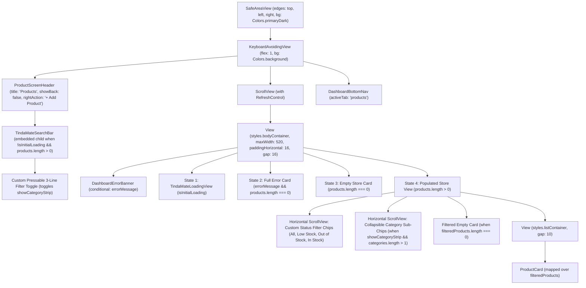

# TindaMate — Products Screen UI/UX Audit
## Phase 1: Read-Only Design Assessment & Improvement Recommendations

**Document Date:** November 14, 2026  
**Auditor:** Senior Mobile UI/UX Designer, React Native Design Systems Specialist & Mobile Application Usability Auditor  
**Audit Scope:** Strictly Read-Only UI/UX Assessment of the TindaMate Products Module (`src/app/products/*`, `src/components/products/*`, and shared UI/theme dependencies)  
**Target Directory:** `C:\TindaMate`  
**Status:** Phase 1 Read-Only Audit Complete — Ready for Review & Approval  

---

## 1. Executive Summary

### 1.1 Overall Design Assessment
The TindaMate Products module (`src/app/products/index.tsx` and supporting screens/components) establishes a functional, mobile-first foundation that connects cleanly to Supabase and applies the centralized stock-status rule (`getProductStockStatus` in `src/lib/products.ts:29-47`). The screen already benefits from the Design 2.0 deep forest green header (`ProductScreenHeader`), pull-to-refresh support, and distinct loading, empty, and error states.

However, from the perspective of a production-grade mobile POS and sari-sari store inventory system, the Products screen and its sub-views currently exhibit **significant visual hierarchy gaps, unused design-system components, dead code, unvirtualized list rendering, inconsistent stock status representations, and deceptive or broken sub-screen interactions** that reduce scanning speed and operational trust for non-technical store owners.

### 1.2 Current Strengths
1. **Consistent Brand Header Identity:** `ProductScreenHeader` (`src/components/products/ProductScreenHeader.tsx:53-168`) provides a recognizable deep forest green (`#064E3B`) header zone with an embedded `TindaMateSearchBar` and a clear `+ Add Product` action pill.
2. **Centralized Stock Status Logic:** `getProductStockStatus` (`src/lib/products.ts:29-47`) and `computeStoreProductSummary` (`src/lib/products.ts:467-494`) deterministically classify inventory into `In Stock`, `Low Stock`, and `Out of Stock` across the module.
3. **Complete State Coverage:** `ProductsListScreen` (`src/app/products/index.tsx:231-399`) explicitly handles 5 states: initial loading (`TindaMateLoadingView`), full initial error with retry, top error banner during refresh (`DashboardErrorBanner`), store-wide empty state (`No products yet`), and filtered/search empty state (`No matching products`).
4. **Thoughtful Sari-Sari Store Form Ergonomics:** `ProductForm` (`src/components/products/ProductForm.tsx:39-48, 224-256, 422-452`) includes quick-select chips for common sari-sari store categories (`Beverages`, `Canned Goods`, `Instant Noodles`, `Snacks`, etc.) and units (`pcs`, `pack`, `bottle`, `can`, `sachet`, `kg`, `box`), plus a live `StockStatusBadge` preview (`ProductForm.tsx:361`).
5. **Accessibility Foundation:** Interactive elements across `ProductCard`, `ProductScreenHeader`, and `ProductsListScreen` include `accessibilityRole`, descriptive `accessibilityLabel` strings, and `maxFontSizeMultiplier` caps to prevent extreme layout breakage.

### 1.3 Most Important Weaknesses
1. **Unvirtualized `.map()` Product List inside `ScrollView` (High Performance & Scalability Flaw):** `src/app/products/index.tsx:215, 389-395` renders all filtered products inside a standard `ScrollView` using `filteredProducts.map(...)` instead of `FlatList`. Sari-sari stores routinely carry 150–500+ SKUs (sachets, canned goods, beverages, cigarettes, candies). Rendering all cards simultaneously degrades frame rates, memory usage, and scroll responsiveness on budget Android devices.
2. **Weak `ProductCard` Visual Hierarchy & Missing Unit/Status Pill:** In `src/components/products/ProductCard.tsx:104-141`, the product name, selling price, stock count, and category are stacked in a single left-aligned column where `priceValue` (`14px` bold, `#0F172A`) is visually smaller than `productName` (`14px` extraBold) and lacks brand color emphasis (`Colors.primary` or `Colors.primaryDark`). Furthermore, despite `ProductCard`'s own JSDoc (`lines 32-34`) promising a *"semantic stock quantity pill"* and *"Right: Category tag & navigation chevron"*, the implementation renders plain colored text (`Stock: 12` without the product's `unit`, e.g., `pcs`/`sachet`) and never uses the existing `StockStatusBadge` component (`src/components/products/StockStatusBadge.tsx`).
3. **Hidden Category Filtering & No Visual Indicator When a Category Filter Is Active:** In `src/app/products/index.tsx:71, 194-209, 339-366`, the category filter strip is hidden behind a custom 3-line toggle button (`showCategoryStrip` defaults to `false`). If a user selects a category (e.g., `Beverages`) and collapses the strip, there is zero badge or indicator showing that a category filter is still restricting the list.
4. **Disconnected Shared Design System Components & Dead Styles:** `ProductsListScreen` imports `FilterChipRow` (`src/app/products/index.tsx:33`), `ActivityIndicator` (`line 3`), `TextInput` (`line 11`), and `SearchVectorIcon` (`line 27`), **none of which are used in JSX**. Instead, lines `300-336` hand-roll custom filter chips that lack `FilterChipRow`'s dedicated pill count badges (`src/components/ui/FilterChipRow.tsx:84-102`). Additionally, lines `423-471` of `src/app/products/index.tsx` contain 49 lines of dead styles (`heroHeaderZone`, `searchRowWrap`, `searchBar`, `searchInput`, `clearSearchBtn`, `clearSearchText`).
5. **Deceptive & Incomplete Controls on Product Details (`src/app/products/[id]/index.tsx`):**
   - **Quantity Stepper Ignores Selected Quantity:** The POS Quick Add row (`lines 323-376`) lets the user increment `selectedQty` (`− 1 +`), but `handleAddToPosCart` (`lines 136-142`) navigates to `/sales?productId=${product.id}` **without passing `selectedQty`**, so POS always adds only `1`.
   - **Cost Price, Profit Margin, Low-Stock Threshold, and Timestamps Are Hidden:** `ProductDetailsScreen` defines `formatTimestamp` (`lines 42-54`) and `metricsGrid`/`metricMiniCard` styles (`lines 626-656`), but **never renders them**. A store owner viewing a product's details cannot see its `cost_price`, gross margin, `low_stock_threshold`, or `updated_at` timestamp without entering the Edit screen.
   - **Non-Persistent Fake Favorite Button & Duplicate Edit Actions:** The header renders a local-state heart toggle (`isFavorite`, `lines 144, 166-174`) that resets on navigation, alongside a `⋮` menu icon (`lines 175-181`), an `Edit` tile (`lines 380-392`), and an `Adjust Stock` tile (`lines 394-406`)—all three of which identically call `handleEdit()` (`router.push('/products/[id]/edit')`).

---

## 2. Files Inspected

Every file below was directly read and verified from `C:\TindaMate`:

| File Path | Purpose of File | Relationship to Products Screen |
| :--- | :--- | :--- |
| [index.tsx](file:///c:/TindaMate/src/app/products/index.tsx) | Main Products list route (`/products`) | Primary screen under audit: renders header, search bar, status filter chips, collapsible category chips, state cards,product list, and bottom nav |
| [add.tsx](file:///c:/TindaMate/src/app/products/add.tsx) | Add Product route (`/products/add`) | Sub-screen launched from `+ Add Product` header pill and empty-state CTA; wraps `ProductForm` |
| [index.tsx](file:///c:/TindaMate/src/app/products/%5Bid%5D/index.tsx) | Product Details route (`/products/[id]`) | Sub-screen launched when tapping a `ProductCard`; displays hero image stage, price, stock pill, POS quick-add stepper, and action tiles |
| [edit.tsx](file:///c:/TindaMate/src/app/products/%5Bid%5D/edit.tsx) | Edit Product route (`/products/[id]/edit`) | Sub-screen launched from Product Details; loads product and populates `ProductForm` for in-place update |
| [ProductCard.tsx](file:///c:/TindaMate/src/components/products/ProductCard.tsx) | Product row card component | Renders individual product rows in `/products` |
| [ProductScreenHeader.tsx](file:///c:/TindaMate/src/components/products/ProductScreenHeader.tsx) | Curved deep-green screen header | Shared hero header used by `/products`, `/products/add`, `/products/[id]`, `/products/[id]/edit`, and other modules |
| [ProductScreenHeader.tsx](file:///c:/TindaMate/src/components/dashboard/ProductScreenHeader.tsx) | Re-export barrel file (`export * from '@/components/products/ProductScreenHeader'`) | Redundant barrel file in `dashboard/` folder pointing to `products/ProductScreenHeader` |
| [StockStatusBadge.tsx](file:///c:/TindaMate/src/components/products/StockStatusBadge.tsx) | Semantic pill badge with colored dot (`In Stock`, `Low Stock`, `Out of Stock`) | Used in `ProductForm` (`line 361`), but **unused** in `ProductCard`, `ProductsListScreen`, and `ProductDetailsScreen` |
| [ProductForm.tsx](file:///c:/TindaMate/src/components/products/ProductForm.tsx) | Shared create/edit product form | Used by `/products/add` and `/products/[id]/edit`; handles validation, quick chips, and photo upload |
| [ProductImagePicker.tsx](file:///c:/TindaMate/src/components/products/ProductImagePicker.tsx) | Camera & gallery image picker | Used inside `ProductForm` to capture/select and preview product photos |
| [TindaMateSearchBar.tsx](file:///c:/TindaMate/src/components/ui/TindaMateSearchBar.tsx) | Reusable pill search input with clear button and `rightAction` slot | Embedded inside `ProductScreenHeader` on `/products` |
| [FilterChipRow.tsx](file:///c:/TindaMate/src/components/ui/FilterChipRow.tsx) | Design 2.0 horizontal filter chip strip with count badges | Imported in `src/app/products/index.tsx:33` but **unused** in JSX |
| [TindaMateButton.tsx](file:///c:/TindaMate/src/components/ui/TindaMateButton.tsx) | Design-system button (`primary`, `accent`, `secondary`, `ghost`, `danger`) | Used in empty, filtered-empty, and error states on `/products` and in `ProductForm` |
| [TindaMateInput.tsx](file:///c:/TindaMate/src/components/ui/TindaMateInput.tsx) | Design-system text input with label, focus ring, and inline error | Used across `ProductForm` |
| [SectionHeader.tsx](file:///c:/TindaMate/src/components/ui/SectionHeader.tsx) | Section heading with right action/subtitle | Available shared UI component (currently unused in `/products`) |
| [DashboardBottomNav.tsx](file:///c:/TindaMate/src/components/dashboard/DashboardBottomNav.tsx) | Floating rounded capsule bottom navigation bar | Rendered at the bottom of `/products` (`lines 404-407`) |
| [DashboardErrorBanner.tsx](file:///c:/TindaMate/src/components/dashboard/DashboardErrorBanner.tsx) | Non-intrusive alert banner with Retry and Dismiss buttons | Used for fetch/save errors across `/products`, `/products/[id]`, and `ProductForm` |
| [DashboardNavIcons.tsx](file:///c:/TindaMate/src/components/dashboard/DashboardNavIcons.tsx) | Pure React Native vector icons | Provides `NavProductsIcon`, `DashboardBadgeVectorIcon`, `SearchVectorIcon`, `CartVectorIcon`, `KpiLowStockBoxIcon` |
| [LowStockAlert.tsx](file:///c:/TindaMate/src/components/dashboard/LowStockAlert.tsx) | Operational stock warning banner on Dashboard | Reference component for how low-stock alerts are styled on `/home` |
| [OrganicWaveDecoration.tsx](file:///c:/TindaMate/src/components/dashboard/OrganicWaveDecoration.tsx) | Absolute-positioned bottom wave decoration | Rendered at the bottom of `/products/[id]` (`line 430`) |
| [animated-icon.tsx](file:///c:/TindaMate/src/components/animated-icon.tsx) | Branded splash and `TindaMateLoadingView` progress bar | Used for loading states in `/products` and `/products/[id]` (but notably omitted in `/products/[id]/edit`) |
| [theme.ts](file:///c:/TindaMate/src/constants/theme.ts) | Centralized Design 2.0 tokens (`Colors`, `Spacing`, `BorderRadius`, `Typography`, `Shadows`, `IconSizes`) | Core design system reference |
| [products.ts](file:///c:/TindaMate/src/lib/products.ts) | Supabase CRUD queries, `getProductStockStatus`, `computeStoreProductSummary`, `validateProductForm`, image upload | Data and business logic layer for Products |
| [product.ts](file:///c:/TindaMate/src/types/product.ts) | TypeScript interfaces (`Product`, `ProductStockStatus`, `StoreProductSummary`, units) | Type definitions for the Products domain |
| [_layout.tsx](file:///c:/TindaMate/src/app/_layout.tsx) | Root Expo Router `Stack` configuration | Registers `products/index`, `products/add`, `products/[id]/index`, and `products/[id]/edit` |
| [home.tsx](file:///c:/TindaMate/src/app/home.tsx), [sales/index.tsx](file:///c:/TindaMate/src/app/sales/index.tsx), [customers/index.tsx](file:///c:/TindaMate/src/app/customers/index.tsx), [expenses/index.tsx](file:///c:/TindaMate/src/app/expenses/index.tsx) | Peer application screens | Inspected for cross-screen layout, header, KPI card, and navigation consistency |

---

## 3. Current UI Architecture

### 3.1 Screen Structure & Component Hierarchy (`/products`)


### 3.2 Related Sub-Screen Hierarchies
- **Add Product (`/products/add`) & Edit Product (`/products/[id]/edit`):**
  `SafeAreaView` → `KeyboardAvoidingView` → `ProductScreenHeader` (with Back button + title + subtitle) → `ScrollView` → `ProductForm` (`DashboardErrorBanner` + Section 1: Product Info & `ProductImagePicker` + Section 2: Pricing + Section 3: Inventory & `StockStatusBadge` + Save/Cancel `TindaMateButton`s).
- **Product Details (`/products/[id]`):**
  `SafeAreaView` → `View` → `View (styles.heroHeaderZone)` wrapping `ProductScreenHeader` (empty title `""`, Back button, Heart + `⋮` icons) → `ScrollView` → `showcaseCard` (Image stage with decorative circles, title, selling price + custom stock pill, auto-generated description box, POS stepper + `Add to Cart` button, 3 bottom action tiles) → `OrganicWaveDecoration`.

### 3.3 Reusable Components & Theme Dependencies
- **Used:** `ProductScreenHeader`, `TindaMateSearchBar`, `ProductCard`, `TindaMateLoadingView`, `DashboardErrorBanner`, `TindaMateButton`, `DashboardBottomNav`, `NavProductsIcon`, `DashboardBadgeVectorIcon`.
- **Available in Codebase but Unused on `/products`:**
  - `FilterChipRow` (`src/components/ui/FilterChipRow.tsx`): Imported at `src/app/products/index.tsx:33` and never rendered.
  - `StockStatusBadge` (`src/components/products/StockStatusBadge.tsx`): Used only inside `ProductForm.tsx:361`; ignored in `ProductCard.tsx` and `products/[id]/index.tsx`.
  - `SectionHeader` (`src/components/ui/SectionHeader.tsx`): Unused for list section headings or result counts.

---

## 4. UI/UX Findings (Evidence-Based Audit)

### Finding 1: Unvirtualized `.map()` Rendering Inside `ScrollView`
- **Severity:** **High**
- **Location:** [src/app/products/index.tsx](file:///c:/TindaMate/src/app/products/index.tsx#L215-L228) and [lines 388–396](file:///c:/TindaMate/src/app/products/index.tsx#L388-L396)
- **Evidence:**
  ```tsx
  <ScrollView style={styles.scrollView} ...>
    ...
    <View style={styles.listContainer}>
      {filteredProducts.map((product) => (
        <ProductCard key={product.id} product={product} onPress={...} />
      ))}
    </View>
  </ScrollView>
  ```
- **Problem:** Every product in `filteredProducts` is mounted in the React Native view tree at once, each containing an `expo-image` `<Image>` or multi-node vector icon (`DashboardBadgeVectorIcon`). Unlike small expense lists, a sari-sari store inventory commonly holds 100–500+ items. Mounting all cards simultaneously causes sluggish initial render, high memory overhead, and dropped frames on entry-level Android phones.

---

### Finding 2: Weak `ProductCard` Layout, Missing `unit` in Stock Display, and Mismatch with Component Specification
- **Severity:** **High**
- **Location:** [src/components/products/ProductCard.tsx](file:///c:/TindaMate/src/components/products/ProductCard.tsx#L27-L148) and [lines 213–245](file:///c:/TindaMate/src/components/products/ProductCard.tsx#L213-L245)
- **Evidence:**
  - JSDoc (`lines 32-34`) states:
    > `- Middle: Product name, bold Peso selling price, and semantic stock quantity pill`  
    > `- Right: Category tag (if set) & navigation chevron`
  - Actual implementation (`lines 47, 104-146`):
    - Line 47 computes `const stockLabel = `${product.stock_quantity} ${product.unit}`;` **only** for `accessibilityLabel` (`line 58`), but line 132 renders:
      ```tsx
      {isOut ? 'Out of Stock' : `Stock: ${product.stock_quantity}`}
      ```
      The product's `unit` (`pcs`, `pack`, `sachet`, `kg`, `bottle`) is completely omitted from the visible card!
    - `productName` (`14px`, `extraBold`, `#0F172A`) and `priceValue` (`14px`, `bold`, `#0F172A`) have nearly identical font sizes and identical color (`Colors.textPrimary`), stacking vertically in a single column (`gap: 3`). The selling price does not stand out as a primary retail figure, nor does it use `tabular-nums`.
    - Stock status is shown as plain colored text (`Stock: 5` in `Colors.accent` `#F97316`), rather than a semantic pill badge (`StockStatusBadge`), making it harder for store owners to distinguish `Low Stock` from `Out of Stock` at a glance in bright store lighting.
    - When `product.image_url` is present (`lines 68-77`), `contentFit="contain"` with `width: '86%', height: '86%'` is used for rectangular camera photos (which `ProductImagePicker` crops at `1:1` square aspect ratio, `src/components/products/ProductImagePicker.tsx:88`), leaving an unnecessary artificial border pad inside the 58x58 thumbnail box.

---

### Finding 3: Hidden Category Filter Strip & Invisible Active Category State
- **Severity:** **High**
- **Location:** [src/app/products/index.tsx](file:///c:/TindaMate/src/app/products/index.tsx#L70-L71), [lines 193–209](file:///c:/TindaMate/src/app/products/index.tsx#L193-L209), and [lines 338–366](file:///c:/TindaMate/src/app/products/index.tsx#L338-L366)
- **Evidence:**
  - `showCategoryStrip` is initialized to `false` (`line 71`).
  - The category filter bar only renders if `showCategoryStrip && categories.length > 1` (`line 339`).
  - The toggle button in the header (`lines 194-208`) only highlights when `showCategoryStrip` is `true` (`showCategoryStrip && styles.filterIconButtonActive`), **not** when `selectedCategory !== 'All'`.
- **Problem:**
  1. If a store only has 1 category (or uncategorized products), tapping the filter button toggles `showCategoryStrip` to `true` (turning the button green), **but nothing appears on screen** because `categories.length > 1` is `false`! This looks like a broken button.
  2. If a user opens the category strip, selects `"Beverages"`, and taps the filter icon again to collapse the strip, the list remains filtered to `"Beverages"`, the status chip counts (`All (28)`, `Low Stock (3)`) still show **store-wide** counts rather than category-filtered counts, and there is no visual indicator anywhere on screen that `"Beverages"` is still filtering the list.

---

### Finding 4: Status Filter Chip Counts Do Not Reflect Active Search or Category Filter (and `FilterChipRow` Is Unused)
- **Severity:** **Medium**
- **Location:** [src/app/products/index.tsx](file:///c:/TindaMate/src/app/products/index.tsx#L33), [lines 131–134](file:///c:/TindaMate/src/app/products/index.tsx#L131-L134), and [lines 300–336](file:///c:/TindaMate/src/app/products/index.tsx#L300-L336)
- **Evidence:**
  - `FilterChipRow` is imported on line 33 (`import { FilterChipRow } from '@/components/ui/FilterChipRow';`) and never used.
  - Instead, lines `300-336` manually map status chips (`All`, `Low Stock`, `Out of Stock`, `In Stock`) with `summary.totalProducts`, `summary.lowStockCount`, etc.
  - There is no result count header above the list (e.g., `"Showing 4 of 28 products"` when searching or filtering by category).
- **Problem:** When a vendor searches `"Lucky Me"` or filters by `"Instant Noodles"`, the status chips still read `All (45) | Low Stock (6) | Out of Stock (2) | In Stock (37)`, creating cognitive dissonance when only 3 cards are visible below. Furthermore, the hand-rolled chips lack the cleaner pill-badge count separation already built into `FilterChipRow` (`src/components/ui/FilterChipRow.tsx:84-102`).

---

### Finding 5: Lack of Inventory Health Summary / Low-Stock Callout Banner & No Header Subtitle
- **Severity:** **Medium**
- **Location:** [src/app/products/index.tsx](file:///c:/TindaMate/src/app/products/index.tsx#L180-L186) vs. [src/app/expenses/index.tsx](file:///c:/TindaMate/src/app/expenses/index.tsx#L218-L237) and [src/app/customers/index.tsx](file:///c:/TindaMate/src/app/customers/index.tsx#L227-L264)
- **Evidence:**
  - In `ExpensesListScreen` (`src/app/expenses/index.tsx:218-231`), `ProductScreenHeader` receives `subtitle={headerSubtitle}` (`"12 expenses recorded"`).
  - In `CustomersListScreen` (`src/app/customers/index.tsx:227-264`), an overview summary card highlights actionable metrics at the top of the screen.
  - In `ProductsListScreen` (`src/app/products/index.tsx:180-186`), `ProductScreenHeader` is passed `title="Products"` with **no `subtitle`**, even though `ProductScreenHeader` natively supports `subtitle` (`src/components/products/ProductScreenHeader.tsx:25, 124-131`).
- **Problem:** Store owners opening `/products` (especially when arriving from the Dashboard's `LowStockAlert` banner, `src/app/home.tsx:696, 789`) are not even pre-filtered to `Low Stock` or shown a compact inventory health callout when items are critically low or out of stock.

---

### Finding 6: Dashboard "Low Stock" Navigation Does Not Deep-Link to the `Low Stock` Filter on `/products`
- **Severity:** **Medium**
- **Location:** [src/app/home.tsx](file:///c:/TindaMate/src/app/home.tsx#L696), [line 789](file:///c:/TindaMate/src/app/home.tsx#L789), [line 814](file:///c:/TindaMate/src/app/home.tsx#L814) and [src/app/products/index.tsx](file:///c:/TindaMate/src/app/products/index.tsx#L63-L75)
- **Evidence:**
  - On the Dashboard (`src/app/home.tsx`), tapping the notification bell (`line 696`), the `Low Stock` KPI tile (`line 789`), or the `LowStockAlert` banner (`line 814`) simply calls `router.push('/products')`.
  - `ProductsListScreen` (`src/app/products/index.tsx`) does not read `useLocalSearchParams<{ filter?: string }>()` and always defaults `selectedFilter` to `'All'` (`line 68`).
- **Problem:** When a vendor taps `"5 Products Running Low — Check inventory →"` on the Dashboard, they land on the `"All"` products list sorted alphabetically (`A–Z`) rather than seeing the 5 low-stock products they tapped to inspect.

---

### Finding 7: Product Details Screen (`src/app/products/[id]/index.tsx`) Has Multiple UX & Data Presentation Flaws
- **Severity:** **High**
- **Location:** [src/app/products/[id]/index.tsx](file:///c:/TindaMate/src/app/products/[id]/index.tsx#L136-L433)
- **Evidence:**
  1. **POS Stepper Quantity Ignored (`lines 136-142, 323-376`):** The user can tap `+` on the quantity stepper to select e.g. `5` units (`selectedQty = 5`), and then tap `Add to Cart`. However, `handleAddToPosCart` (`lines 136-142`) executes:
     ```tsx
     router.push({ pathname: '/sales', params: { productId: product.id } } as any);
     ```
     `selectedQty` is completely discarded! Over in `src/app/sales/index.tsx:269`, `addProductToCart(prev, matching)` only ever adds `1` unit.
  2. **Key Inventory & Financial Fields Hidden (`lines 42-54, 306-320, 626-656`):**
     - `formatTimestamp` (`lines 42-54`) is defined at the top of `src/app/products/[id]/index.tsx` and **never called** (dead function).
     - Styles `metricsGrid`, `metricsGridStacked`, `metricMiniCard`, `metricLabel`, `metricValue`, `metricCaption` (`lines 626-656`) are defined in `StyleSheet.create` and **never rendered**!
     - As a result, `product.cost_price`, gross profit per unit (`selling_price - cost_price`), `product.low_stock_threshold`, `product.category`, and `product.updated_at` are completely invisible on the Product Details screen. Instead, `lines 308-319` render a generic filler sentence (`"Store inventory item sold per pcs. Ready for POS checkout..."`).
  3. **Duplicate Header Wrapping (`lines 160-185`):** `ProductScreenHeader` already renders a curved deep-green container (`borderBottomLeftRadius: 24, borderBottomRightRadius: 24`, `src/components/products/ProductScreenHeader.tsx:176-186`), yet `ProductDetailsScreen` wraps it inside *another* `<View style={styles.heroHeaderZone}>` (`lines 160, 445-451`) with duplicate `borderBottomLeftRadius: 24` and `Shadows.sm`, violating `ProductScreenHeader`'s own JSDoc warning (`line 51`: *"without requiring duplicate nested hero header zones"*) and passing an empty `title=""` (`line 162`).
  4. **Fake Ephemeral Favorite Button & Redundant Edit Triggers (`lines 144, 166-182, 379-407`):**
     - The heart icon (`♥` / `♡`, `lines 166-174`) toggles local component state `const [isFavorite, setIsFavorite] = useState(false)` (`line 144`), which is not persisted in Supabase or AsyncStorage and vanishes as soon as the user navigates back.
     - The header `⋮` button (` accessibilityLabel="Product menu options"`, `lines 175-181`), the `Edit` tile (`lines 380-392`), and the `Adjust Stock` tile (`lines 394-406`) all call the exact same function `handleEdit` (`router.push('/products/[id]/edit')`).
  5. **`OrganicWaveDecoration` Overlaps Bottom Scroll Content (`lines 430, 477`):** `OrganicWaveDecoration` (`height: 70`, `position: 'absolute', bottom: 0, zIndex: 1`) is placed over the bottom of the screen without a bottom nav bar, visually colliding with the bottom of the showcase card on smaller screens.

---

### Finding 8: Inconsistent Loading & Feedback States Across Add / Edit / List Flows
- **Severity:** **Medium**
- **Location:** [src/app/products/[id]/edit.tsx](file:///c:/TindaMate/src/app/products/%5Bid%5D/edit.tsx#L141-L145), [src/app/products/add.tsx](file:///c:/TindaMate/src/app/products/add.tsx#L55-L58), and [src/components/products/ProductForm.tsx](file:///c:/TindaMate/src/components/products/ProductForm.tsx#L161-L166)
- **Evidence:**
  1. **Inconsistent Loading Indicator in Edit Product:** While `ProductsListScreen` (`line 242`) and `ProductDetailsScreen` (`line 211`) use the branded `<TindaMateLoadingView compact />`, `EditProductScreen` (`src/app/products/[id]/edit.tsx:142-145`) uses a raw `<ActivityIndicator size="large" color={Colors.primaryDark} />`.
  2. **No Post-Save Success Feedback Banner:** Unlike `ExpensesListScreen` (`src/app/expenses/index.tsx:81-87, 310-329`), which shows a green confirmation banner (`"Expense successfully recorded"` / `"Expense changes saved"`), saving a new or edited product in `/products/add` (`line 58`) or `/products/[id]/edit` (`line 98`) silently navigates back without any visual confirmation banner.
  3. **Mixed Language Error Message in `ProductForm`:** Every UI string, validation error (`src/lib/products.ts:127-234`), and helper text in the Products module is in English, except `src/components/products/ProductForm.tsx:165`, which falls back to Tagalog (`'Hindi mai-upload ang litrato sa storage. Pakisuri ang internet connection.'`).
  4. **Emoji Icons in `ProductImagePicker`:** While the rest of TindaMate Design 2.0 uses custom React Native vector icons (`DashboardNavIcons.tsx`, `AuthIcons.tsx`), `ProductImagePicker` (`src/components/products/ProductImagePicker.tsx:209, 232`) uses platform-dependent OS emojis (`📷` and `🖼️`) on its camera and gallery buttons, and `ExpensesListScreen` (`line 370`) uses `🔍` while `CustomersListScreen` (`line 319`) uses `<SearchVectorIcon />`.

---

### Finding 9: Dead Code, Unused Imports, and Redundant Barrel File
- **Severity:** **Low**
- **Location:** [src/app/products/index.tsx](file:///c:/TindaMate/src/app/products/index.tsx#L3-L33), [lines 423–471](file:///c:/TindaMate/src/app/products/index.tsx#L423-L471), [src/app/products/[id]/index.tsx](file:///c:/TindaMate/src/app/products/%5Bid%5D/index.tsx#L3), [lines 42–54](file:///c:/TindaMate/src/app/products/%5Bid%5D/index.tsx#L42-L54), [lines 70–71](file:///c:/TindaMate/src/app/products/%5Bid%5D/index.tsx#L70-L71), [lines 626–656](file:///c:/TindaMate/src/app/products/%5Bid%5D/index.tsx#L626-L656), and [src/components/dashboard/ProductScreenHeader.tsx](file:///c:/TindaMate/src/components/dashboard/ProductScreenHeader.tsx#L1)
- **Evidence:**
  - `src/app/products/index.tsx`:
    - Unused imports: `ActivityIndicator` (`line 3`), `TextInput` (`line 11`), `SearchVectorIcon` (`line 27`), `FilterChipRow` (`line 33`).
    - Unused styles (`lines 423-471`): `heroHeaderZone`, `searchRowWrap`, `searchBar`, `searchInput`, `clearSearchBtn`, `clearSearchText`.
  - `src/app/products/[id]/index.tsx`:
    - Unused import: `ActivityIndicator` (`line 3`).
    - Unused variables/functions: `formatTimestamp` (`lines 42-54`), `isCompactPhone` (`line 71`).
    - Unused styles (`lines 626-656`): `metricsGrid`, `metricsGridStacked`, `metricMiniCard`, `metricLabel`, `metricValue`, `metricCaption`.
  - `src/components/dashboard/ProductScreenHeader.tsx`: 1-line re-export barrel file (`export * from '@/components/products/ProductScreenHeader'`) that is not imported anywhere in `src/`.

---

### Finding 10: Search Bar Disappears When Store Has 0 Products or During Initial Load, and Lacks Sort Options
- **Severity:** **Low**
- **Location:** [src/app/products/index.tsx](file:///c:/TindaMate/src/app/products/index.tsx#L187-L211)
- **Evidence:**
  - In `src/app/products/index.tsx:187`, `TindaMateSearchBar` is conditionally rendered only when `!isInitialLoading && products.length > 0`.
  - During `isInitialLoading`, the green `ProductScreenHeader` renders at a shorter height (~76px) and then suddenly jumps taller (~132px) once `products` finishes loading, causing a noticeable vertical layout shift (CLS) on initial mount.
  - Furthermore, products are only ever ordered alphabetically by name (`src/lib/products.ts:322`), with no option for the vendor to sort by **Lowest Stock First**, **Price: Low to High**, or **Recently Updated**.

---

## 5. Design System Consistency Evaluation

Inspection of `src/constants/theme.ts` against the Products module reveals the following alignment and deviations:

| Design Token Category | Theme Definition (`src/constants/theme.ts`) | Products Module Usage | Consistency Assessment |
| :--- | :--- | :--- | :--- |
| **Brand Colors** | `primary: '#0D7A4D'`, `primaryDark: '#064E3B'`, `accent: '#F97316'`, `accentDark: '#EA580C'`, `accentWarm: '#F59E0B'` | Used in `ProductScreenHeader` (`primaryDark`), `ProductCard` (`primary`, `accent`, `error`), `DashboardBottomNav` | **Mostly Consistent**, except `ProductCard` selling price uses `Colors.textPrimary` (`#0F172A`) instead of `Colors.primaryDark`/`Colors.primary` (which `theme.ts:29` explicitly designates for *"Buttons, active states, price text"*). |
| **Backgrounds & Surfaces** | `background: '#F4F6F8'`, `surface: '#FFFFFF'`, `primarySoft: '#ECFDF5'`, Route stack default `'#FDF7EB'` (`_layout.tsx:97`) | `ProductsListScreen` uses `Colors.background` (`#F4F6F8`) and `Colors.surface` (`#FFFFFF`) | **Consistent** with Design 2.0 slate canvas and white card surfaces. Note: `ProductDetailsScreen` hardcodes `'#FAFAF9'` (`line 500`) and `'#DCFCE7'`/`'#BBF7D0'`/`'#FEF3C7'` (`lines 575-582`) instead of using `Colors.surfaceSubtle`, `Colors.successLight`, `Colors.primaryBorder`, `Colors.warningLight`. |
| **Input Borders** | `Colors.border: '#E2E8F0'` (`theme.ts:61`) | `TindaMateInput` (`src/components/ui/TindaMateInput.tsx:206`) hardcodes `borderColor: '#E5E0D0'`, while `TindaMateSearchBar` (`line 120`) hardcodes `'#EDF2EE'` | **Minor Token Drift:** Hardcoded hex borders should reference `Colors.border` (`#E2E8F0`). |
| **Border Radius** | `BorderRadius.card: 16` (`theme.ts:192`: *"Standard list cards (ProductCard, CustomerCard, SaleHistoryItemCard)"*) | `ProductCard.tsx:156` uses `BorderRadius.xl` (`24`), while `ProductCard` thumbnail (`line 177`) uses `BorderRadius.lg` (`16`) | **Token Mismatch:** `theme.ts:192` explicitly documents `BorderRadius.card` (`16px`) for `ProductCard`, yet `ProductCard` uses `BorderRadius.xl` (`24px`), making list rows overly rounded compared to their 58px thumbnail boxes. |
| **Typography & Tabular Numerals** | `Typography.presets` includes `fontVariant: ['tabular-nums']` for financial/numeric values (`theme.ts:245, 252`) | Neither `ProductCard` (`priceValue`, `stockText`) nor `ProductDetailsScreen` (`sellingPriceBig`) applies `fontVariant: ['tabular-nums']` | **Inconsistent:** Prices (`₱15.00`) and stock counts (`12 pcs`) in list cards and details lack `tabular-nums`, which helps vertical alignment when scanning prices down a list. |
| **Shared Components** | `FilterChipRow`, `StockStatusBadge`, `TindaMateLoadingView` | `FilterChipRow` is unused on `/products`; `StockStatusBadge` is unused on `ProductCard` and `/products/[id]`; `TindaMateLoadingView` is unused on `/products/[id]/edit` | **Fragmented Reuse:** Existing, well-built design-system components are bypassed in favor of inline custom JSX. |

---

## 6. Recommended Improvements

### 6.1 Layout & Hierarchy
1. **Add Dynamic Inventory Subtitle to `ProductScreenHeader` on `/products`:**
   - Pass a concise summary subtitle to `ProductScreenHeader` (e.g., `"28 items • 3 low stock"` or `"Loading store inventory..."` during initial load) so store owners immediately see total SKU count and stock health at the top of the screen, matching `ExpensesListScreen` (`src/app/expenses/index.tsx:218-231`).
2. **Prevent Header Height Jump During Initial Loading:**
   - Keep `TindaMateSearchBar` rendered inside `ProductScreenHeader` during `isInitialLoading` (with `editable={!isInitialLoading}`) or reserve its vertical height so the curved green header does not jump by ~56px when loading completes.
3. **Replace `.map()` Inside `ScrollView` with `FlatList`:**
   - Refactor `src/app/products/index.tsx` to use React Native's `<FlatList>` with `ListHeaderComponent` (containing the error banner, status filter strip, category strip, and result count/sort bar) and `ListEmptyComponent` (rendering the loading, error, empty-store, or no-matching-products card). This guarantees smooth 60fps scrolling even for stores with 500+ products.

### 6.2 Product Cards (`src/components/products/ProductCard.tsx`)
1. **Upgrade to a Balanced 3-Zone Retail Row Layout:**
   - **Left Zone (Thumbnail / Icon):** 56×56 container (`BorderRadius.md` `14px`, matching a `BorderRadius.card` `16px` outer card radius) using `contentFit="cover"` for square camera photos so product photos fill the thumbnail cleanly without awkward inner padding.
   - **Center Zone (Identity & Metadata):**
     - **Top line:** Product Name (`Typography.sizes.body` `15px`, `bold`, `Colors.textPrimary`, `numberOfLines={1}`).
     - **Bottom line:** Category pill/label (e.g., `Beverages` or `Uncategorized` in muted slate) + Stock quantity with unit (`12 pcs` or `Low: 3 packs` or `Out of Stock`).
   - **Right Zone (Price & Status Alignment):**
     - **Top right:** Prominent Selling Price (`Typography.sizes.base` `16px`, `extraBold`, `Colors.primaryDark` `#064E3B`, `fontVariant: ['tabular-nums']`) with unit suffix (`/ pc`).
     - **Bottom right:** Compact `StockStatusBadge` (`In Stock`, `Low Stock`, `Out of Stock`) or semantic stock pill (`12 pcs` in green pill, `3 pcs left` in amber pill, `Out of Stock` in red pill), alongside a subtle right chevron `›`.
2. **Always Display the Product's `unit`:**
   - Replace `Stock: ${product.stock_quantity}` (`ProductCard.tsx:132`) with `${product.stock_quantity} ${product.unit}` (e.g., `24 pcs`, `4 sachets`, `10 kg`) so vendors know what unit is being counted.

### 6.3 Search, Filtering & Sorting
1. **Use Shared `FilterChipRow` for Status Filters:**
   - Replace the manual `ScrollView` chip loop (`src/app/products/index.tsx:300-336`) with the already-imported `<FilterChipRow>` component (`src/components/ui/FilterChipRow.tsx`), which renders crisp pill count badges (`All [28]`, `Low Stock [3]`, `Out of Stock [1]`, `In Stock [24]`).
2. **Make Category Filtering Discoverable & Honest:**
   - Only show the category filter toggle button when `categories.length > 1` (or show a disabled/informative state if no categories exist).
   - When `selectedCategory !== 'All'`, display an active indicator dot/badge on the filter icon button **and** keep the category strip visible (or show an active removable chip `"Category: Beverages ✕"`) so the user never forgets a category filter is active.
3. **Add a Compact Result Count & Quick Sort Row:**
   - Above the product list, show a compact row: left side `"Showing 12 of 28 products"` (or `"28 Products"` when unfiltered), right side a lightweight sort pill cycling or opening options: `Name (A–Z)`, `Stock: Low to High`, `Price: Low to High`.
4. **Support Deep-Linking from Dashboard Low-Stock Alerts (`?filter=low-stock`):**
   - Read `useLocalSearchParams<{ filter?: string }>()` in `src/app/products/index.tsx` so navigating to `/products?filter=Low%20Stock` automatically selects the `Low Stock` filter tab.

### 6.4 Inventory Indicators
1. **Unify Stock Badges Across All Product Views:**
   - Use `StockStatusBadge` (`src/components/products/StockStatusBadge.tsx`)—extended with an optional `stockCountLabel` prop (e.g., `In Stock • 12 pcs` or `Low: 3 pcs`)—across `ProductCard`, `ProductDetailsScreen`, and `ProductForm` instead of maintaining three separate status badge implementations.
2. **Surface Low-Stock Threshold Context:**
   - When a product is in `Low Stock` status on `ProductCard` or `ProductDetailsScreen`, clearly indicate the threshold or remaining count (`3 pcs left` in warm amber `#92400E` on `#FEF3C7`).

### 6.5 Product Details Screen (`src/app/products/[id]/index.tsx`)
1. **Restore Missing Inventory & Financial Metrics Grid:**
   - Render the currently unused `metricsGrid` (`lines 626-656`) to display:
     - **Cost Price:** `product.cost_price !== null ? formatPesoCurrency(product.cost_price) : 'Not set'`
     - **Estimated Profit / Margin:** When `cost_price !== null`, show `₱X.XX (Y%)` per unit; otherwise prompt `"Add cost price to track profit"`.
     - **Low-Stock Alert Level:** `${product.low_stock_threshold} ${product.unit}`
     - **Category & Last Updated:** `${product.category ?? 'Uncategorized'}` and `formatTimestamp(product.updated_at)`.
2. **Remove Duplicate Nested Header Wrapper & Ephemeral Favorite Button:**
   - Remove the outer `<View style={styles.heroHeaderZone}>` wrapper (`line 160`) around `ProductScreenHeader`.
   - Pass `title="Product Details"` (or `product?.name ?? 'Product Details'`) and a clear `rightActionLabel="Edit"` to `ProductScreenHeader`, removing the non-persistent heart icon (`isFavorite`) and redundant `⋮` glyph (`lines 166-182`).
   - Simplify the bottom actions so each button has a distinct, honest purpose (e.g., primary `Add to Sale` / `Edit Product`, without three separate buttons all routing identically to `/products/[id]/edit`).
3. **Remove Overlapping `OrganicWaveDecoration` or Add Adequate Bottom Clearance:**
   - Either remove `<OrganicWaveDecoration />` (`line 430`) from `ProductDetailsScreen` (keeping the screen clean and modern like `/products/add` and `/products/[id]/edit`) or ensure `scrollContent` has sufficient bottom padding so the wave never obscures interactive buttons.
4. *(Note on POS Quantity Stepper)*: If the quantity stepper (`selectedQty`) on `ProductDetailsScreen` is retained, passing `qty` via route params to `/sales` would require a small coordination in `src/app/sales/index.tsx` (which is a functional cross-screen change—flagged in Section 7/8 for explicit approval). Alternatively, in a pure UI refinement, the button on `ProductDetailsScreen` can be a single clean `"Sell This Item in POS"` CTA without a misleading stepper until multi-qty param handoff is approved.

### 6.6 Typography, Colors, Spacing & Responsiveness
1. **Apply `fontVariant: ['tabular-nums']` to All Prices & Stock Quantities:**
   - Add `fontVariant: ['tabular-nums']` to `ProductCard.styles.priceValue`, `ProductCard.styles.stockText`, and `ProductDetailsScreen.styles.sellingPriceBig`.
2. **Standardize Card Border Radius to `BorderRadius.card` (`16px`):**
   - Align `ProductCard.styles.card` with `BorderRadius.card` (`16px`) and thumbnail `imageBox`/`iconBox` with `BorderRadius.sm` (`10px`) or `BorderRadius.md` (`14px`) as specified in `src/constants/theme.ts:188-193`.
3. **Replace Emoji Icons & Tagalog Fallback String in `ProductForm` / `ProductImagePicker`:**
   - Replace `📷` and `🖼️` in `ProductImagePicker.tsx:209, 232` with clean React Native vector icons consistent with `DashboardNavIcons.tsx`.
   - Standardize the photo upload error fallback in `ProductForm.tsx:165` to clear English (`'Could not upload product photo. Please check your internet connection and try again.'`) matching the rest of the module.
   - Replace raw `<ActivityIndicator>` in `src/app/products/[id]/edit.tsx:143` with `<TindaMateLoadingView compact message="Loading product details..." />`.

---

## 7. Proposed Design Direction

### 7.1 Target Visual Experience (`/products`)
The recommended Products screen layout follows a clean, high-contrast, modern POS inventory aesthetic tailored for one-handed operation by sari-sari store owners:

```
+-------------------------------------------------------------------+
|  [Cube]  Products                              [ + Add Product ]  |
|          28 items in store • 3 low stock                          |
|  +-----------------------------------------------------+ +-----+  |
|  | [🔍] Search products by name or category...     [✕] | | [=] |  |
|  +-----------------------------------------------------+ +-----+  |
+-------------------------------------------------------------------+
|  ( All [28] )  ( Low Stock [3] )  ( Out of Stock [1] ) (In Stock) |
|  [All Categories] [Beverages] [Canned Goods] [Instant Noodles]    |
|                                                                   |
|  Showing 28 products                            Sort: Name A–Z ▾  |
|                                                                   |
|  +-------------------------------------------------------------+  |
|  | +--------+  Lucky Me! Pancit Canton         ₱15.00 / pc     |  |
|  | | [Img]  |  Instant Noodles              [● In Stock • 24] ›|  |
|  | +--------+                                                  |  |
|  +-------------------------------------------------------------+  |
|  | +--------+  Argentina Corned Beef 150g      ₱38.00 / can    |  |
|  | | [Img]  |  Canned Goods                  [● Low: 3 left] › |  |
|  | +--------+                                                  |  |
|  +-------------------------------------------------------------+  |
|  | +--------+  Coca-Cola Mismo 290ml           ₱20.00 / bottle |  |
|  | | [Icon] |  Beverages                     [● Out of Stock] ›|  |
|  | +--------+                                                  |  |
|  +-------------------------------------------------------------+  |
|                                                                   |
|   +-----------------------------------------------------------+   |
|   |   [Home]    [■ Products]    ( + POS )   [Customers] [More]|   |
|   +-----------------------------------------------------------+   |
+-------------------------------------------------------------------+
```

### 7.2 Section-by-Section Specification
1. **Top Curved Deep-Green Header (`ProductScreenHeader`):**
   - Left: `NavProductsIcon` inside translucent squircle badge + `"Products"` (`20px` extraBold white) + dynamic subtitle (`"28 items • 3 low stock"` in `#D1FAE5`).
   - Right: High-contrast emerald pill button `+ Add Product`.
   - Bottom of Header: `TindaMateSearchBar` (always rendered to prevent height jumps) + Category Filter toggle button (with an active emerald dot badge whenever `selectedCategory !== 'All'`).
2. **Filter & Sort Control Zone (`FlatList` Header):**
   - **Row 1 (Status Filter Chips):** `FilterChipRow` displaying `All`, `Low Stock`, `Out of Stock`, and `In Stock` with pill count badges.
   - **Row 2 (Category Chips):** Visible when toggled or automatically kept visible whenever `selectedCategory !== 'All'`.
   - **Row 3 (List Summary & Sort Bar):** Left shows `"Showing X products"` (or `"X matching products"`), right shows a compact sort selector (`Name A–Z`, `Lowest Stock`, `Price`).
3. **Product Cards (`ProductCard`):**
   - Crisp white surface (`#FFFFFF`), `16px` border radius (`BorderRadius.card`), `1px` subtle border (`#E2E8F0`), `Shadows.xs`.
   - Left: `56x56` rounded square (`12px` radius) with `contentFit="cover"` photo or semantic pastel icon container.
   - Middle: Product Name (`15px` bold `#0F172A`, 1 line) + Category & unit metadata (`12px` medium `#64748B`, e.g., `Instant Noodles • per pc`).
   - Right: Selling Price (`16px` extraBold `#064E3B`, `tabular-nums`) stacked above a semantic stock pill (`In Stock • 24 pcs` in `#DCFCE7`/`#166534`, `Low • 3 pcs` in `#FEF3C7`/`#92400E`, or `Out of Stock` in `#FEF2F2`/`#DC2626`) + right chevron `›`.
4. **Product Details Screen (`/products/[id]`):**
   - Single clean `ProductScreenHeader` (`title="Product Details"`, Back button on left, `Edit` pill on right).
   - Hero Showcase Card: Image stage (`180px` height), Product Title (`22px` extraBold), Selling Price (`30px` extraBold `#064E3B`, `tabular-nums`) + `StockStatusBadge`.
   - **2×2 Inventory & Pricing Metrics Grid:**
     1. `Cost Price` (`₱12.00` or `Not set`)
     2. `Profit / Unit` (`₱3.00 (20.0%)` or `—`)
     3. `Low-Stock Alert` (`5 pcs`)
     4. `Category` (`Instant Noodles`)
   - Clean footer metadata (`Last updated: Nov 14, 2026, 1:30 PM`) and straightforward primary/secondary actions (`Edit Product / Adjust Stock` and `Sell in POS`).

---

## 8. Implementation Plan & Impact Matrix

### 8.1 Prioritized Implementation Roadmap

#### Phase 1: High-Impact Visual & Component Improvements (Visual-Only / Zero Business Logic Changes)
1. **Redesign `ProductCard` (`src/components/products/ProductCard.tsx`):**
   - Establish 3-zone layout (Thumbnail left, Name + Category middle, Tabular Selling Price + Semantic Stock Pill right).
   - Include `product.unit` in stock display (`24 pcs` instead of `Stock: 24`).
   - Apply `BorderRadius.card` (`16px`), `fontVariant: ['tabular-nums']`, and `contentFit="cover"` for thumbnails.
2. **Adopt `FilterChipRow` & Clean Up Dead Styles in `ProductsListScreen` (`src/app/products/index.tsx`):**
   - Replace manual filter chip JSX with `<FilterChipRow>`.
   - Add dynamic inventory subtitle to `ProductScreenHeader`.
   - Keep `TindaMateSearchBar` mounted during initial load (disabled while loading) to eliminate header height jump.
   - Remove unused imports and 49 lines of dead styles.
3. **Complete `ProductDetailsScreen` Visual Hierarchy (`src/app/products/[id]/index.tsx`):**
   - Render the 2×2 Inventory & Pricing Metrics Grid (`Cost Price`, `Profit/Margin`, `Low-Stock Threshold`, `Category`) and `Last Updated` timestamp using the already-written `formatTimestamp` helper and `metricsGrid` styles.
   - Remove the duplicate outer `heroHeaderZone` wrapper, the non-persistent `isFavorite` heart toggle, and the redundant `⋮` icon.

#### Phase 2: UX, Performance & Interaction Improvements
4. **Virtualize Product List with `FlatList` (`src/app/products/index.tsx`):**
   - Replace `<ScrollView>` + `.map()` with `<FlatList>` (`keyExtractor={(item) => item.id}`), preserving `RefreshControl` and all 5 empty/loading/error states.
5. **Improve Category Filter Visibility & Add Client-Side Sort Toggle (`src/app/products/index.tsx`):**
   - Show active badge on filter button when `selectedCategory !== 'All'`, auto-keep category strip visible when active, hide/disable category toggle when store has no categories, and add a compact client-side sort pill (`Name A–Z`, `Lowest Stock`, `Price`).
6. **Unify Sub-Screen Loading, Language & Vector Icons (`edit.tsx`, `ProductForm.tsx`, `ProductImagePicker.tsx`):**
   - Replace raw `ActivityIndicator` in `src/app/products/[id]/edit.tsx` with `TindaMateLoadingView`.
   - Replace Tagalog fallback string in `ProductForm.tsx:165` with English.
   - Replace `📷`/`🖼️` emojis in `ProductImagePicker.tsx` with vector icons.

#### Phase 3: Cross-Screen Functional Polish (Requires Explicit Approval)
7. **Deep-Link Dashboard Low-Stock Alerts to `/products?filter=Low%20Stock`** (`src/app/home.tsx` + `src/app/products/index.tsx`).
8. **Align Product Details POS Action** (`src/app/products/[id]/index.tsx` + optionally `src/app/sales/index.tsx`): Either pass `qty` param to `/sales` or replace the unlinked stepper on Product Details with a direct `"Sell Item in POS"` button.

---

### 8.2 Implementation Impact Matrix

| # | Improvement | Category | Current Implementation | Recommended Change | Files Affected | Complexity | Regression Risk |
| :- | :--- | :--- | :--- | :--- | :--- | :--- | :--- |
| **1** | **3-Zone `ProductCard` with Unit & Stock Pill** | Visual-only | Single-column stack (`ProductCard.tsx:104-141`); omits `unit`; price is `14px` `#0F172A`; plain text stock status | 3-zone row: 56×56 cover image/icon, Name + Category, Right-aligned `16px` `#064E3B` tabular price + semantic stock/unit pill | `src/components/products/ProductCard.tsx`, `src/components/products/StockStatusBadge.tsx` | **Low** | **Low** — Pure presentational change; props `(product, onPress)` remain identical |
| **2** | **`FlatList` Virtualization on `/products`** | Component Architecture & UX | `ScrollView` + `filteredProducts.map()` (`products/index.tsx:215, 389`) | Replace with `FlatList` using `ListHeaderComponent` and `ListEmptyComponent` | `src/app/products/index.tsx` | **Medium** | **Low** — Must keep `keyboardShouldPersistTaps="handled"` and `RefreshControl` intact |
| **3** | **Header Subtitle, `FilterChipRow` Adoption & Dead Code Cleanup** | Visual & Component Architecture | No header subtitle; `FilterChipRow` imported but unused; search bar unmounts during load; 49 lines of dead styles | Pass inventory count subtitle to `ProductScreenHeader`; render `FilterChipRow`; keep search bar mounted; delete dead styles | `src/app/products/index.tsx` | **Low** | **Low** — Visual & cleanup only |
| **4** | **Category Filter Active State & Client-Side Sort Bar** | UX & Interaction | Category toggle turns green when open even if 0 categories; no indicator when collapsed with active category; fixed `A–Z` order | Show active dot when `selectedCategory !== 'All'`; keep strip visible when active; add client-side sort (`Name`, `Stock`, `Price`) and result count | `src/app/products/index.tsx` | **Low** | **Low** — Local UI state only; does not alter Supabase queries |
| **5** | **Product Details Metrics Grid & Header Cleanup** | Visual & UX | Hides `cost_price`, margin, `low_stock_threshold`, `updated_at`; double-wraps header; fake `isFavorite` state; 3 identical Edit triggers | Render 2×2 metrics grid + timestamp; remove duplicate header wrapper & fake favorite heart; clarify Edit vs. POS actions | `src/app/products/[id]/index.tsx` | **Medium** | **Low** — Uses fields already fetched on `Product` object |
| **6** | **Edit Screen Loading, Vector Icons & English Error String** | Visual Consistency | Raw `ActivityIndicator` in `edit.tsx:143`; emojis in `ProductImagePicker.tsx`; Tagalog fallback in `ProductForm.tsx:165` | Use `TindaMateLoadingView`; vector camera/gallery icons; English upload error fallback | `src/app/products/[id]/edit.tsx`, `src/components/products/ProductImagePicker.tsx`, `src/components/products/ProductForm.tsx` | **Low** | **Low** — Presentational only |
| **7** | **Dashboard Low-Stock Deep-Link & POS Stepper Handoff** | Functional Cross-Screen *(Requires Approval)* | Dashboard pushes `/products` without filter param; Product Details stepper `selectedQty` is ignored by `/sales` | Support `?filter=Low%20Stock` param on `/products`; either pass `qty` param to `/sales` or remove stepper on Details | `src/app/products/index.tsx`, `src/app/products/[id]/index.tsx` *(and optionally `src/app/home.tsx`, `src/app/sales/index.tsx`)* | **Low** | **Low–Medium** — Touches navigation params if enabled |

---

## 9. Manual Testing Recommendations

After any approved implementation phase is executed, the following scenarios should be manually verified on both Android (small 360dp width and standard 412dp width) and Web/iOS:

1. **Initial Loading & Layout Stability:**
   - Open `/products` on a cold session and verify that `ProductScreenHeader` and `TindaMateSearchBar` do not jump in height when `TindaMateLoadingView` transitions to the product list.
2. **Empty Store & Error Recovery States:**
   - Test with an account having `0` products: verify the `"No products yet"` card and `"Add Product"` button navigate cleanly to `/products/add`.
   - Simulate offline/network failure: verify the full error card (when list is empty) and `DashboardErrorBanner` (when refreshing an existing list) allow retrying via `"Retry"`.
3. **Product Card Readability & Edge Cases:**
   - Test products with **very long names** (e.g., 80–120 characters like `"Lucky Me! Instant Pancit Canton Extra Hot Chili Flavor Value Pack 6x60g"`): verify single-line or two-line truncation (`ellipsizeMode="tail"`) never pushes the selling price or stock badge off-screen on a narrow `320px–360px` viewport.
   - Test products with **high prices** (`₱12,450.00`) and **different units** (`pcs`, `sachet`, `bottle`, `kg`): verify tabular numeral alignment and visible unit labels.
   - Test products with **valid photos**, **missing photos (`image_url: null`)**, and **broken image URLs (`404`)**: verify `onError` gracefully falls back to the semantic pastel icon box.
4. **Search, Status Filter Chips & Category Filtering:**
   - Verify tapping `All`, `Low Stock`, `Out of Stock`, and `In Stock` filters the list accurately.
   - Select a category filter, collapse/toggle the filter button, and verify the active category remains clearly indicated and easy to reset via `"Show All Products"`.
5. **Large Inventory Scroll Performance:**
   - Scroll rapidly through 50–200+ products in `FlatList` and verify smooth scrolling, pull-to-refresh behavior, and bottom navigation clearance (the last card must not be hidden behind the floating `DashboardBottomNav`).
6. **Product Details, Add & Edit Flows:**
   - Open `/products/[id]` for products with and without `cost_price`: verify `Cost Price`, `Profit / Margin`, `Low-Stock Alert Level`, `Category`, and `Last Updated` display accurately.
   - Edit a product in `/products/[id]/edit`, save changes, and verify the updated values immediately appear on `/products/[id]` and `/products`.

---

## 10. Final Recommendation: Top 5 Highest-Priority Improvements

To achieve the maximum visual and usability upgrade with minimal risk, implement these **five improvements first**:

1. **Redesign `ProductCard` into a 3-Zone Retail Layout with Visible Units & Semantic Stock Badges (`src/components/products/ProductCard.tsx`):** Elevate the selling price (`16px` extraBold `#064E3B`, `tabular-nums`), display the product's `unit` (`24 pcs`, `3 sachets`), and replace plain colored stock text with a semantic status pill so store owners can scan prices and stock health instantaneously.
2. **Replace `ScrollView` + `.map()` with `FlatList` on `/products` (`src/app/products/index.tsx`):** Virtualize the product list while keeping the filter controls in `ListHeaderComponent` so the screen scales effortlessly to hundreds of sari-sari store SKUs on budget Android devices.
3. **Adopt `FilterChipRow`, Add Header Inventory Subtitle & Stabilize Search Bar Mount (`src/app/products/index.tsx`):** Use the existing `FilterChipRow` component with pill count badges, display `"X items • Y low stock"` in `ProductScreenHeader`, keep `TindaMateSearchBar` mounted during initial load to prevent header layout jumps, and remove all 49 lines of dead styles.
4. **Fix Category Filter Discoverability & Add a Result Count / Sort Bar (`src/app/products/index.tsx`):** Indicate when a category filter is active, keep the category strip visible while a category is selected, and add a compact `"Showing X products"` + Sort selector (`Name A–Z`, `Lowest Stock`, `Price`).
5. **Complete `ProductDetailsScreen` by Surfacing Cost Price, Profit Margin, Threshold & Timestamps and Removing Fake/Duplicate Controls (`src/app/products/[id]/index.tsx`):** Render the missing 2×2 inventory/pricing metrics grid, remove the duplicate nested header wrapper and non-persistent favorite heart button, and make the bottom actions unambiguous.
