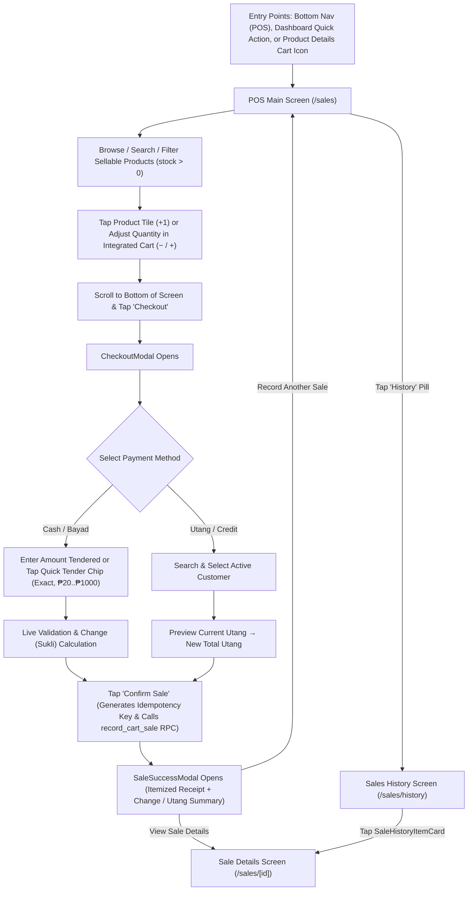

# TindaMate — Batch S-0: Sales Module UI/UX Read-Only Audit & Redesign Recommendations

**Project:** TindaMate (*Your Digital Tindahan Assistant*)  
**Module Audited:** Sales / POS, Cart, Checkout, Sale Confirmation, Sales History, and Sale Details  
**Audit Type:** Strict Read-Only UI/UX & Component Architecture Assessment  
**Reference Standard:** Completed Products Module UI/UX (`src/app/products/index.tsx`, `src/app/products/[id]/index.tsx`) & Centralized Design System (`src/constants/theme.ts`)

---

## 1. Executive Summary

### Overall Condition of the Sales UI/UX
The TindaMate Sales module (`src/app/sales/index.tsx`, `src/app/sales/history.tsx`, `src/app/sales/[id].tsx`, and `src/components/sales/*`) has a strong, reliable transactional foundation. It already supports multi-item POS cart management, centavo-safe arithmetic, idempotent `record_cart_sale()` RPC submission, cash tender validation with quick-bill chips, Utang (store credit) customer selection, and historical transaction snapshots.

However, from a **real-world sari-sari store POS usability and Design 2.0 consistency standpoint**, several critical workflow bottlenecks and visual inconsistencies reduce transaction speed and visual polish compared to the recently upgraded **Products** module:

### Key Strengths
1. **Solid Transactional & Domain Integrity:** Centavo-integer arithmetic (`calculateSaleTotal`, `validatePaymentAmount`), idempotency keys (`generateIdempotencyKey`), and atomic Supabase RPC (`record_cart_sale`) protect against floating-point drift and double-deduction.
2. **Persistence & Cross-Screen Cart Sync:** The active POS cart persists via `src/lib/cartStore.ts` (`AsyncStorage` + pub/sub listeners) and synchronizes with live product inventory via `syncCartWithLatestProducts()`.
3. **Complete State Coverage:** Loading (`TindaMateLoadingView`), error (`DashboardErrorBanner`), empty catalog, empty cart, and filtered-empty states exist across POS, History, and Sale Details.
4. **Utang & Cash Parity:** `CheckoutModal` (`src/components/sales/CheckoutModal.tsx`) cleanly branches between Cash (`Bayad`) and Store Credit (`Utang`) with live balance previews (`Current Utang → New Total Utang`).

### Most Important Weaknesses Identified
1. **Buried Cart Below the Product Grid (`src/app/sales/index.tsx#L759-L963`):** The Integrated Cart panel is rendered *at the very bottom* of the main `ScrollView` below the entire 2-column product catalog. When a store has 15–50+ products, the cashier must scroll all the way down past every product card to see the cart total, adjust quantities, or tap **Checkout**—and there is no sticky bottom cart summary bar.
2. **Duplicate Nested Hero Headers (`src/app/sales/index.tsx#L515-L579`, `src/app/sales/history.tsx#L205-L223`):** Unlike the upgraded Products screen (which embeds `TindaMateSearchBar` directly inside `ProductScreenHeader` via its `children` prop), both POS and Sales History wrap `ProductScreenHeader` inside an extra outer `View` (`posHeroHeader` / `heroHeaderZone`) and build custom inline search/filter bars.
3. **Unwired `onRemove` Prop & Missing Explicit Item Delete in `CartItemCard` (`src/components/sales/CartItemCard.tsx#L37-L160`):** `CartItemCard` accepts `onRemove: (productId: string) => void` and even defines `styles.removeLink` (`#L283-L294`), but never renders a remove button in JSX! If a customer decides not to buy an item with `quantity: 10`, the cashier must tap `−` ten times to remove it.
4. **Emoji Icons & Non-Standard Header in `CheckoutModal` (`src/components/sales/CheckoutModal.tsx#L206-L228`, `#L312`, `#L333`, `#L443`, `#L610`):** `CheckoutModal` uses a white flat header instead of TindaMate's Deep Forest Green header language, and relies on platform-dependent OS emojis (`💵`, `📝`, `⚠️`, `📞`, `👥`) instead of crisp SVG vector icons from `DashboardNavIcons.tsx`.
5. **Misleading Filter & Trend Placeholder in `SalesHistoryScreen` (`src/app/sales/history.tsx#L45-L49`, `#L151-L172`, `#L183-L193`, `#L362-L366`):**
   - The period filter strip only offers `'This Week' | 'This Month' | 'Custom'`—it lacks a **`Today`** filter (the single most important filter for a daily sari-sari store owner) and uses `'Custom'` to mean *"All Sales"* without any date picker.
   - `TodaySalesSummaryCard` (`src/components/sales/TodaySalesSummaryCard.tsx`) is already built in the repository but is **completely unused** in `SalesHistoryScreen`.
   - The summary card hardcodes a static pill reading `"No comparison yet"` (`#L364`) and a modulo-bucket sparkline (`buckets[idx % 6]`) that does not reflect actual chronological daily sales.
6. **Silent Failure When Tapping Max-Stock Product Tile in POS (`src/app/sales/index.tsx#L333-L345`, `#L771-L781`):** When `inCartQty >= product.stock_quantity`, tapping the product card silently returns without any visual or banner feedback explaining that max available stock is already in the cart.

---

## 2. Files and Components Inspected

| File Path | Role / Responsibility | Relationship to Sales Module |
| :--- | :--- | :--- |
| [`src/app/sales/index.tsx`](file:///C:/TindaMate/src/app/sales/index.tsx) | Main POS / New Sale screen (`/sales`) | Renders POS header, search bar, category chips, 2-column product grid, integrated cart card, and mounts `CheckoutModal` & `SaleSuccessModal`. |
| [`src/app/sales/history.tsx`](file:///C:/TindaMate/src/app/sales/history.tsx) | Sales History screen (`/sales/history`) | Displays period filters, total sales KPI card, and date-grouped `SaleHistoryItemCard` rows. |
| [`src/app/sales/[id].tsx`](file:///C:/TindaMate/src/app/sales/%5Bid%5D.tsx) | Sale Transaction Details screen (`/sales/[id]`) | Displays historical sale overview, itemized `sale_items` breakdown, payment/Utang metadata, and navigation actions. |
| [`src/components/sales/CartItemCard.tsx`](file:///C:/TindaMate/src/components/sales/CartItemCard.tsx) | POS Cart line-item component | Renders thumbnail, product name, unit price, `− qty +` stepper, line subtotal, and max-stock warning banner. |
| [`src/components/sales/CheckoutModal.tsx`](file:///C:/TindaMate/src/components/sales/CheckoutModal.tsx) | Full-screen modal for POS payment & confirmation | Handles Order Summary, Cash (`Bayad`) vs. Credit (`Utang`) toggle, tender input, quick-bill chips, change (`Sukli`) calculation, and customer credit selection. |
| [`src/components/sales/SaleSuccessModal.tsx`](file:///C:/TindaMate/src/components/sales/SaleSuccessModal.tsx) | Post-sale receipt confirmation modal | Displays transaction reference, timestamp, itemized receipt paper, total paid, cash tendered/change or Utang summary, and next-step CTAs. |
| [`src/components/sales/SaleHistoryItemCard.tsx`](file:///C:/TindaMate/src/components/sales/SaleHistoryItemCard.tsx) | Individual row card in Sales History | Displays cash/Utang icon badge, timestamp, total amount, item count, Utang customer pill, and `"View ›"` badge. |
| [`src/components/sales/TodaySalesSummaryCard.tsx`](file:///C:/TindaMate/src/components/sales/TodaySalesSummaryCard.tsx) | Dedicated Today's Sales KPI card | Built to display today's revenue and transaction count, currently **unused** in `src/app/sales/history.tsx`. |
| [`src/lib/sales.ts`](file:///C:/TindaMate/src/lib/sales.ts) | Protected POS domain logic & Supabase queries | Contains centavo-safe `calculateSaleTotal`, cart reducers, `validatePaymentAmount`, `getQuickPaymentOptions`, `recordCartSale` RPC caller, and sales history queries. |
| [`src/lib/cartStore.ts`](file:///C:/TindaMate/src/lib/cartStore.ts) | Persistent & reactive cart store | Synchronizes active cart across `/products`, `/products/[id]`, and `/sales` via `AsyncStorage` and pub/sub listeners. |
| [`src/types/sale.ts`](file:///C:/TindaMate/src/types/sale.ts) | TypeScript interfaces for Sales domain | Defines `Sale`, `SaleItem`, `CartItem`, `CartSummary`, `PaymentValidationResult`, and `CompletedCartSaleResult`. |
| [`src/components/products/ProductScreenHeader.tsx`](file:///C:/TindaMate/src/components/products/ProductScreenHeader.tsx) | Unified Design 2.0 curved green screen header | Used across Products and Sales screens; supports `children` (embedded search bar), `showCartButton`, `rightActionLabel`, and `rightElement`. |
| [`src/components/ui/TindaMateSearchBar.tsx`](file:///C:/TindaMate/src/components/ui/TindaMateSearchBar.tsx) | Shared pill search bar component | Used in Products list (`src/app/products/index.tsx`), but **not yet reused** in `/sales` or `/sales/history`. |
| [`src/components/ui/FilterChipRow.tsx`](file:///C:/TindaMate/src/components/ui/FilterChipRow.tsx) | Shared horizontal filter chip strip with count badges | Used in Products list (`src/app/products/index.tsx`), but **not yet reused** in `/sales` or `/sales/history`. |
| [`src/components/ui/TindaMateButton.tsx`](file:///C:/TindaMate/src/components/ui/TindaMateButton.tsx) | Shared button component (`primary`, `accent`, `secondary`, `ghost`, `danger`) | Used across POS checkout, modals, and empty/error states. |
| [`src/constants/theme.ts`](file:///C:/TindaMate/src/constants/theme.ts) | Single source of truth for Design 2.0 tokens | Defines `Colors`, `Spacing`, `BorderRadius`, `Typography`, `IconSizes`, and `Shadows`. |
| [`src/app/products/index.tsx`](file:///C:/TindaMate/src/app/products/index.tsx) | Upgraded Products List screen (Consistency Reference) | Reference implementation for header embedding, `TindaMateSearchBar`, `FilterChipRow`, and card density. |
| [`src/app/products/[id]/index.tsx`](file:///C:/TindaMate/src/app/products/%5Bid%5D/index.tsx) | Upgraded Product Details screen (Consistency Reference) | Reference implementation for 2x2 metrics grid, `StockStatusBadge`, and stepper + cart integration. |

---

## 3. Current Sales Workflow

---

## 4. Screen-by-Screen Findings

### A. Sales / POS Main Screen (`src/app/sales/index.tsx`)

1. **Duplicate Nested Hero Header Wrapper (`#L515-L579`, `#L1014-L1020`):**
   - **Code-Verified Finding:** `ProductScreenHeader` already renders a rounded deep-green hero zone (`borderBottomLeftRadius: 24, borderBottomRightRadius: 24, overflow: 'hidden'`) and accepts `children` for embedded search bars (as used in `src/app/products/index.tsx#L491-L537`). In `SalesScreen`, `ProductScreenHeader` is wrapped inside `<View style={styles.posHeroHeader}>`, which applies a second `backgroundColor: Colors.primaryDark` and `borderBottomLeftRadius: 24`, and renders a bespoke inline `TextInput` search bar (`#L550-L577`) instead of reusing `<TindaMateSearchBar />`.
   - **Usability & Visual Impact:** Creates extra vertical padding in the header zone (`ProductScreenHeader`'s `paddingBottom: 20` + `posHeroHeader`'s `paddingBottom: 12`), pushing product tiles further down on small Android screens, and duplicates search input styling.

2. **Bespoke Category Filter Chips Without Product Counts (`#L699-L727`, `#L1111-L1137`):**
   - **Code-Verified Finding:** `SalesScreen` builds a custom horizontal `ScrollView` for `categoryOptions` instead of reusing `<FilterChipRow />` (`src/components/ui/FilterChipRow.tsx`), and does not display product counts per category (unlike Products screen's `All (28)`, `Low Stock (3)`).
   - **Usability Impact:** Store owners cannot see how many sellable items belong to each category before tapping, and the chip padding/typography slightly diverges from `FilterChipRow`.

3. **Smart Category Fallback Hardcoded to Brand Keywords (`#L202-L241`):**
   - **Code-Verified Finding:** When a store's products have no `category` set, `categoryOptions` defaults to `['All', 'Drinks', 'Snacks', 'Canned', 'Others']` (`#L175`) and matches hardcoded keywords (`'piattos'`, `'lucky me'`, `'milo'`). If a store owner has uncategorized products that don't match those specific words, selecting `'Drinks'`, `'Snacks'`, or `'Canned'` shows 0 results even though products exist.
   - **Usability Impact:** Showing category chips that don't actually exist in the user's product data leads to confusing empty filter states. (Note: Category extraction should only show categories actually present on products, plus `'Uncategorized'` when some products lack a category, or hide the category strip when no categories are set—matching `src/app/products/index.tsx#L253`).

4. **POS Product Tile Stock & Low-Stock Readability (`#L760-L850`, `#L1158-L1264`):**
   - **Code-Verified Finding:**
     - `posProductStock` (`#L831-L835`, `#L1240-L1244`) displays `{product.stock_quantity} {product.unit} left` in muted gray (`Colors.textMuted`, `fontSize: 11`) even when the product is critically low on stock (`stock_quantity <= low_stock_threshold`).
     - `posProductPrice` (`#L1235-L1239`) uses `Colors.textPrimary` (`#0F172A`) and lacks `fontVariant: ['tabular-nums']`, whereas the Products screen uses `Colors.primaryDark` (`#064E3B`) with `tabular-nums` for instant price scanning.
     - `posAddCircleBtn` (`#L1245-L1248`) is `32×32px` (`width: 32, height: 32`), which is decorative inside the tile `Pressable`, but visually looks like a separate small button.
     - Hardcoded hex colors (`#EDF2EE`, `#10B981`, `#FCFDFC`, `#F8FAF7`, `#0D7A4D`) are used instead of `Colors.*` tokens.

5. **No Feedback When Tapping a Product Tile Already at Max Stock (`#L333-L345`, `#L775`):**
   - **Code-Verified Finding:** When `inCartQty >= product.stock_quantity`, `handleAddToCart(product)` silently returns `prev` (`#L340-L341`). The tile remains pressable (`onPress={() => handleAddToCart(product)}`) and scales on press (`posProductTilePressed`), giving the false impression that another unit was added.

---

### B. Shopping Cart (`src/app/sales/index.tsx#L854-L963` & `src/components/sales/CartItemCard.tsx`)

1. **Cart Placed at the Very Bottom of the ScrollView With No Sticky Summary Bar (`src/app/sales/index.tsx#L582-L967`):**
   - **Code-Verified Finding:** The entire POS screen is a single `ScrollView` containing:
     1. Category chips (`#L699`)
     2. Out-of-stock notice (`#L729`)
     3. Full 2-column grid of all sellable products (`#L759-L851`)
     4. Integrated Cart Panel (`#L855-L963`)
   - **Usability Impact (Critical POS Friction):** In a real sari-sari store with 20–60 products, the Integrated Cart Panel is pushed several screen-heights below the fold. As the cashier taps products in the grid:
     - There is **no visible running total** or **sticky bottom bar** on screen.
     - To review the cart or tap **Checkout**, the cashier must manually scroll past the entire product catalog.
     - Conversely, when at the bottom of the screen looking at the cart, the cashier must scroll all the way back up to add one more item.

2. **`onRemove` Prop Accepted by `CartItemCard` But Never Rendered (`src/components/sales/CartItemCard.tsx#L26`, `#L41`, `#L283-L294`):**
   - **Code-Verified Finding:** `CartItemCardProps` declares `onRemove: (productId: string) => void` (`#L26`), `SalesScreen` passes `onRemove={handleRemove}` (`src/app/sales/index.tsx#L908`), and `CartItemCard.tsx` even defines `styles.removeLink` and `styles.removeLinkText` (`#L283-L294`)—yet **no remove button or icon is rendered anywhere in `CartItemCard`'s JSX**!
   - **Usability Impact:** If a customer adds 8 packs of noodles and changes their mind, the cashier cannot remove the line item in one tap; they must press `−` 8 times.

3. **Cramped Single-Row `CartItemCard` Layout on Standard & Small Android Screens (`src/components/sales/CartItemCard.tsx#L52-L150`):**
   - **Code-Verified Finding:** `CartItemCard` packs 4 horizontal columns into a single row (`mainRow` with `gap: 10`):
     1. 36×36px Thumbnail (`#L54-L69`)
     2. `infoCol` (`flex: 1`) with `numberOfLines={1}` product name + unit price (`#L72-L83`)
     3. `stepperContainer` (~92px wide) (`#L86-L137`)
     4. `rightCol` (`minWidth: 64`) with subtotal (`#L140-L149`)
   - **Usability Impact:** On a 360dp Android screen (content width ~304dp after screen + card padding), `36 + 10 + 92 + 10 + 64 = 212dp` is consumed by fixed elements, leaving **only ~92dp** for `infoCol`! Product names longer than ~10 characters (e.g., `"Lucky Me! Pancit Canton..."` → `"Lucky Me!..."`) are severely truncated, and the stepper buttons (`26×26px`, `#L230-L232`) are well below the recommended 36–44dp POS touch target size.

4. **Missing `tabular-nums` on Cart Quantities, Subtotals, and Total (`src/components/sales/CartItemCard.tsx#L265-L282`, `src/app/sales/index.tsx#L1370-L1375`):**
   - **Code-Verified Finding:** Neither `quantityText`, `subtotalValue`, nor `cartTotalValue` includes `fontVariant: ['tabular-nums']`, causing numbers to jitter horizontally as quantities increment.

---

### C. Checkout and Payment (`src/components/sales/CheckoutModal.tsx`)

1. **Inconsistent Flat White Header vs. Design 2.0 Deep Green Header (`#L206-L228`, `#L756-L798`):**
   - **Code-Verified Finding:** `CheckoutModal` uses a white header (`backgroundColor: Colors.surface`) with a gray `✕` text button (`closeButton`) and sets `SafeAreaView` background to `Colors.backgroundWarm` (`#E4F2EA`, `#L750`), creating a mint status bar above a white header above a gray scroll body (`Colors.backgroundAlt`, `#L801`).
   - **Usability & Visual Impact:** Visually disconnected from the Deep Forest Green (`Colors.primaryDark`) header used across POS, Products, and Sales History.

2. **Order Summary Always Expanded Above Payment Controls (`#L259-L289`):**
   - **Code-Verified Finding:** In `CheckoutModal`, the full `Order Summary` card listing every `cartItems` row (`#L268-L287`) is rendered *above* `Payment Method` and `Amount Tendered (Bayad)`.
   - **Usability Impact:** When a customer buys 6–10 distinct items, the `Order Summary` list pushes the `Payment Method` toggle and `Amount Tendered` input below the fold! The cashier has to scroll past the items list just to type the cash tendered or tap a Quick Tender chip. Making `Order Summary` collapsible (or placing Payment Method + Amount Tendered *first* right below the Total Amount Hero Card, with a compact/collapsible Order Summary below) dramatically speeds up checkout.

3. **OS Emoji Dependency Instead of Vector Icons (`#L312`, `#L333`, `#L443`, `#L523`, `#L610`, `#L689`):**
   - **Code-Verified Finding:** `CheckoutModal` uses raw emojis: `💵 Cash (Bayad)`, `📝 Utang (Credit)`, `⚠️ Insufficient Payment`, `📞 {phone}`, `👥 No Active Customers`.
   - **Visual Impact:** Renders inconsistently across Android OEM fonts (Samsung, Xiaomi, Realme) and violates the vector icon standard established in the Products and Dashboard modules (`DashboardNavIcons.tsx`).

4. **Customer List Hard-Truncated to 5 Items Without Scroll (`#L629-L677`):**
   - **Code-Verified Finding:** `filteredCustomers.slice(0, 5)` (`#L629`) only renders the first 5 customers and shows a static text note `"Showing 5 of X customers. Search to narrow down."` (`#L675`).
   - **Usability Impact:** Store owners who prefer scrolling a short list of 8–12 regular *suki* customers cannot select the 6th customer without typing in the search box.

5. **Primary Confirm Button Color in Checkout (`#L702-L730`):**
   - **Code-Verified Finding:** On the POS screen, the Checkout CTA uses `variant="accent"` (Vibrant Orange `#F97316`), while inside `CheckoutModal` the final confirmation button uses `variant="primary"` (Green) even when recording an Utang sale (`paymentMethod === 'credit'`).

---

### D. Transaction Confirmation (`src/components/sales/SaleSuccessModal.tsx`)

1. **Cramped Receipt Paper & Small Change (`Sukli`) Typography (`#L263-L298`, `#L618-L662`):**
   - **Code-Verified Finding:** In `SaleSuccessModal`, the `Change / Sukli` amount (`styles.changeAmount`, `#L653-L656`) is only `fontSize: Typography.sizes.base` (`16px`), which is *smaller* than `totalAmount` (`20px`, `#L545`) and much smaller than `CheckoutModal`'s change display (`24px`, `#L1080`).
   - **Usability Impact:** Immediately after confirming a cash sale, the cashier's #1 task is handing the exact **Sukli (Change)** to the customer. Making `Change / Sukli` `16px` inside a small footer row forces the cashier to squint.

2. **Emoji Usage in Receipt Badges (`#L145`, `#L163`):**
   - **Code-Verified Finding:** Uses `📝 Charged to ...` and `ℹ️ {priceDifferenceNotice}` instead of clean vector badges.

---

### E. Sales History (`src/app/sales/history.tsx` & `src/components/sales/SaleHistoryItemCard.tsx`)

1. **Missing `"Today"` Filter & Confusing `"Custom"` Filter Label (`src/app/sales/history.tsx#L43-L49`, `#L151-L172`, `#L214-L220`):**
   - **Code-Verified Finding:**
     - `PERIOD_FILTERS` is hardcoded to `['This Week', 'This Month', 'Custom']` (`#L45-L49`).
     - There is **no `'Today'` filter**, even though sari-sari store owners check today's sales multiple times a day!
     - Selecting `'Custom'` (or tapping the top-right calendar icon `#L217`) does **not** open a date picker—it simply returns all historical sales (`if (selectedPeriod === 'Custom') return sales;`, `#L152-L154`).
     - Furthermore, the comment at `#L56` even says `Period Filter Chips ("This Week", "This Month", "Today", "All")`, proving `'Today'` and `'All'` were intended!

2. **No Search or Payment-Type Filter (All / Cash / Utang) in Sales History (`src/app/sales/history.tsx`):**
   - **Code-Verified Finding:** Unlike the Products screen (which has `TindaMateSearchBar` and status chips), `SalesHistoryScreen` has **no search bar** (to find a sale by product name, customer name, or `#REF` ID) and **no Cash vs. Utang filter**.

3. **Static `"No comparison yet"` Pill & Modulo-Bucket Sparkline (`src/app/sales/history.tsx#L183-L193`, `#L362-L366`):**
   - **Code-Verified Finding:**
     - The summary hero card always renders a static badge saying `"No comparison yet"` (`#L364`) instead of useful real metadata (such as `"X transactions • Y Cash, Z Utang"`).
     - `miniTrendBars` (`#L188-L190`) loops over `filteredSales` and sums `s.total_amount` into `buckets[idx % 6]` (modulo index!), which is mathematically arbitrary rather than grouping by day/time.

4. **`SaleHistoryItemCard` Hides the Purchased Product Name(s) (`src/components/sales/SaleHistoryItemCard.tsx#L82-L116`):**
   - **Code-Verified Finding:** `SaleHistoryItemCard` only renders:
     - `formattedDate • formattedTime` (`#L87`)
     - `formattedTotal` (`#L96`)
     - `itemCountLabel` (`"3 items"`, `#L104`) + optional Utang badge (`#L109`)
   - It **never displays `sale.product_name`**! Every single transaction card in Sales History looks identical (`Date • Time`, `₱XX.XX`, `2 items`) without telling the store owner *what* was sold (e.g., `"Coca-Cola Mismo 290ml + 1 more · 3 units"`).

---

### F. Transaction Details (`src/app/sales/[id].tsx`)

1. **Duplicate / Technical Metadata Rows (`#L355-L412`):**
   - **Code-Verified Finding:** The `Transaction Details` card displays:
     - `Reference No.: #XXXXXXXX` (`#L356-L360`)
     - `Transaction ID: <full UUID>` (`#L390-L397`)
     - `Idempotency Key: <full UUID>` (`#L399-L412`)
   - **Usability Impact:** Exposing raw UUID `Idempotency Key` and duplicate `Transaction ID` strings clutters the receipt view for non-technical sari-sari store owners. Keeping the human-readable `Reference No. (#XXXXXXXX)` prominent while tucking technical IDs into a subtle caption or removing the raw idempotency UUID improves clarity.

2. **Legacy Pastel Token Usage (`#L577-L584`, `#L612-L625`, `#L687-L698`):**
   - **Code-Verified Finding:** Uses `Colors.pastel.green.bg` and `Colors.pastel.blue.bg` instead of Design 2.0 `Colors.primarySoft`, `Colors.primaryBorder`, and `StockStatusBadge`-consistent pills, and lacks `fontVariant: ['tabular-nums']` on monetary values (`#L599`, `#L681`, `#L706`).

---

## 5. UI/UX Issues (Prioritized Matrix)

| ID | Priority | Screen / Component | Issue Summary | Exact File & Line Reference | Usability Impact |
| :--- | :--- | :--- | :--- | :--- | :--- |
| **S-01** | **Critical** | POS Main (`/sales`) | Active Cart is buried at the bottom of the product `ScrollView` with no sticky bottom cart bar. | [`src/app/sales/index.tsx#L582-L967`](file:///C:/TindaMate/src/app/sales/index.tsx#L582-L967) | Cashiers must scroll past the entire product catalog to see the running total or tap Checkout. |
| **S-02** | **Critical** | Cart Item (`CartItemCard`) | `onRemove` prop is passed and styled (`styles.removeLink`), but **no remove button is rendered** in JSX. | [`src/components/sales/CartItemCard.tsx#L26-L160`](file:///C:/TindaMate/src/components/sales/CartItemCard.tsx#L26-L160) | Removing an item with quantity > 1 requires repeatedly tapping `−` instead of a single delete tap. |
| **S-03** | **High** | Cart Item (`CartItemCard`) | 4-column single-row layout truncates product names to ~10 chars on 360dp phones; stepper buttons are only `26×26px`. | [`src/components/sales/CartItemCard.tsx#L52-L150`](file:///C:/TindaMate/src/components/sales/CartItemCard.tsx#L52-L150), [`#L230-L232`](file:///C:/TindaMate/src/components/sales/CartItemCard.tsx#L230-L232) | Hard to read product names in cart; small `− / +` buttons cause mis-taps during fast checkout. |
| **S-04** | **High** | Checkout (`CheckoutModal`) | Full `Order Summary` list sits above `Payment Method` and `Amount Tendered`, pushing payment inputs below the fold on multi-item carts. | [`src/components/sales/CheckoutModal.tsx#L259-L355`](file:///C:/TindaMate/src/components/sales/CheckoutModal.tsx#L259-L355) | Forces unnecessary scrolling before the cashier can enter cash tendered or select Utang customer. |
| **S-05** | **High** | Sales History (`/sales/history`) | Missing `'Today'` period filter; `'Custom'` label actually shows `'All Time'` without a date picker; static `"No comparison yet"` badge & modulo sparkline. | [`src/app/sales/history.tsx#L43-L49`](file:///C:/TindaMate/src/app/sales/history.tsx#L43-L49), [`#L151-L193`](file:///C:/TindaMate/src/app/sales/history.tsx#L151-L193), [`#L362-L366`](file:///C:/TindaMate/src/app/sales/history.tsx#L362-L366) | Store owners cannot filter to Today's sales in one tap and see placeholder text on the main KPI card. |
| **S-06** | **High** | History Card (`SaleHistoryItemCard`) | `sale.product_name` is omitted from history cards; cards only show date, amount, and `"X items"`. | [`src/components/sales/SaleHistoryItemCard.tsx#L82-L116`](file:///C:/TindaMate/src/components/sales/SaleHistoryItemCard.tsx#L82-L116) | Store owners cannot tell which transaction is which without opening each receipt one by one. |
| **S-07** | **Medium** | POS Main & History Headers | Duplicate outer header wrapper (`posHeroHeader` / `heroHeaderZone`) and custom search bar instead of embedding `<TindaMateSearchBar />` inside `<ProductScreenHeader>` & reusing `<FilterChipRow />`. | [`src/app/sales/index.tsx#L515-L579`](file:///C:/TindaMate/src/app/sales/index.tsx#L515-L579), [`src/app/sales/history.tsx#L205-L223`](file:///C:/TindaMate/src/app/sales/history.tsx#L205-L223) | Visual inconsistency with the upgraded Products screen and wasted vertical header space. |
| **S-08** | **Medium** | POS Product Grid (`/sales`) | No low-stock badge/color on POS tiles; tapping a tile already at max stock fails silently; missing `tabular-nums` on prices. | [`src/app/sales/index.tsx#L333-L345`](file:///C:/TindaMate/src/app/sales/index.tsx#L333-L345), [`#L760-L850`](file:///C:/TindaMate/src/app/sales/index.tsx#L760-L850) | Cashiers aren't warned when selling the last few units of an item or why tapping a tile stops incrementing. |
| **S-09** | **Medium** | Confirmation (`SaleSuccessModal`) | `Change / Sukli` font size is only `16px` (`Typography.sizes.base`), smaller than total amount; uses emojis (`📝`, `ℹ️`). | [`src/components/sales/SaleSuccessModal.tsx#L263-L298`](file:///C:/TindaMate/src/components/sales/SaleSuccessModal.tsx#L263-L298), [`#L653-L656`](file:///C:/TindaMate/src/components/sales/SaleSuccessModal.tsx#L653-L656) | Change due (`Sukli`) should be the most scannable number on the post-sale receipt. |
| **S-10** | **Medium** | Checkout (`CheckoutModal`) | Uses flat white header, raw OS emojis (`💵`, `📝`, `⚠️`, `📞`, `👥`), and caps customer list at `.slice(0, 5)` without scroll. | [`src/components/sales/CheckoutModal.tsx#L206-L228`](file:///C:/TindaMate/src/components/sales/CheckoutModal.tsx#L206-L228), [`#L312-L334`](file:///C:/TindaMate/src/components/sales/CheckoutModal.tsx#L312-L334), [`#L629`](file:///C:/TindaMate/src/components/sales/CheckoutModal.tsx#L629) | Inconsistent header aesthetic, OEM-dependent emoji rendering, and restricted customer browsing. |
| **S-11** | **Low** | Sale Details (`/sales/[id]`) | Exposes raw UUID `Idempotency Key` and full UUID `Transaction ID` rows; lacks `tabular-nums` on receipt amounts. | [`src/app/sales/[id].tsx#L389-L412`](file:///C:/TindaMate/src/app/sales/%5Bid%5D.tsx#L389-L412) | Visual noise from developer-facing UUIDs on a store owner's receipt screen. |

---

## 6. Recommended Redesign Direction

### A. POS Main Screen (`/sales`) — Fast, One-Handed Cashier Workflow
1. **Unified `ProductScreenHeader` + Embedded `TindaMateSearchBar`:**
   - Remove the duplicate `posHeroHeader` wrapper.
   - Pass `<TindaMateSearchBar />` directly as `children` of `<ProductScreenHeader title="POS Cashier" subtitle="X products ready to sell" />`, matching the exact geometry of the upgraded Products screen.
   - Keep the top-right **History** pill and **Clear Cart** icon button aligned at `38px` height.
2. **Data-Driven `FilterChipRow` for Categories:**
   - Reuse `<FilterChipRow />` with real category counts (e.g., `All (24)`, `Beverages (8)`, `Snacks (6)`). Hide the category strip if no products have categories assigned, eliminating fake keyword categories.
3. **Enhanced 2-Column POS Product Tiles:**
   - Display selling price in `Colors.primaryDark` (`#064E3B`) with `fontVariant: ['tabular-nums']`.
   - Color-code the stock caption: when `stock_quantity <= low_stock_threshold`, show amber warning text (`Colors.warningText`: `"Only 3 pcs left"`).
   - When `inCartQty > 0`, show the top-right badge (`"2 in cart"` in `Colors.primaryDark`, or `"Max: 5 in cart"` in `Colors.accent`). If the cashier taps a tile already at max stock, show a brief inline feedback toast/banner (`"Max available stock (5 pcs) already in cart"`).
4. **Sticky Bottom Cart Summary Bar + Jump-to-Cart / Direct Checkout:**
   - When `cartItems.length > 0`, render a **Sticky Floating Cart Bar** docked just above `DashboardBottomNav`:
     - Left: Cart badge icon + `"X items"` + bold `tabular-nums` Total (`₱245.00`) + `"View Cart ↑"` tap action (smoothly scrolls to the Integrated Cart section).
     - Right: High-contrast Orange **`Checkout →`** pill button (`Colors.accent`) so the cashier can open `CheckoutModal` **immediately from anywhere in the product grid without scrolling to the bottom**!

### B. Integrated Cart Panel & `CartItemCard`
1. **Two-Tier Scannable `CartItemCard` Layout:**
   - **Top Row:** Thumbnail (`40×40px`) + Full Product Name (`numberOfLines={2}`, no more 10-char truncation!) + Unit Price (`₱15.00 / pc`) + **Explicit Remove Button** (Trash/Close icon wired to `onRemove(item.productId)` with a 36×36dp hit target).
   - **Bottom Row:** Left: Stock / Max-stock pill indicator; Right: Ergonomic `34×34px` `− / +` Stepper buttons + Bold `tabular-nums` Line Subtotal (`₱45.00`).

### C. Checkout Modal (`CheckoutModal.tsx`)
1. **Deep Forest Green Header + Prioritized Payment Hierarchy:**
   - Style the modal header in `Colors.primaryDark` (`#064E3B`) with crisp white title (`"POS Checkout"`) and circular glass close button, matching `ProductScreenHeader`.
   - **Reorder Sections for Speed:**
     1. **Total Amount Due Hero Banner** (`₱245.00` • `5 items`)
     2. **Payment Method Segmented Toggle** (`Cash (Bayad)` vs. `Utang (Credit)`) using clean SVG vector icons instead of emojis.
     3. **Active Payment Input Card** (`Amount Tendered` + `Quick Tender` chips + prominent `Change / Sukli` card for Cash; or scrollable customer selector + `Current Utang → New Total Utang` comparison card for Credit).
     4. **Collapsible / Compact Order Summary** below payment controls (expanded by default when ≤ 3 items, or toggleable `"Order Summary (X items) ▾"` so payment controls are always above the fold!).

### D. Sale Confirmation Modal (`SaleSuccessModal.tsx`)
1. **Prominent Change (`Sukli`) Callout:**
   - Elevate the `Change / Sukli` box into a high-visibility highlight card (`fontSize: Typography.sizes.displaySm` `24px`, `tabular-nums`) so the cashier can read the change at a glance.
   - Replace raw emojis (`📝`, `ℹ️`) with vector icons and semantic pill badges.

### E. Sales History (`/sales/history`) & Sale Details (`/sales/[id]`)
1. **Accurate Period Filters + Search + Payment Type Filter:**
   - Update period chips to: **`Today`**, **`This Week`**, **`This Month`**, **`All Time`** (with transaction counts via `FilterChipRow`).
   - Add `<TindaMateSearchBar placeholder="Search by product, customer, or #ref..." />` inside `<ProductScreenHeader>` and secondary filter pills (`All`, `Cash`, `Utang`).
   - Replace the static `"No comparison yet"` badge and modulo sparkline with real period metrics: **Cash Sales total**, **Utang Sales total**, and **Transaction Count**.
2. **Product Title Preview in `SaleHistoryItemCard`:**
   - Display `sale.product_name` prominently on each history card alongside the `Date • Time`, `Total Amount` (`tabular-nums`), item/unit count, and `Cash` / `Utang · Customer` badge.
3. **Cleaner Receipt Metadata in `SaleDetailsScreen` (`/sales/[id]`):**
   - Keep `Reference No. (#XXXXXXXX)`, `Date`, `Time`, `Payment Method`, and `Customer` prominent; remove the developer-only `Idempotency Key` row from the user-facing UI and apply `tabular-nums` across all currency figures.

---

## 7. Proposed Component Improvements

| Component | File Path | Action | Details |
| :--- | :--- | :--- | :--- |
| `ProductScreenHeader` | [`src/components/products/ProductScreenHeader.tsx`](file:///C:/TindaMate/src/components/products/ProductScreenHeader.tsx) | **Reuse directly** | Pass `<TindaMateSearchBar />` as `children` in both `/sales` and `/sales/history`; remove outer duplicate `posHeroHeader` / `heroHeaderZone` wrappers. |
| `TindaMateSearchBar` | [`src/components/ui/TindaMateSearchBar.tsx`](file:///C:/TindaMate/src/components/ui/TindaMateSearchBar.tsx) | **Reuse directly** | Replace custom `TextInput` search bar in `/sales` and add search support to `/sales/history`. |
| `FilterChipRow` | [`src/components/ui/FilterChipRow.tsx`](file:///C:/TindaMate/src/components/ui/FilterChipRow.tsx) | **Reuse directly** | Use for category chips in `/sales` and period/payment filter chips in `/sales/history`. |
| `CartItemCard` | [`src/components/sales/CartItemCard.tsx`](file:///C:/TindaMate/src/components/sales/CartItemCard.tsx) | **Enhance existing** | Wire up `onRemove` delete button, upgrade to 2-row responsive layout, enlarge stepper buttons to `34×34px`, and add `tabular-nums`. |
| `CheckoutModal` | [`src/components/sales/CheckoutModal.tsx`](file:///C:/TindaMate/src/components/sales/CheckoutModal.tsx) | **Enhance existing** | Apply Deep Green header, move Payment Method & Tender input above collapsible Order Summary, replace emojis with vector icons, and allow scrolling full customer list. |
| `SaleSuccessModal` | [`src/components/sales/SaleSuccessModal.tsx`](file:///C:/TindaMate/src/components/sales/SaleSuccessModal.tsx) | **Enhance existing** | Enlarge `Change / Sukli` display to `24px` (`tabular-nums`) and replace emojis with vector icons. |
| `SaleHistoryItemCard` | [`src/components/sales/SaleHistoryItemCard.tsx`](file:///C:/TindaMate/src/components/sales/SaleHistoryItemCard.tsx) | **Enhance existing** | Add `sale.product_name` title line, cash/utang semantic pill, and `tabular-nums` amount formatting. |

---

## 8. Protected Existing Functionality (Must Not Change)

The following business logic, RPC contracts, and state mechanisms are **strictly protected** and must remain 100% untouched during any UI/UX implementation batch:

1. **Centavo-Safe Monetary Arithmetic (`src/lib/sales.ts`):**
   - `calculateSaleTotal(unitPrice, quantity)`
   - `calculateCartSummary(cart)`
   - `validatePaymentAmount(rawInput, totalAmount)`
   - `getQuickPaymentOptions(totalAmount)`
2. **Cart Reducer & Stock Sync Functions (`src/lib/sales.ts` & `src/lib/cartStore.ts`):**
   - `addProductToCart`, `updateCartItemQuantity`, `removeCartItem`, `syncCartWithLatestProducts`
   - `getPersistedCart`, `savePersistedCart`, `subscribeToCartChanges`, `addProductWithQuantityToCart`
3. **Atomic Transaction Recording & Idempotency (`src/lib/sales.ts` & `src/app/sales/index.tsx`):**
   - `generateIdempotencyKey()` and `activeIdempotencyKeyRef` lifecycle
   - `recordCartSale(cartItems, idempotencyKey, paymentMethod, customerId)` calling `public.record_cart_sale` RPC
   - Server-authoritative total & change recalculation (`result.sale.total_amount`)
4. **Utang (Store Credit) Integration (`src/components/sales/CheckoutModal.tsx`):**
   - `fetchStoreCustomers('', 'Active')`
   - Passing `paymentMethod: 'credit'`, `customerId`, and `customerName` to `onConfirmSale`
5. **Historical Sale Queries (`src/lib/sales.ts`):**
   - `fetchStoreSales()`, `fetchStoreSaleById(saleId)`, and `groupSalesByDate(sales)`

---

## 9. Recommended Implementation Batches

To keep changes safe, reviewable, and low-risk, the redesign is divided into **3 self-contained UI/UX batches**:

### Batch S-1: POS Main Screen & Cart Ergonomics (`/sales` + `CartItemCard`)
- **Scope:**
  - Unify POS header by embedding `<TindaMateSearchBar />` inside `<ProductScreenHeader />` and reusing `<FilterChipRow />` with accurate category counts.
  - Upgrade POS product tiles with `Colors.primaryDark` `tabular-nums` pricing, low-stock amber indicators, and max-stock tap feedback.
  - Add a **Sticky Bottom Cart Summary Bar** above `DashboardBottomNav` when `cartItems.length > 0` (`X items • ₱Total` + `View Cart` + `Checkout →` CTA).
  - Redesign `CartItemCard` with a 2-tier layout (no 10-char name truncation), larger `34×34px` stepper buttons, `tabular-nums`, and a working **Remove (`onRemove`)** button.
- **Relevant Files:**
  - `src/app/sales/index.tsx`
  - `src/components/sales/CartItemCard.tsx`
- **Dependencies:** Existing `ProductScreenHeader`, `TindaMateSearchBar`, `FilterChipRow`, `DashboardNavIcons`.
- **Risk Level:** **Low** (Purely presentational and layout improvements; all cart state and checkout handlers remain unchanged).
- **Acceptance Criteria:**
  - Cashiers can see the cart item count, total amount, and tap **Checkout** from a sticky bottom bar without scrolling past the product grid.
  - Each `CartItemCard` has a working single-tap Remove button wired to `onRemove`.
  - Long product names wrap cleanly up to 2 lines in `CartItemCard`.
- **Regression Checks:**
  - Adding/incrementing/decrementing/removing items updates `cartStore` and header badges accurately.
  - Deep-linking `/sales?productId=...&qty=...` still pre-populates the cart.

---

### Batch S-2: Checkout Modal & Sale Confirmation Receipt Polish (`CheckoutModal` + `SaleSuccessModal`)
- **Scope:**
  - Upgrade `CheckoutModal` header to Deep Forest Green (`Colors.primaryDark`).
  - Place `Payment Method` and `Amount Tendered` / `Customer Selector` *above* a collapsible `Order Summary` card so payment inputs are immediately visible without scrolling.
  - Replace all OS emojis (`💵`, `📝`, `⚠️`, `📞`, `👥`, `ℹ️`) in `CheckoutModal` and `SaleSuccessModal` with vector icons from `DashboardNavIcons.tsx`.
  - Allow scrolling the full filtered customer list in `CheckoutModal` (removing the hard `.slice(0, 5)` lock).
  - Enlarge `Change / Sukli` in `SaleSuccessModal` to a prominent `24px` `tabular-nums` callout box.
- **Relevant Files:**
  - `src/components/sales/CheckoutModal.tsx`
  - `src/components/sales/SaleSuccessModal.tsx`
- **Dependencies:** Existing `DashboardNavIcons`, `TindaMateButton`, `validatePaymentAmount`, `getQuickPaymentOptions`.
- **Risk Level:** **Low** (Preserves 100% of `onConfirmSale` arguments, centavo validation, and Utang customer selection state).
- **Acceptance Criteria:**
  - Opening `CheckoutModal` immediately shows Total Amount Due, Payment Method toggle, and Cash Tendered input above the fold on a 360×640dp screen.
  - `SaleSuccessModal` displays `Change / Sukli` prominently with `tabular-nums`.
- **Regression Checks:**
  - Cash validation (empty, invalid, insufficient, exact, overpaid) and Quick Tender chips behave identically.
  - Utang customer selection and `Current Utang → New Total Utang` math remain intact.
  - Duplicate tap lock (`isSubmitting`) prevents double submissions.

---

### Batch S-3: Sales History & Sale Details Refinement (`/sales/history` + `SaleHistoryItemCard` + `/sales/[id]`)
- **Scope:**
  - Unify `SalesHistoryScreen` header with `<ProductScreenHeader>` + embedded `<TindaMateSearchBar />` (search by product name, customer name, or `#ref`).
  - Upgrade period filter strip to **`Today`**, **`This Week`**, **`This Month`**, and **`All Time`**, plus a secondary **`All` / `Cash` / `Utang`** filter chip row.
  - Replace the static `"No comparison yet"` pill and modulo sparkline in `SalesHistoryScreen` with real period metrics (**Total Sales**, **Cash Total**, **Utang Total**, and **Transaction Count**).
  - Update `SaleHistoryItemCard` to display `sale.product_name` prominently alongside date/time, `tabular-nums` amount, and item count.
  - Polish `SaleDetailsScreen` (`/sales/[id]`) with Design 2.0 tokens (`Colors.primarySoft`), `tabular-nums` currency alignment, and clean metadata rows (hiding raw UUID `idempotency_key`).
- **Relevant Files:**
  - `src/app/sales/history.tsx`
  - `src/components/sales/SaleHistoryItemCard.tsx`
  - `src/app/sales/[id].tsx`
- **Dependencies:** `ProductScreenHeader`, `TindaMateSearchBar`, `FilterChipRow`.
- **Risk Level:** **Low** (Read-only display and client-side filtering of `fetchStoreSales()` and `fetchStoreSaleById()`).
- **Acceptance Criteria:**
  - Store owners can filter Sales History by `Today`, `This Week`, `This Month`, or `All Time`, and filter by `Cash` vs. `Utang`.
  - Every `SaleHistoryItemCard` clearly displays the sold product summary (`sale.product_name`).
- **Regression Checks:**
  - Tapping any history card opens `/sales/[id]` with the exact historical line items and pricing.

---

## 10. Manual Testing Checklist

After each batch is approved and implemented, verify the following scenarios on a mobile device or emulator (including compact 360dp width):

### POS & Cart (Batch S-1)
- [ ] **Header & Search:** Search by product name or category in `/sales`; clear search using `✕`.
- [ ] **Category Chips:** Tap category filter chips and verify product counts match visible sellable items.
- [ ] **Sticky Cart Bar:** Add 1 or more products while scrolled near the top of a 20+ product catalog; verify the Sticky Bottom Cart Bar appears immediately with live item count, total amount, `View Cart`, and `Checkout` button.
- [ ] **Single-Tap Item Removal:** In the cart, tap the Trash/Remove button on an item with `quantity > 1` and verify the entire line item is removed in one tap.
- [ ] **Max Stock Guard:** Increment a product up to its `availableStock` limit; verify the `+` button disables and tapping the product tile shows clear max-stock feedback.

### Checkout & Confirmation (Batch S-2)
- [ ] **Above-the-Fold Payment Input:** Add 6 distinct products to the cart and tap **Checkout**; verify that `Amount Tendered` and `Quick Tender` chips are immediately accessible without scrolling past all 6 items first, and that `Order Summary` can be expanded/collapsed.
- [ ] **Cash Scenarios:** Test insufficient cash (warning shortfall), exact cash (`Sakto`), and overpaid cash (`Sukli` calculation).
- [ ] **Utang Scenarios:** Switch to `Utang (Credit)`, search/scroll past 5+ active customers, select a customer, and verify `Current Utang → New Total Utang`.
- [ ] **Receipt Modal (`SaleSuccessModal`):** Confirm a sale and verify the receipt modal shows prominent `Change / Sukli` (for cash) or `Charged to Customer` (for Utang), and both `"Record Another Sale"` and `"View Sale Details"` work.

### Sales History & Details (Batch S-3)
- [ ] **Period & Payment Filters:** Filter Sales History by `Today`, `This Week`, `This Month`, and `All Time`, and toggle between `All`, `Cash`, and `Utang`.
- [ ] **History Search:** Search for a specific product name, customer name, or reference `#ID` in Sales History.
- [ ] **History Card Readability:** Verify each `SaleHistoryItemCard` displays the product summary name, timestamp, item count, and total amount.
- [ ] **Sale Details (`/sales/[id]`):** Open both a Cash sale and an Utang multi-item sale; verify all line items, historical unit prices, subtotals, and reference metadata display cleanly.

---

## 11. Final Recommendation

### Recommended First Implementation Batch: **Batch S-1 (POS Main Screen & Cart Ergonomics)**

**Why start with Batch S-1:**
1. **Highest Daily Operational Impact:** The POS Main Screen (`/sales`) and `CartItemCard` are used on every single customer transaction. Adding the **Sticky Bottom Cart Summary Bar** eliminates the #1 usability bottleneck (scrolling past the entire product catalog to reach the cart or checkout button).
2. **Fixes an Incomplete UI Control (`onRemove`):** Wiring up the missing Delete/Remove button in `CartItemCard` and fixing the 10-character product name truncation immediately makes cart editing fast and frustration-free.
3. **Establishes Design 2.0 Parity with Products:** Embedding `TindaMateSearchBar` inside `ProductScreenHeader` and reusing `FilterChipRow` brings `/sales` into immediate visual alignment with the completed Products screen.
